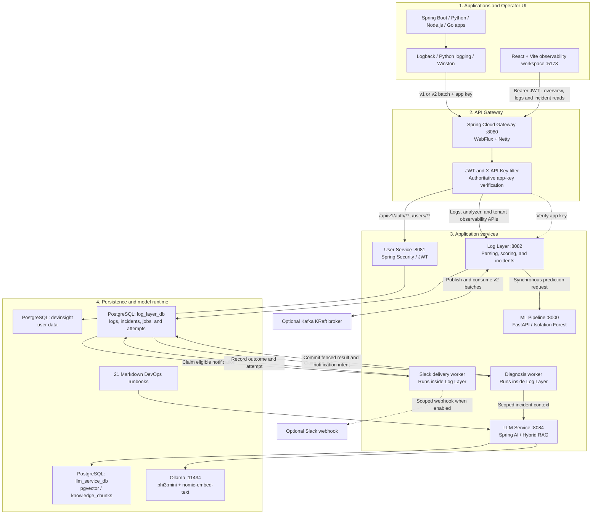
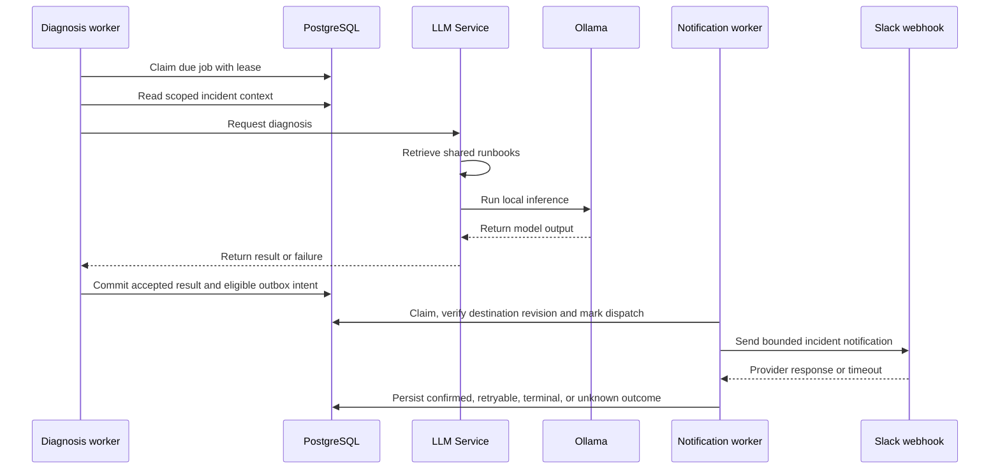
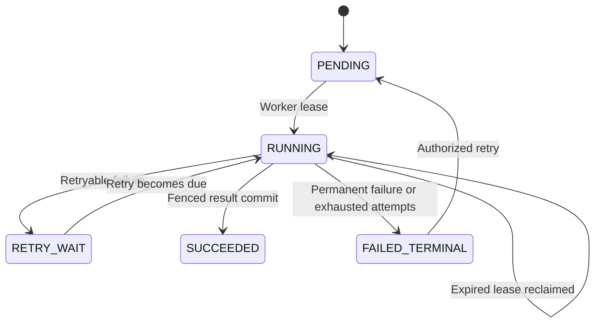

# DevInsight — AI-Powered DevOps Observability & Incident Analysis Platform

<p align="center">
  
  
  
  
  
  
  
  
  
  
  
</p>

> **Turn distributed application logs into structured telemetry, ML-based anomaly signals, runbook-grounded incident explanations, and actionable Slack notifications.**

DevInsight is a microservices-based log observability and incident-investigation project. It combines a **reactive API Gateway**, Java/Spring Boot services, a Python/FastAPI **Isolation Forest** inference service, **hybrid retrieval over DevOps runbooks**, and locally hosted `phi3:mini` inference through Ollama. The platform helps operators move from searching raw logs to inspecting structured log records, anomaly signals, possible causes, and suggested troubleshooting steps.

**Scope:** DevInsight analyzes and recommends; it **does not execute remediation commands or independently verify that an incident is resolved**. Performance figures in this README refer to specific saved historical benchmark runs, not guaranteed production service-level objectives.

---

## Developer guides

- [System architecture](system-architecture/README.md)
- [Model serving, rollback, and training](ml-pipeline/README.md)
- [RAG retrieval experiments](docs/verification/rag_retrieval_experiments_and_final_decision.md)

## Table of Contents

- [1. Project Overview](#1-project-overview)
- [2. System Architecture](#2-system-architecture)
  - [2.1 End-to-End System Architecture](#21-end-to-end-system-architecture)
  - [2.2 Telemetry & Incident Lifecycle Sequence](#22-telemetry-incident-lifecycle-sequence)
  - [2.3 Deep-Dive Architecture Guides](#23-deep-dive-architecture-guides)
- [3. How DevInsight Works](#3-how-devinsight-works)
- [4. Key Features](#4-key-features)
  - [4.1 Authentication and User Management](#41-authentication-and-user-management)
  - [4.2 Log Ingestion](#42-log-ingestion)
  - [4.3 Log Explorer](#43-log-explorer)
  - [4.4 ML-Based Anomaly Detection](#44-ml-based-anomaly-detection)
  - [4.5 AI-Powered Incident Analysis](#45-ai-powered-incident-analysis)
  - [4.6 Hybrid RAG Retrieval](#46-hybrid-rag-retrieval)
  - [4.7 Centralized Dashboard & Live Inspector](#47-centralized-dashboard-live-inspector)
  - [4.8 Low-Overhead Client Integration (Spring Boot Logback SDK)](#48-low-overhead-client-integration-client-integrationsspring-boot)
  - [4.9 Automated Real-Time Alerting Engine](#49-automated-real-time-alerting-engine)
  - [4.10 Cloud-Native Kubernetes Orchestration](#410-cloud-native-kubernetes-orchestration-k8s)
  - [4.11 Multi-Tech-Stack Application Integrations Hub](#411-multi-tech-stack-application-integrations-hub-integrations)
  - [4.12 Dynamic Per-Service Slack Alert Routing Engine](#412-dynamic-per-service-slack-alert-routing-engine)
  - [4.13 Enterprise Observability Dark Mode](#413-enterprise-observability-dark-mode-datadog-grafana-apm-style)
- [5. Technology Stack](#5-technology-stack)
- [6. Monorepo Structure](#6-monorepo-structure)
- [7. Microservices and Responsibilities](#7-microservices-and-responsibilities)
  - [7.1 API Gateway](#71-api-gateway)
  - [7.2 User Service](#72-user-service)
  - [7.3 Log Layer](#73-log-layer)
  - [7.4 ML Pipeline](#74-ml-pipeline)
  - [7.5 LLM Service](#75-llm-service)
  - [7.6 Frontend](#76-frontend)
- [8. Database Design](#8-database-design)
  - [8.1 User and log persistence](#81-user-and-log-persistence)
  - [8.2 RAG vector store](#82-rag-vector-store)
- [9. Machine Learning Pipeline](#9-machine-learning-pipeline)
- [10. LLM and RAG Architecture](#10-llm-and-rag-architecture)
- [11. RAG Evaluation and Experiments](#11-rag-evaluation-and-experiments)
- [12. Empirical Performance Benchmarks](#12-empirical-performance-benchmarks)
  - [Architectural Latency Boundaries & Performance Insights](#architectural-latency-boundaries-performance-insights)
- [13. API Reference](#13-api-reference)
  - [13.1 Authentication APIs](#131-authentication-apis)
  - [13.2 Log APIs](#132-log-apis)
  - [13.3 Organization Applications and Ingestion Credentials](#133-organization-applications-and-ingestion-credentials)
  - [13.4 ML Pipeline APIs](#134-ml-pipeline-apis)
  - [13.5 LLM Service APIs](#135-llm-service-apis)
- [14. Prerequisites](#14-prerequisites)
- [15. Environment Configuration](#15-environment-configuration)
- [16. Database Setup](#16-database-setup)
- [17. Ollama Setup](#17-ollama-setup)
- [18. Running the Project Locally](#18-running-the-project-locally)
  - [One-Click Orchestration Scripts](#one-click-orchestration-scripts)
  - [Production Kubernetes Deployment (`k8s/`)](#production-kubernetes-deployment-k8s)
  - [Running with Docker Compose](#running-with-docker-compose)
  - [Production Deployment with Docker Hub](#production-deployment-with-docker-hub-docker-composeprodyml)
- [19. Frontend](#19-frontend)
- [20. Testing and Verification](#20-testing-and-verification)
- [21. Security Considerations](#21-security-considerations)
  - [Authentication boundaries and known gaps](#authentication-boundaries-and-known-gaps)
- [22. Known Limitations & Production Hardening](#22-known-limitations-production-hardening)
- [23. Development and Deployment Lifecycle](#23-development-and-deployment-lifecycle)
- [24. Future Improvements](#24-future-improvements)
- [25. Architectural Implementation Status](#25-architectural-implementation-status)
- [Summary](#summary)
---

# 1. Project Overview

DevInsight is designed to simplify the process of analyzing application logs and investigating technical incidents.

In a typical development environment, engineers frequently encounter:

- Application errors and exceptions.
- Unexpected service failures.
- Database connection problems.
- Infrastructure and deployment issues.
- Container and orchestration failures.
- Performance-related warnings.
- Repeated or unusual application behavior.

Manually investigating these problems requires searching through logs, understanding error messages, identifying the affected service, and consulting technical documentation.

DevInsight brings these activities into one platform.

It uses:

1. **Microservices architecture** to separate application responsibilities.
2. **Machine Learning** to identify anomalous log behavior.
3. **Retrieval-Augmented Generation** to retrieve relevant DevOps knowledge.
4. **Large Language Models** to explain incidents and recommend possible solutions.
5. **React dashboard** to provide a centralized interface for log ingestion and investigation.

### Project preview

The repository includes screenshots from the React interface:

Screenshot checklist for a public demo: dashboard, log ingestion, and incident diagnosis with synthetic data. Older workspace captures show account information and a V1 result, so the release omits them.

### Main objective

Transform raw application logs into useful diagnostic information:

```text
Raw Application Logs
        |
        v
Log Parsing and Validation
        |
        v
ML-Based Anomaly Detection
        |
        v
Log Storage + Prediction Metadata
        |
        v
RAG-Based Knowledge Retrieval
        |
        v
LLM Incident Analysis
        |
        v
Summary + Root Cause + Suggested Fix
```

---

# 2. System Architecture

DevInsight separates user authentication, log ingestion, anomaly scoring, and LLM-assisted analysis into five backend services. **Spring Cloud Gateway is reactive (WebFlux/Netty)**. The User Service and Log Layer use Spring MVC/JPA, and the Log Layer waits synchronously for ML inference through `WebClient.block()`. Eligible ingestion writes a durable diagnosis job in the same database transaction as its source log. Workers claim committed jobs independently. Kafka is an optional intake path. The Docker Compose and Kubernetes manifests are deployment templates.

The Gateway accepts **Bearer JWT** for user requests and **X-API-Key** for application log ingestion. It verifies application credentials against the Log Layer. Organization routes also verify membership.

### 2.1 End-to-End System Architecture



The Gateway uses reactive I/O. The Log Layer performs a blocking ML HTTP call and JPA persistence on the processing path. Kafka lets the v2 intake acknowledge the broker submission before waiting for either operation.

### 2.2 Telemetry & Incident Lifecycle Sequence

```mermaid
sequenceDiagram
    participant C as Collector
    participant G as Gateway
    participant L as Log Layer
    participant K as Kafka
    participant P as PostgreSQL

    C->>G: Batch with app key
    G->>L: Authorized request
    alt Synchronous v1
        L->>L: Parse and score
        L->>P: Commit telemetry and jobs
        L-->>G: HTTP 200
        G-->>C: Persisted log IDs
    else Kafka v2
        L->>K: Publish batch
        par Confirm submission
            K-->>L: Broker acknowledgement
            L-->>G: HTTP 202
            G-->>C: Broker receipt
        and Process records
            K-->>L: Deliver events
            L->>L: Parse and score
            L->>P: Commit telemetry and jobs
            L->>K: Commit processed offset
        end
    end
```



The synchronous path returns HTTP 201 for a single log or HTTP 200 for a committed v1 batch. Kafka v2 returns HTTP 202 after broker acknowledgement. Broker processing can proceed independently of that response. Use the log or incident view to check database persistence and diagnosis progress.

Once an eligible ingestion transaction commits, the worker and LLM Service follow this path:



### 2.3 Deep-Dive Architecture Guides

For detailed class diagrams, package structures, and inter-service schemas, see the dedicated [system-architecture/](system-architecture/README.md) documentation:

- **[Master System Flowcharts & State Machine](system-architecture/COMPLETE_PROJECT_FLOWCHART.md)** — Earlier detailed diagrams. Use the diagrams above for the current HTTP, Kafka, and durable diagnosis boundaries.
- **[External Service Interactions & Protocols](system-architecture/EXTERNAL_INTERACTIONS.md)** — Network boundaries, header forwarding (`X-User-Email`), payload JSON schemas, and fault-tolerance fallbacks.
- **[API Gateway Architecture](system-architecture/api-gateway/INTERNAL_ARCHITECTURE.md)** — Reactive Netty pipeline, dual-authentication web filter, and CORS configuration.
- **[User Service Architecture](system-architecture/user-service/INTERNAL_ARCHITECTURE.md)** — Spring Security 6, BCrypt password hashing, and stateless JWT issuance.
- **[Log Layer Architecture](system-architecture/log-layer/INTERNAL_ARCHITECTURE.md)** — Polyglot parsers (Strategy pattern), reactive WebClient adapters, and asynchronous Slack routing.
- **[ML Pipeline Architecture](system-architecture/ml-pipeline/INTERNAL_ARCHITECTURE.md)** — FastAPI feature extraction, Shannon entropy calculation, and Isolation Forest scoring.
- **[LLM Service Architecture](system-architecture/llm-service/INTERNAL_ARCHITECTURE.md)** — Hybrid RAG retriever (Dense + BM25 + RRF), prompt templates, and Ollama integration.

### Architecture Components

| Component | Technology | Responsibility |
|---|---|---|
| **Frontend** | React 19 + Vite + CSS | Log explorer, anomaly visualization, incident management, and interactive inspector |
| **API Gateway** | Spring Cloud Gateway + WebFlux | High-throughput non-blocking reverse proxy with dual JWT and API-Key authentication |
| **User Service** | Spring Boot 3 + Spring Security 6 | RBAC user management, BCrypt hashing, and stateless JWT token issuance |
| **Log Layer** | Spring Boot 3 + Hibernate + JPA | Tenant-scoped ingestion, multiline parsing, incident correlation, and leased diagnosis workers |
| **ML Pipeline** | Python 3.11 + FastAPI + Scikit-Learn | Statistical anomaly detection using an Isolation Forest model; latency depends on request and environment |
| **LLM Service** | Spring Boot 3 + Spring AI | Hybrid RAG retrieval (BM25 + Dense Vectors + RRF) and prompt orchestration |
| **PostgreSQL** | PostgreSQL 16 + pgvector | Multi-database architecture: `devinsight` (user/auth), `log_layer_db` (telemetry), and `llm_service_db` (`knowledge_chunks` vector store) |
| **Ollama** | Local LLM Engine (llama.cpp) | Self-hosted local inference with `phi3:mini` (3.8B) and `nomic-embed-text` |
| **Slack Notifier** | PostgreSQL outbox + WebClient | Fenced incident notifications, bounded retries and attempt history. Disabled in the managed Windows launcher |

### Why microservices?

The application separates authentication, log processing, machine learning, and LLM-based analysis into independent services.

This provides:

- Separation of responsibilities.
- Independent development and testing.
- Independent service configuration.
- The ability to scale resource-intensive components separately.
- Easier maintenance as the system grows.

For example, ML inference and LLM inference have different computational requirements. Keeping them separate avoids making the Log Layer responsible for every processing task.

---

# 3. How DevInsight Works

The following sequence describes the complete log-analysis workflow.

### Step 1 — User authentication

The user registers or logs in through the React frontend.

The request passes through the API Gateway to the User Service.

The User Service authenticates the user and generates a JWT token.

### Step 2 — API Gateway routing

The frontend sends HTTP requests to the API Gateway.

The Gateway:

- Routes requests to the appropriate backend service.
- Applies JWT authentication and authorization.
- Handles CORS and security filters.

### Step 3 — User data persistence

The User Service stores user information in its PostgreSQL database.

### Step 4 — Log ingestion and storage

Users can submit individual logs through the frontend. External collectors send authenticated batches over synchronous HTTP or optional Kafka ingestion.

The Log Layer:

- Receives the log request.
- Parses and validates the incoming log.
- Extracts structured information.
- Stores the log, any incident membership, and any eligible diagnosis job in one PostgreSQL transaction.

### Step 5 — ML anomaly detection

The Log Layer sends the required log information to the ML Pipeline using `WebClient` with an internal `X-API-Key`. This is a **synchronous wait in the current Log Layer**, bounded by a configured timeout (5 seconds by default).

The ML Pipeline extracts features and performs anomaly prediction using the loaded model artifacts. The HTTP route requires the configured internal API key.

### Step 6 — ML prediction returned

The ML Pipeline returns prediction information, including the anomaly classification and associated prediction metadata.

The Log Layer stores the ML result with the log.

### Step 7 — LLM incident investigation

Qualifying anomalies or `ERROR`/`FATAL` logs can create durable diagnosis work when automatic diagnosis is enabled. Workers claim committed jobs, load tenant-scoped incident context, and call the LLM Service outside the database transaction. A manual analysis endpoint is also available.

The LLM Service:

1. Constructs an analysis prompt.
2. Retrieves relevant DevOps knowledge using the RAG pipeline.
3. Combines the log, ML prediction, and retrieved context.
4. Sends the resulting prompt to Ollama.
5. Generates an incident-analysis response.

### Step 8 — Analysis returned

The LLM Service returns structured analysis containing information such as:

- Summary.
- Probable root cause.
- Severity.
- Recommended troubleshooting actions.

The active worker commits the result, diagnosis status and eligible notification intent together. A separate worker delivers the notification and records each attempt. Suggested commands and incident resolution remain under operator control.

### Step 9 — Frontend presentation

The frontend displays the log and its associated analysis.

The user can inspect the log, review the anomaly prediction, and understand the generated troubleshooting recommendations.

### Complete request flow

The flow below separates intake, log persistence, and the asynchronous diagnosis. A successful intake response can arrive before diagnosis finishes.

```text
React frontend -> API Gateway -> User Service -> devinsight
Collector -> API Gateway -> Log Layer
                              |
                              +-- v1: process inline
                              +-- v2: Kafka -> Log Layer consumer
                              |
                              v
                  canonical parsing and ML scoring
                              |
                              v
                  PostgreSQL: log + incident membership + eligible job
                              |
                              v
                  worker lease -> bounded context -> RAG and Ollama
                              |
                              v
                  fenced result -> incident and diagnosis views
```

---

# 4. Key Features

## 4.1 Authentication and User Management

- User registration and login.
- JWT token generation.
- JWT-based authentication.
- Protected backend API requests.
- User profile management.

## 4.2 Log Ingestion

- Submit logs through the frontend.
- Support file/text-based log submission.
- Associate logs with source and environment information.
- Parse and structure incoming log information.
- Persist logs for future investigation.

## 4.3 Log Explorer

- Search persisted messages with bounded server-side filtering, paging, and stable occurrence-time ordering.
- Filter by application, severity, source, environment, ML status, candidate V2 classification, trace, correlation, or incident.
- Open a source event in the log investigation view, inspect redacted multiline text, and follow its linked incident.

## 4.4 ML-Based Anomaly Detection

- Extract features from incoming logs.
- Detect anomalous log behavior.
- Return anomaly/normal predictions.
- Associate predictions with model metadata.
- Support individual and batch **ML prediction** endpoints. Collectors use the separate synchronous or Kafka-backed Log Layer intake routes.

## 4.5 AI-Powered Incident Analysis

- Analyze logs using an LLM.
- Include ML prediction information in the analysis context.
- Retrieve relevant DevOps documentation.
- Generate incident summaries.
- Identify probable root causes.
- Recommend troubleshooting actions.

## 4.6 Hybrid RAG Retrieval

- Dense vector retrieval.
- BM25 lexical retrieval.
- Reciprocal Rank Fusion.
- Experimental reranking.
- Retrieval benchmarking.

## 4.7 Centralized Dashboard & Live Inspector

- The organization-scoped Overview shows persisted event volume, normalized severities, V2 anomalies, incident attention, and separate diagnosis and Slack delivery states.
- Logs, Incidents, and Applications share the active organization. Overview and active incident views refresh during use and display the last successful read.
- Interactive Live Inspector (`/analyzer`) for manual multi-line stack trace triage.
- Direct visualization of anomaly scores, token metrics, and extracted shell remediation commands.

## 4.8 Low-Overhead Client Integration (`client-integrations/spring-boot`)

- **Drop-In Logback Appender**: Spring Boot applications can use the included `DevInsightLogbackAppender` and a `logback-spring.xml` configuration to transmit logs to the Gateway.
- **Bounded Background Dispatch**: The appender uses an `ArrayBlockingQueue` and a daemon worker thread to reduce synchronous logging overhead. A bounded queue limits memory growth, but can also drop telemetry under sustained overload.
- **Headless Ingestion**: Authenticated via machine-to-machine `X-API-Key` headers without requiring interactive user credentials.

## 4.9 Automated Real-Time Alerting Engine

- **Conditional incident trigger.** With automatic diagnosis enabled, eligible logs persist a job in the ingestion transaction. Workers dispatch LLM analysis after commit.
- **Sanitized Slack messages** include severity, the owning application, and a stable notification reference. Single-application incidents can also include a bounded diagnosis excerpt.
- **Durable attempts** record delivery, scheduled retry, permanent rejection and unknown outcomes in PostgreSQL. The incident view exposes delivery status and attempt history.

## 4.10 Cloud-Native Kubernetes Orchestration (`k8s/`)

- Declarative Kubernetes manifests for local clusters and possible cloud deployment targets (for example EKS); cloud execution and rollout success must be verified separately.
- Configured liveness/readiness probes, model-puller Jobs, and Ollama resource limits; these controls reduce some operational risks but do not guarantee that out-of-memory failures cannot occur.

## 4.11 Multi-Tech-Stack Application Integrations Hub (`/integrations`)

- **Multi-Runtime Ingestion SDKs**: Zero-code drop-in telemetry handlers for:
  - **Python (FastAPI / Django / Flask)**: Asynchronous non-blocking `DevInsightHandler` & ASGI middleware.
  - **Node.js (Express / NestJS)**: Custom Winston and Pino transports capturing unhandled v8 stack traces.
  - **Go (Zap / Slog / Logrus)**: Buffered HTTP hook with goroutine panic recovery.
  - **Kubernetes & Docker**: Fluent Bit DaemonSet scraping stdout/stderr across pods with namespace tagging.
  - **Database & Infra**: Syslog and error log collectors for PostgreSQL, Redis, and Nginx.
  - **Java / Spring Boot**: Drop-in XML `DevInsightLogbackAppender`.
- **Organization application management**: Register applications per organization, issue and revoke ingestion credentials, and configure their Slack destination under `/api/v1/organizations/{org}/applications`.

## 4.12 Dynamic Per-Service Slack Alert Routing Engine

- **Application delivery policy** sets the minimum severity and can disable Slack independently for an integration.
- **Slack routing** uses the diagnosis owner's verified application and its encrypted webhook. A multi-application incident sends one generic notice through the owning application.
- **Revocation and rotation** change the destination revision. Pending work for an earlier revision is cancelled before dispatch. Managers can retry eligible deliveries and must confirm possible duplication after an unknown outcome.

## 4.13 Enterprise Observability Dark Mode (Datadog / Grafana APM Style)

- **Unified Dark Theme**: Modern high-contrast observability palette (`#090d16` background, `#0f172a` surfaces, `#6366f1` indigo accents) optimized for high-stress operational debugging.
- **Interactive Live Inspector Sandbox**: Submit multi-line stack traces and inspect ML scores, analysis metadata, and extracted suggested commands.
- **Deployment Pipeline Telemetry Graph**: Visual 4-stage pipeline tracker (Ingested → ML Anomaly Scored → RAG Diagnosed → Slack Dispatched) with real-time millisecond latency chips.

---

# 5. Technology Stack

## Backend

| Technology | Usage |
|---|---|
| Java 21 | Backend development |
| Spring Boot | Microservice development |
| Spring Cloud Gateway | API Gateway |
| Spring WebFlux / Reactor Netty | Non-blocking HTTP Gateway; not the entire Log Layer |
| Spring Security | Authentication and authorization |
| Spring Data JPA | Database persistence |
| PostgreSQL Driver | Database connectivity |
| WebClient | Inter-service HTTP communication |
| Maven | Dependency and build management |
| JJWT | JWT-related functionality |

## Machine Learning

| Technology | Usage |
|---|---|
| Python | ML pipeline development |
| FastAPI | ML REST API |
| Uvicorn | ASGI server |
| Scikit-learn | Machine-learning functionality |
| Pandas | Data processing |
| NumPy | Numerical processing |
| Joblib | Model artifact handling |

## LLM and RAG

| Technology | Usage |
|---|---|
| Spring AI | LLM and embedding integration |
| Ollama | Local LLM runtime |
| `phi3:mini` | Chat model |
| `nomic-embed-text:latest` | Embedding model |
| BM25 | Lexical retrieval |
| Dense Retrieval | Semantic retrieval |
| Reciprocal Rank Fusion | Hybrid result fusion |
| PostgreSQL 16 + pgvector | User/log persistence and 768-dimensional embedding storage for RAG |

## Frontend

| Technology | Usage |
|---|---|
| React | Frontend development |
| Vite | Development and build tooling |
| Axios | HTTP requests |
| React Router | Client-side routing |
| Lucide React | Icons |

---

# 6. Monorepo Structure

The repository is a monorepo containing separate backend services, integration clients, container and Kubernetes configurations, and development scripts:

```text
AI-Powered-DevOps-Log-Analyzer-Incident-Assistant/
│
├── api-gateway/                 # Reactive Spring Cloud Gateway reverse proxy (:8080)
│   ├── src/
│   └── pom.xml
│
├── user-service/                # Spring Boot user authentication & JWT management (:8081)
│   ├── src/
│   └── pom.xml
│
├── log-layer/                   # Log ingestion, multiline parser & Slack dispatcher (:8082)
│   ├── src/
│   └── pom.xml
│
├── ml-pipeline/                 # Python 3.11 FastAPI Isolation Forest model (:8000)
│   ├── app/
│   ├── artifacts/
│   └── requirements.txt
│
├── llm-service/                 # Spring AI Hybrid RAG engine & prompt orchestration (:8084)
│   ├── src/
│   │   └── main/resources/knowledge/   # 21 operational runbooks (253 chunks)
│   └── pom.xml
│
├── frontend/                    # React 19 + Vite + CSS dashboard (:5173)
│   ├── src/
│   └── package.json
│
├── client-integrations/         # Universal drop-in client logging SDKs & manifests
│   ├── spring-boot/             # DevInsightLogbackAppender.java & logback-spring.xml
│   ├── python/                  # DevInsightHandler.py (logging.Handler) & ASGI middleware
│   ├── nodejs/                  # DevInsightTransport.js (Winston / Pino transport)
│   └── kubernetes/              # fluent-bit-daemonset.yaml (Cluster-wide container scraper)
│
├── k8s/                         # Declarative Kubernetes manifests (Local & AWS EKS)
│   ├── 00-namespace.yaml
│   ├── 01-config-and-secrets.yaml
│   ├── 02-storage/
│   ├── 03-infrastructure/       # postgres.yaml, ollama.yaml, ollama-job.yaml
│   ├── 04-apps/                 # api-gateway, log-layer, llm-service, ml-pipeline, frontend
│   └── kustomization.yaml
│
├── scripts/                     # Orchestration & live simulation scripts
│   ├── start-all.ps1            # Multi-service launcher (PowerShell)
│   ├── start-all.sh             # Multi-service launcher (Bash)
│   ├── stop-all.ps1             # Stops managed Windows service processes
│   ├── test-live-springboot-ingest.ps1  # Real-time incident streaming simulator
│   └── setup-db.sql             # Multi-database PostgreSQL init script
│
├── docs/                        # Architecture diagrams & retrieval benchmark reports
│   └── assets/
│
├── docker-compose.yml           # Local multi-stage development stack
├── docker-compose.prod.yml      # Production stack pulling Docker Hub images
├── README.md
└── .gitignore
```

Each service has its own dependencies, configuration, and responsibilities.

---

# 7. Microservices and Responsibilities

| Service | Port | Main Responsibility |
|---|---:|---|
| API Gateway | `8080` | Routing and security |
| User Service | `8081` | Authentication and user management |
| Log Layer | `8082` | Log processing and orchestration |
| ML Pipeline | `8000` | Feature extraction and anomaly prediction |
| LLM Service | `8084` | RAG-based incident analysis |
| Frontend | `5173` | Web application |
| PostgreSQL | `5432` | Persistent storage |
| Ollama | `11434` | Local model inference |

## 7.1 API Gateway

**Technology:** Spring Cloud Gateway, Spring WebFlux/Netty, Spring Security. The Gateway checks JWTs and application keys. The Log Layer verifies an active application credential for each ingestion request. Log Layer also verifies JWTs independently.

The API Gateway acts as the single entry point for frontend requests.

Responsibilities:

- Route requests to backend services.
- Validate JWT authentication.
- Apply authorization rules.
- Handle CORS configuration.
- Centralize gateway security.

### Configured routes

```text
/api/v1/auth/**          → User Service (:8081)
/api/v1/users/**         → User Service (:8081)
/api/v1/logs/**          → Log Layer (:8082)
/api/v1/analyzer/**      → Log Layer (:8082)
/api/v1/organizations/** → Log Layer (:8082)
```

The Gateway uses `SecurityWebFilterChain` and an authentication filter that restricts application keys to ingestion. The Log Layer verifies both credential scope and organization membership downstream.

## 7.2 User Service

**Technology:** Spring Boot, Spring Security, Spring Data JPA, PostgreSQL.

Responsibilities:

- User registration.
- User login.
- Password authentication.
- JWT generation.
- User profile management.
- User persistence.

The service uses a JWT authentication filter based on Spring Security's `OncePerRequestFilter`.

## 7.3 Log Layer

**Technology:** Spring Boot, Spring Data JPA, PostgreSQL, WebClient.

The Log Layer is responsible for managing the log-analysis workflow.

Responsibilities:

- Receive log-ingestion requests.
- Parse and validate incoming logs.
- Store logs.
- Search and retrieve logs.
- Trigger ML analysis.
- Store ML predictions.
- Trigger LLM analysis.
- Store analysis results.
- Return structured responses to the frontend.

The Log Layer orchestrates ingestion, ML inference, persistence, and LLM analysis. Prediction remains synchronous on the processing path (`.block()` with a timeout). The PostgreSQL `diagnosis_jobs` and `diagnosis_attempts` tables track eligible diagnosis work, leases, and attempt outcomes.

### ML integration

The Log Layer maps log information into an ML prediction request, adds the shared internal `X-API-Key` header through `WebClientConfig`, and calls the FastAPI prediction service. The default timeout is five seconds; an ML failure is recorded while log persistence can proceed.

### Analysis lifecycle

The log entity maintains analysis-related metadata, including:

```text
prediction
predictionLabel
decisionScore
modelVersion
analysisStatus
analyzedAt
```

Log scoring and the projected log diagnosis state use separate fields. The durable diagnosis API exposes the worker lifecycle below.



The default automatic attempt budget is four. A replacement worker can repeat an Ollama call after an uncertain result. PostgreSQL accepts a result only from the current unexpired claim. Incident acknowledgement and resolution remain separate actions.

## 7.4 ML Pipeline

**Technology:** Python, FastAPI, Scikit-learn. `/api/v1/predict` and `/api/v1/predict/batch` now use a FastAPI dependency that validates the internal `X-API-Key` when configured.

Responsibilities:

- Receive structured log information.
- Extract model features.
- Perform anomaly detection.
- Support single predictions.
- Support batch predictions.
- Return prediction metadata.
- Expose model and health information.

## 7.5 LLM Service

**Technology:** Spring Boot, Spring AI, Ollama.

Responsibilities:

- Receive log-analysis requests.
- Construct analysis prompts.
- Retrieve relevant DevOps knowledge.
- Perform hybrid retrieval.
- Communicate with Ollama.
- Generate structured incident-analysis responses.

## 7.6 Frontend

**Technology:** React, Vite, Axios.

The frontend provides the user-facing application for:

- Authentication.
- Dashboard overview.
- Log ingestion.
- Log exploration.
- Search and filtering.
- AI analysis inspection.

The frontend communicates with the API Gateway rather than directly accessing individual backend services.

---

# 8. Database Design

DevInsight uses PostgreSQL for relational persistence and `pgvector` for runbook embeddings. The Docker initialization SQL (`docker/init-db.sql`) provisions **three logical databases**, not just the two previously listed.

| Database | Owner / purpose | Main data |
|---|---|---|
| `devinsight` | User Service | Authentication and user records |
| `log_layer_db` | Log Layer | Structured logs, analysis metadata, registered application integrations |
| `llm_service_db` | LLM Service | `knowledge_chunks` embeddings and document metadata |

### 8.1 User and log persistence

The Java services use Spring Data JPA/Hibernate to map entities to relational tables. Separate logical databases help keep authentication, telemetry, and retrieval data independently organized, although they currently share a PostgreSQL server in the supplied Compose setup.

### 8.2 RAG vector store

The Docker image was updated from standard PostgreSQL to **`pgvector/pgvector:pg16`**. `docker/init-db.sql` now creates the `vector` extension in `llm_service_db` and a `knowledge_chunks` table with a `vector(768)` embedding column, JSONB metadata, and an HNSW cosine index.

```sql
-- Run inside llm_service_db after pgvector is installed:
CREATE EXTENSION IF NOT EXISTS vector;

-- The full idempotent table/index DDL is in docker/init-db.sql.
```

`PostgresVectorStore` synchronizes managed runbook chunks through upserts and supports cosine-based retrieval. The setup requires the `nomic-embed-text` embedding dimension to match the `vector(768)` schema.

**Deployment note:** The separate SQL embedded in `k8s/01-config-and-secrets.yaml` still creates the databases without initializing `vector` and `knowledge_chunks`. Kubernetes RAG startup needs an equivalent migration/init step before it can be treated as reproducible. Existing Docker volumes also skip first-run initialization scripts; migrations may be required after upgrading an existing database.

### 8.3 Design rationale

PostgreSQL provides transactions, indexing, and structured queries. Using pgvector avoids introducing a separate vector-database service for a relatively small runbook corpus. A larger knowledge base may eventually justify a dedicated vector store or improved indexing/retention policies.

# 9. Machine Learning Pipeline

The ML Pipeline is implemented as a separate FastAPI service. A shared `X-API-Key` dependency protects prediction routes when an internal key is configured; the Log Layer supplies that key on outbound ML requests.

The local service defaults to **V2 Curated Isolation Forest** (`2.0.0-candidate`). It classifies a log as anomalous when its Isolation Forest decision score is strictly below `-0.02`. The score ranks anomalousness, with lower values indicating more unusual logs.

| Profile | Feature contract | Preprocessing | Default cutoff |
|---|---|---|---:|
| `ACTIVE_MODEL=v2` | 40 ordered features including severity, text statistics, operational indicators, hour of day, and service category | No scaler | `-0.02` |
| `ACTIVE_MODEL=v1` | 41 ordered legacy features | StandardScaler | `0.0` |

On 213 labeled synthetic operational fixtures, V2 detected **29 of 64 incidents** with **8 false alerts** across 149 normal logs. V1 detected **13 of 64** with zero false alerts. The models are compared at their respective operating cutoffs. See the [dataset provenance and evaluation limits](ml-pipeline/ml_finalization_results/DATASET_PROVENANCE_AND_QUALITY.md).

## ML workflow

```text
Structured Log Request
         |
         v
Feature Extraction
         |
         v
Feature Processing
         |
         v
Trained ML Model
         |
         v
Anomaly Prediction
         |
         v
Prediction Metadata
         |
         v
Log Layer
```

## Prediction information

The prediction response contains fields such as:

```text
prediction
prediction_label
is_anomaly
decision_score
model_version
```

The anomaly convention used by the model includes:

| Prediction | Meaning |
|---:|---|
| `-1` | Anomaly |
| `1` | Normal |

The Log Layer stores the prediction information alongside the corresponding log. During ingestion it waits for this HTTP prediction call with a configured timeout; LLM diagnosis is a separate background stage.

## ML API endpoints

| Method | Endpoint | Purpose |
|---|---|---|
| POST | `/api/v1/predict` | Single-log prediction |
| POST | `/api/v1/predict/batch` | Batch prediction |
| GET | `/api/v1/system/health` | Pipeline health |
| GET | `/api/v1/system/model` | Model information |

### Security and inference behavior

The prediction router registers `verify_internal_api_key` as a FastAPI dependency, and `WebClientConfig` sends the `X-API-Key` header from the Log Layer. Each FastAPI process loads the selected artifacts at startup and checks the ordered feature schema and estimator dimension. V2 also checks the model SHA-256 against the bundled metadata.

Isolation Forest fits the current per-log tabular feature API and can train without a large verified labeled corpus. V2 replaces the V1 service hash with explicit service categories and prunes redundant features. Optional shadow scoring compares the candidate with an authoritative model in a bounded background worker. The detector can miss operational incidents, including events whose evidence spans multiple logs.

See the [ML Pipeline guide](ml-pipeline/README.md) for startup, training, thresholds, rollback, and shadow mode.

### Health check

```http
GET http://localhost:8000/api/v1/system/health
```

The health endpoint reports information such as service status, service name, version, environment, and model-loading status.

---

# 10. LLM and RAG Architecture

The LLM Service provides context-aware incident analysis using Retrieval-Augmented Generation.

Instead of relying only on the language model's internal knowledge, DevInsight retrieves relevant information from a DevOps knowledge base and includes it in the analysis prompt.

## 10.1 Why RAG?

A language model may not have sufficient information about a specific infrastructure error or the technical configuration of a system.

RAG helps by retrieving relevant documentation before generating an answer.

For example, when a log contains a PostgreSQL connection error, the retrieval pipeline can search for relevant PostgreSQL documentation and provide that context to the LLM.

## 10.2 Knowledge Base

The project includes 21 curated Markdown runbooks in its LLM Service resources. Runbook chunk counts depend on the active splitter configuration and should not be assumed constant across revisions.

| Category | Documents |
|---|---:|
| Docker | 5 |
| Kubernetes | 5 |
| Nginx | 3 |
| PostgreSQL | 3 |
| Spring Boot | 5 |
| **Total** | **21** |

Knowledge documents are stored under:

```text
llm-service/src/main/resources/knowledge/
```

## 10.3 Document Processing

The knowledge documents are split into smaller chunks before retrieval.

The **current Java splitter** (`SimpleDocumentSplitter.java`) uses:

```text
Chunk size:    1000 characters
Chunk overlap: 200 characters
Boundary order: paragraph → sentence → word → character fallback
```

The zero-overlap setting shown later was a **historical experiment**, not the current splitter default. Re-evaluate the current code configuration before reporting updated retrieval scores.

These chunks are embedded using `nomic-embed-text` and indexed for retrieval. The current default vector backend uses the `llm_service_db` PostgreSQL/pgvector schema described in Section 8.

## 10.4 Dense Retrieval

Dense retrieval uses vector embeddings to identify semantically similar documents.

For example:

```text
Query:
"Why is my Spring Boot application unable to connect to PostgreSQL?"

        |
        v

Query Embedding
        |
        v

Vector Similarity Search
        |
        v

Relevant Knowledge Chunks
```

Dense retrieval is useful when the query and documentation use different wording but describe similar concepts.

## 10.5 BM25 Lexical Retrieval

BM25 is a lexical information-retrieval method that ranks documents using query-term relevance.

It is useful when exact technical terms matter.

For example:

```text
Query:
"CrashLoopBackOff"
```

BM25 can prioritize documentation containing that specific technical term.

## 10.6 Hybrid Retrieval

DevInsight combines dense retrieval and BM25 retrieval. The Java `HybridRetriever` aggregates chunks by their **source document** before fusing rankings, so duplicate chunks from one runbook do not automatically dominate the fused list.

```text
                  User Query
                      |
              -----------------
              |               |
              v               v
        Dense Retrieval   BM25 Retrieval
              |               |
              v               v
        Semantic Results  Lexical Results
              |               |
              -------|--------
                      |
                      v
               RRF Fusion
                      |
                      v
              Ranked Results
                      |
                      v
              Prompt Construction
                      |
                      v
                   Ollama
                      |
                      v
              Generated Analysis
```

## 10.7 Reciprocal Rank Fusion

Reciprocal Rank Fusion combines the rankings produced by different retrieval systems.

The RRF score is:

\[
RRF(d)=\sum_{r \in R}\frac{1}{k+rank_r(d)}
\]

Where:

- \(d\) is a retrieved document.
- \(R\) represents the retrieval rankings.
- \(rank_r(d)\) is the rank of document \(d\) in ranking \(r\).
- \(k\) is a smoothing constant.

RRF combines rankings without requiring the retrieval systems to produce directly comparable raw scores.

## 10.8 LLM Inference

After retrieval, the LLM Service constructs a prompt containing:

- Log information.
- ML prediction information.
- Retrieved DevOps knowledge.
- Analysis instructions.

The prompt is sent to the locally configured Ollama runtime. A configured or self-hosted model does not guarantee end-to-end data isolation when the system also sends selected incident details to external Slack webhooks.

Current documented models:

```text
Chat Model:
phi3:mini

Embedding Model:
nomic-embed-text:latest
```

Ollama runs locally and exposes its service at:

```text
http://localhost:11434
```

## 10.9 Structured Analysis Response

The LLM Service generates an analysis response containing fields such as:

```text
summary
rootCause
severity
recommendation
```

This response is returned to the Log Layer for persistence and presentation through the frontend.

---

# 11. RAG Evaluation and Experiments

The retrieval pipeline was evaluated using an internal DevOps benchmark containing 20 queries.

The benchmark covers:

- Spring Boot
- Docker
- Kubernetes
- Nginx
- PostgreSQL

The objective was to compare retrieval strategies and select a configuration based on measured retrieval performance.

## 11.1 Evaluation Metrics

### Hit@1

Measures whether the relevant document appears at rank 1.

### Hit@3

Measures whether the relevant document appears within the top 3 results.

### Hit@5

Measures whether the relevant document appears within the top 5 results.

### Mean Reciprocal Rank (MRR)

MRR evaluates how highly the first relevant result is ranked.

\[
MRR=\frac{1}{N}\sum_{i=1}^{N}\frac{1}{rank_i}
\]

Where:

- \(N\) is the number of queries.
- \(rank_i\) is the position of the first relevant result for query \(i\).

A higher MRR indicates that relevant results tend to appear closer to the top.

## 11.2 Baseline Retrieval Results

The documented internal benchmark results are:

| Retrieval Strategy | Hit@1 | Hit@3 | Hit@5 | MRR |
|---|---:|---:|---:|---:|
| Dense, no overlap | 80% | 100% | 100% | 0.9000 |
| BM25, no overlap | 75% | 95% | 100% | 0.8542 |
| Hybrid RRF, no overlap | 75% | 95% | 100% | 0.8542 |

These results are specific to the project's internal benchmark. They should not be interpreted as general performance guarantees for RAG systems.

## 11.3 Chunk Overlap Experiment

A 200-character overlap was tested against the no-overlap configuration.

Results:

| Retrieval Strategy | MRR Without Overlap | MRR With 200-Character Overlap |
|---|---:|---:|
| Dense | 0.9000 | 0.8500 |
| BM25 | 0.8542 | 0.8042 |
| Hybrid | 0.8542 | 0.8042 |

The overlap configuration reduced the measured MRR in the benchmark.

**Historical experiment decision:** The no-overlap configuration had higher scores in that recorded comparison. **Current implementation:** `SimpleDocumentSplitter` now uses a 200-character overlap; these older scores have not been reproduced against that exact current configuration.

## 11.4 Lexical Reranker Experiment

A lexical reranking approach was tested after Hybrid RRF.

```text
Dense Retrieval + BM25
          |
          v
       RRF Fusion
          |
          v
     Lexical Reranker
          |
          v
     Ranked Results
```

Results:

| Metric | Result |
|---|---:|
| Hit@1 | 70% |
| Hit@3 | 95% |
| Hit@5 | 100% |
| MRR | 0.8292 |

This approach performed worse than the Hybrid RRF baseline.

## 11.5 TF-IDF-Inspired Reranker Experiment

A second reranking experiment used TF-IDF-inspired weighting.

Results:

| Metric | Result |
|---|---:|
| Hit@1 | 70% |
| Hit@3 | 90% |
| Hit@5 | 95% |
| MRR | 0.8017 |

This approach also performed worse than the Hybrid RRF baseline.

## 11.6 Final Retrieval Decision

The current source-code configuration and historical evaluation should be reported separately:

```text
Current Java splitter: 1000 characters, 200-character overlap
Current retrievers: Dense + BM25, fused using RRF (k=60)
Historical evaluated no-overlap results: Dense 0.9000 MRR; Hybrid 0.8542 MRR
```

Dense retrieval ranked better than hybrid RRF on the documented 20-query evaluation. Hybrid retrieval remains a design choice for combining semantic and exact-token matches, **not** a demonstrated MRR improvement. The historical evaluation and the current keyword-based benchmark script do not constitute an independently reproduced result for the latest deployment.

The lexical and TF-IDF-inspired rerankers remain experimental approaches that did not improve the measured benchmark results.

Detailed experiment documentation:

[View RAG Retrieval Experiments and Final Decision](docs/verification/rag_retrieval_experiments_and_final_decision.md)

---

# 12. Empirical Performance Benchmarks

| Saved local workload | Result |
|---|---|
| Standalone FastAPI scoring, 500 sequential requests | 500 HTTP 200 responses, 62.70 req/s, 14.66 ms p50, 22.17 ms p95 |
| Gateway ingestion, 500 requests across 20 workers | 500 HTTP 201 responses, 31.89 req/s, 928.57 ms p95 |
| Asynchronous diagnosis, one requested incident | 24.37 s to first observed completion on one run. A separate attempt failed |
| Parser fixtures, six runtime formats | 6/6 ingested and 6/6 severities matched in the latest saved run |

The FastAPI scoring run did not record model identity. Ingestion latency measures acceptance and the diagnosis result is based on polling one event.

# 13. API Reference

The following endpoints describe the documented service APIs.

All frontend requests are routed through the API Gateway where applicable.

## 13.1 Authentication APIs

### Register

```http
POST /api/v1/auth/register
```

Example request:

```json
{
  "email": "user@example.com",
  "password": "your-password",
  "role": "DEVELOPER"
}
```

### Login

```http
POST /api/v1/auth/login
```

Example request:

```json
{
  "email": "user@example.com",
  "password": "your-password"
}
```

The login response contains a JWT token.

### Get Current User

```http
GET /api/v1/users/me
```

Requires:

```http
Authorization: Bearer <token>
```

## 13.2 Log APIs

### Ingest a Log

```http
POST /api/v1/logs
```

The request supports fields such as:

```text
rawLog
source
environment
applicationName
hostName
correlationId
```

### Get a Log

```http
GET /api/v1/logs/{id}
```

### Search Logs

```http
POST /api/v1/logs/search
```

The frontend uses this endpoint for log searching and dashboard exploration.

### Analyze a Log

```http
POST /api/v1/logs/{id}/analyze
```

Documented analysis types include:

```text
SUMMARY
ROOT_CAUSE
SUGGESTED_FIX
```

### Live Analyzer and external batch ingestion

```http
POST /api/v1/analyzer/inspect
POST /api/v1/logs/inspect
POST /api/v1/logs/batch
```

The inspector endpoints are implemented in the Log Layer. Application-scoped POST requests to `/api/v1/logs/batch` accept up to 10 events and 64 KiB of UTF-8 JSON. A successful response contains committed log IDs. Stable event IDs allow safe retries.

Optional Kafka ingestion uses `POST /api/v2/logs/batch`. HTTP 202 confirms broker acceptance. Collectors default to synchronous ingestion and can opt into Kafka with `DEVINSIGHT_DELIVERY_MODE=ASYNC_KAFKA`.

HTTP and Kafka share parsing and scoring. The V2 model is `2.0.0-candidate` with 40 features and a threshold of `-0.02`. Log views distinguish model results, error severity, and diagnosis status.

The Incidents view shows tenant-scoped event history, association reasons, lifecycle state, and diagnosis status.

Incident matching uses rolling event-time windows and optional W3C trace context. Diagnosis and notification jobs persist in PostgreSQL. The incident view shows both workflows independently. Flyway V8 adds the outbox and V9 shares backoff between registrations of the same webhook.

See the [Spring Boot](examples/collectors/spring-boot), [Python](examples/collectors/python), and [Node.js](examples/collectors/nodejs) collector examples.

### Historical retention

The public API preserves historical logs. Tenant log reads and diagnosis require a signed user token and a verified organization selection.

## 13.3 Organization Applications and Ingestion Credentials

Create an organization, register an application under it, then issue a scoped ingestion key. Application credentials support expiration, rotation and revocation. Copy the value when it is issued, and supply it in the `X-API-Key` header to `POST /api/v1/logs`. Slack configuration is scoped to the application and returns a configuration flag.

The former integration-management routes are retired. Gateway continues to verify ingestion credentials through an internal Log Layer endpoint.

### Incident and diagnosis APIs

Use a bearer JWT and the organization in the URL. `{orgPath}` means `/api/v1/organizations/{org}`.

| Method | Endpoint | Purpose |
|---|---|---|
| GET | `{orgPath}/incidents` | List incidents with pagination and filters |
| GET | `{orgPath}/incidents/{incident}` and `{orgPath}/incidents/{incident}/logs` | Read incident details and source logs |
| POST | `{orgPath}/incidents/{incident}/acknowledge` or `/resolve` under the same incident | Transition lifecycle state using the current `version` in the request body |
| GET | `{orgPath}/incidents/{incident}/diagnosis` or `{orgPath}/logs/{log}/diagnosis` | Read status and attempt history |
| POST | Add `/retry` to either diagnosis path | Retry terminal work as an owner, admin, or DevOps member |

New incidents use a five-minute rolling gap and a 30-minute maximum span. Matching uses organization and environment scope. Optional W3C `traceparent` helps group cross-service events. A report of trace origin does not change access or application ownership.

## 13.4 ML Pipeline APIs

| Method | Endpoint |
|---|---|
| POST | `/api/v1/predict` (internal `X-API-Key`) |
| POST | `/api/v1/predict/batch` (internal `X-API-Key`) |
| GET | `/api/v1/system/health` |
| GET | `/api/v1/system/model` |

## 13.5 LLM Service APIs

| Method | Endpoint |
|---|---|
| POST | `/api/v1/llm/analyze` |
| GET | `/api/v1/system/health` |
| GET | `/test` |

The LLM analysis request can contain:

```text
timestamp
level
service_name
message
prediction
prediction_label
decision_score
model_version
```

The analysis response can contain:

```text
summary
rootCause
severity
recommendation
```

---

# 14. Prerequisites

Before running DevInsight locally, install the following tools.

| Requirement | Version / Tool |
|---|---|
| Java | Java 21 |
| Build Tool | Maven |
| Python | Python 3.x |
| Node.js | Node.js and npm |
| Database | PostgreSQL 16 with pgvector extension for RAG |
| LLM Runtime | Ollama |
| Version Control | Git |

### Verify installations

Using PowerShell:

```powershell
java -version
mvn -version
python --version
node --version
npm --version
psql --version
ollama --version
git --version
```

Java 21 is used by the Java services. Containerized startup additionally requires Docker/Compose or a Kubernetes cluster; a local manual run requires PostgreSQL with pgvector and the Ollama models below. Commands should be checked against your local environment before use.

---

# 15. Environment Configuration

Do not commit actual passwords, JWT secrets, or internal API keys.

Sensitive configuration is intended to be provided through environment variables. **Important:** several service and deployment files still contain development fallback credentials. Do not deploy those fallback values on a publicly reachable system; supply unique strong secrets and rotate any previously exposed ones.

Documented variables include:

```text
DB_PASSWORD
JWT_SECRET
INTERNAL_API_KEY
SLACK_WEBHOOK_ENCRYPTION_KEY   # protects tenant application configuration
NOTIFICATION_DELIVERY_TRANSPORT # OFF in the managed Windows launcher
```

## PowerShell Configuration

Open PowerShell from the repository root.

Configure the PostgreSQL password:

```powershell
$env:DB_PASSWORD="<your-postgres-password>"
```

Configure the JWT secret:

```powershell
$env:JWT_SECRET="<your-jwt-secret>"
```

Configure the internal API key for the ML Pipeline:

```powershell
$env:INTERNAL_API_KEY="<your-local-internal-api-key>"
```

Replace the placeholders with strong local values. Use the **same** internal key for the Gateway, Log Layer, and FastAPI ML service where they share this configuration; do not embed credentials in committed examples. See `.env.example` and `.env.prod.example` for additional deployment variables.

These PowerShell variables are session-level. If you open a new terminal, configure them again in that terminal where required.

### Security note

Never publish actual credentials in:

- GitHub repositories.
- README examples.
- Screenshots.
- Application logs.
- Public configuration files.

Use placeholders in documentation and keep real secrets outside version control.

---

# 16. Database Setup

DevInsight uses three PostgreSQL databases, with `pgvector` enabled in the LLM database. The Compose setup uses `pgvector/pgvector:pg16` and mounts [`docker/init-db.sql`](docker/init-db.sql) on **first initialization of an empty PostgreSQL volume**.

### Local manual setup

Use a PostgreSQL 16 installation with the pgvector extension installed. In `psql`, create the three databases if they do not already exist:

```sql
CREATE DATABASE devinsight;
CREATE DATABASE log_layer_db;
CREATE DATABASE llm_service_db;
```

Then connect to `llm_service_db` and initialize the extension and `knowledge_chunks` schema. The authoritative table and index definitions, including the `vector(768)` column, are in `docker/init-db.sql`. **Do not blindly rerun the entire script on databases that already exist**, because its `CREATE DATABASE` statements are not idempotent.

Apply [User Service Flyway V1](user-service/src/main/resources/db/migration) to `devinsight` and [Log Layer V1–V9](log-layer/src/main/resources/db/migration) to `log_layer_db` with a migration administrator. Run `flyway migrate` followed by `flyway validate` using the module’s migration directory. The application startup validates the schema. Automatic migration and automatic baselining are disabled. For an existing database, review its migration history and verify a restorable backup before applying an upgrade.

The Log Layer needs a non-owner login that inherits `devinsight_log_tenant` without superuser or RLS bypass. After migrations on a fresh instance, create this login and set its password from an interactive `psql` session connected to `log_layer_db`.

```sql
CREATE ROLE devinsight_log_app LOGIN INHERIT NOSUPERUSER NOBYPASSRLS NOCREATEDB NOCREATEROLE;
\password devinsight_log_app
GRANT devinsight_log_tenant TO devinsight_log_app;
```

Set `LOG_LAYER_DB_USERNAME` and `LOG_LAYER_DB_PASSWORD` in the ignored `.env.local` file. Use the existing runtime credentials on an already migrated instance. To populate dense retrieval on a fresh, empty `llm_service_db`, set `RAG_SYNCHRONIZE_ON_START=true` for the first launch, then clear the override for ordinary starts.

### Docker Compose setup

For a fresh Compose installation, the mounted initialization script creates the databases, the vector extension, the runbook table, and its HNSW index. Restarting Compose with an existing database volume **does not rerun** the initialization script; apply a database migration when upgrading an existing instance.

### Kubernetes setup

`k8s/03-infrastructure/postgres.yaml` now selects a pgvector-enabled image. However, `k8s/01-config-and-secrets.yaml` currently provides only database-creation statements; its SQL still needs the pgvector extension and schema initialization before the RAG database can be considered reproducibly provisioned.

### Verification

```sql
-- In psql, connected to llm_service_db:
SELECT extname FROM pg_extension WHERE extname = 'vector';
SELECT to_regclass('public.knowledge_chunks');
```

A successful extension/table check verifies schema presence but **does not** prove that embeddings, RAG ingestion, or Ollama inference succeeded. Test those components independently.

| Database | Default port | Consumer |
|---|---:|---|
| `devinsight` | 5432 | User Service |
| `log_layer_db` | 5432 | Log Layer |
| `llm_service_db` | 5432 | LLM Service / pgvector |

Always supply database credentials using environment variables or a secure secret mechanism.

# 17. Ollama Setup

The LLM Service uses Ollama for local inference.

Install Ollama and make sure it is running.

The default local endpoint is:

```text
http://localhost:11434
```

## Pull the required models

### Chat model

```powershell
ollama pull phi3:mini
```

### Embedding model

```powershell
ollama pull nomic-embed-text:latest
```

## Verify installed models

```powershell
ollama list
```

The expected models are:

```text
phi3:mini
nomic-embed-text:latest
```

The chat model generates incident-analysis responses, while the embedding model is used to generate embeddings for semantic retrieval.

Ollama must be available for embedding generation and actual LLM analysis. The RAG ingestion runner is wired into LLM startup, so missing models, database schema, or Ollama connectivity can affect startup or knowledge synchronization depending on the configured path. Local Ollama execution does not prevent an external Slack webhook from receiving selected alert content.

---

# 18. Running the Project Locally

The recommended approach is to start and verify each service independently.

The following instructions use PowerShell.

Make sure PostgreSQL and Ollama are running before starting the application services.

## Terminal 1 — ML Pipeline

Navigate to the ML Pipeline directory:

```powershell
cd ml-pipeline
```

Install the service dependencies into an appropriate Python environment (a virtual environment is recommended):

```powershell
python -m pip install -r requirements.txt
```

Configure the internal API key:

```powershell
$env:ACTIVE_MODEL="v2"
$env:INTERNAL_API_KEY="<your-local-internal-api-key>"
```

Start the FastAPI application:

```powershell
python -m uvicorn app.main:app --host 0.0.0.0 --port 8000
```

Service URL:

```text
http://localhost:8000
```

Health endpoint:

```text
http://localhost:8000/api/v1/system/health
```

The repository includes both serving bundles. See the [ML guide](ml-pipeline/README.md) for paths and rollback instructions.

Check `http://localhost:8000/api/v1/system/model` for `model_version=2.0.0-candidate`, `feature_count=40`, and `active_threshold=-0.02`.

## Terminal 2 — User Service

Open another terminal from the repository root.

Configure the database password and JWT secret:

```powershell
$env:DB_PASSWORD="<your-postgres-password>"
$env:JWT_SECRET="<your-jwt-secret>"
```

Start the User Service:

```powershell
mvn -f .\user-service\pom.xml spring-boot:run
```

Service URL:

```text
http://localhost:8081
```

## Terminal 3 — Log Layer

Open another terminal from the repository root.

Configure the database password and internal API key:

```powershell
$env:DB_PASSWORD="<your-postgres-password>"
$env:INTERNAL_API_KEY="<matching-internal-api-key>"
```

Start the Log Layer:

```powershell
mvn -f .\log-layer\pom.xml spring-boot:run
```

Service URL:

```text
http://localhost:8082
```

The Log Layer communicates with:

```text
ML Pipeline:
http://localhost:8000

LLM Service:
http://localhost:8084
```

Set the service URLs and use the same non-empty `INTERNAL_API_KEY` in the Gateway, Log Layer, and ML service. The ML prediction routes require a configured key and reject requests with a missing or invalid header.

## Terminal 4 — LLM Service

Open another terminal.

Navigate to the LLM Service:

```powershell
cd llm-service
```

Start the application:

```powershell
mvn spring-boot:run
```

Service URL:

```text
http://localhost:8084
```

Ensure Ollama is running and the required models are available.

## Terminal 5 — API Gateway

Open another terminal from the repository root.

Configure its JWT secret and internal service key first:

```powershell
$env:JWT_SECRET="<same-jwt-signing-secret>"
$env:INTERNAL_API_KEY="<matching-internal-api-key>"
```

Start the Gateway:

```powershell
mvn -f .\api-gateway\pom.xml spring-boot:run
```

Gateway URL:

```text
http://localhost:8080
```

The Gateway routes frontend requests to the User Service and Log Layer.

## Terminal 6 — Frontend

Open another terminal.

Navigate to the frontend directory:

```powershell
cd frontend
```

Install dependencies:

```powershell
npm install
```

Start the development server:

```powershell
npm run dev
```

Open the application:

```text
http://localhost:5173
```

### Expected local service URLs

| Component | URL |
|---|---|
| Frontend | http://localhost:5173 |
| API Gateway | http://localhost:8080 |
| User Service | http://localhost:8081 |
| Log Layer | http://localhost:8082 |
| ML Pipeline | http://localhost:8000 |
| LLM Service | http://localhost:8084 |
| Ollama | http://localhost:11434 |

---

## One-Click Orchestration Scripts

For quick local development without manual multi-terminal management, automated orchestration scripts are provided in `scripts/`:

### Windows (PowerShell)

Run `setup-local-env.ps1` once if persistent local configuration is missing. Use Java 21 and a Python environment with the ML requirements installed, and install frontend dependencies with `npm.cmd --prefix frontend ci`. Ensure the database is migrated and Ollama is running before launching. The Windows launcher reuses saved credentials through service-specific child environments. It binds all six services to loopback, disables local Slack and email delivery, and checks HTTP readiness before reporting success. Service logs are under `logs/local-services/`.

```powershell
# Start the application services using the provided launcher:
.\scripts\start-all.ps1

# Verify an existing local stack without writing records:
.\scripts\test-local-endpoints.ps1

# Stop the launched application services:
.\scripts\stop-all.ps1
```

### Optional local Kafka intake

With the managed application stack stopped, set up and start the loopback Kafka broker, then enable Kafka intake when launching. Both synchronous routes stay available. Collectors select v2 with `DEVINSIGHT_DELIVERY_MODE=ASYNC_KAFKA`.

```powershell
.\scripts\setup-kafka-local.ps1
.\scripts\start-kafka-local.ps1
.\scripts\test-kafka-local.ps1
.\scripts\start-all.ps1 -Kafka
```

Stop the application stack before calling `.\scripts\stop-kafka-local.ps1`. Local broker storage is retained.

### Verify the application workflow

Sign in, create an organization in **Integrations**, and register a development application. Issue a scoped ingestion key, then run one of the [collector examples](examples/collectors) with the key supplied through its environment. Inspect the log in the dashboard and open **Incidents** to review related events, diagnosis status, and attempts. To exercise the full write workflow automatically, use `.\scripts\test-local-endpoints.ps1 -RunWorkflow` on a disposable stack.

The Spring Boot smoke script sends one synthetic multiline log through the single-log route. On a disposable stack, match the sample application name to the registered development application and supply its key through the shell environment.

```powershell
.\scripts\test-live-springboot-ingest.ps1 -ApiKey $env:DEVINSIGHT_API_KEY -ServiceName 'order-payment-service'
```

### Linux / macOS / WSL (Bash)

Set and export `JWT_SECRET` and `INTERNAL_API_KEY` in the launching shell before running the script.

```bash
chmod +x scripts/start-all.sh
./scripts/start-all.sh
```

---

## Production Kubernetes Deployment (`k8s/`)

DevInsight provides declarative Kubernetes manifests organized under `k8s/`, including workloads, ConfigMaps/Secrets, volume claims, Services, and health probes. They can be adapted for local clusters or cloud-managed Kubernetes, but **successful EKS/GKE/AKS deployment has not been established from the supplied runtime evidence**. Complete the vector database initialization and secret hardening before using them outside an isolated environment.

### Kubernetes Architecture Overview

All workloads run in an isolated namespace: `devinsight`.

```text
Kubernetes Cluster (Local Docker Desktop Kind / AWS EKS)
  └── Namespace: devinsight
       ├── ConfigMap & Secrets (devinsight-config, devinsight-secrets, postgres-init-script)
       │
       ├── Stateful Storage (PersistentVolumeClaims)
       │    ├── postgres-pvc (2Gi ReadWriteOnce)
       │    └── ollama-pvc (8Gi ReadWriteOnce)
       │
       ├── Infrastructure Layer
       │    ├── postgres (Deployment + ClusterIP Service :5432)
       │    └── ollama (Deployment + ClusterIP Service :11434 + ollama-model-puller Job)
       │
       ├── Application Microservices (Docker Hub images: adityagoku12/devinsight-*)
       │    ├── ml-pipeline (Deployment + ClusterIP Service :8000)
       │    ├── user-service (Deployment + ClusterIP Service :8081)
       │    ├── llm-service (Deployment + ClusterIP Service :8084)
       │    ├── log-layer (Deployment + ClusterIP Service :8082)
       │    ├── api-gateway (Deployment + ClusterIP Service :8080)
       │    └── frontend (Deployment + NodePort Service :80 / NodePort 30080)
```

### 1. Deploying to Local Kubernetes (Kind / Docker Desktop)

Replace the three credential placeholders in `k8s/01-config-and-secrets.yaml` in a private deployment copy, or override them through a private deployment overlay. Use the credential-configured manifests for either Kubernetes procedure below.

```bash
# 1. Deploy all resources via Kustomize:
kubectl apply -k k8s/

# 2. Check rollout status across all pods:
kubectl get pods -n devinsight -w

# 3. Forward frontend and gateway ports to your host:
kubectl port-forward svc/frontend -n devinsight 5173:80
kubectl port-forward svc/api-gateway -n devinsight 8080:8080
```

Access the web application at **`http://localhost:5173`** and the API Gateway at **`http://localhost:8080`**.

### 2. Example AWS EKS setup (not a verified deployment)

The following commands are an **illustrative starting point only**, not an executed deployment record. **Creating EKS clusters incurs AWS charges**; review capacity, secrets, network policies, DB initialization, and resource requirements before use.

```bash
# Example only: create a managed EKS cluster (charges apply):
eksctl create cluster \
  --name devinsight-cluster \
  --region us-east-1 \
  --nodegroup-name standard-workers \
  --node-type t3.xlarge \
  --nodes 2 --nodes-min 1 --nodes-max 3 \
  --managed

# 2. Update local kubeconfig context:
aws eks update-kubeconfig --region us-east-1 --name devinsight-cluster

# 3. Apply the DevInsight manifests:
kubectl apply -k k8s/
```

*A managed cloud deployment also needs appropriately configured ingress/load balancing, TLS, DNS, IAM, firewall rules, and budget controls. Changing a Service type alone is not proof of a secure or successful production exposure.*

### 3. Configured resilience mechanisms (deployment testing required):
- **Dual Health Probes**: Configured with `livenessProbe` (TCP socket / Actuator) and `readinessProbe` with automated traffic gate-keeping.
- **Resource limits**: Ollama memory limits and `OLLAMA_MAX_LOADED_MODELS` can reduce peak resource usage, but do not guarantee that OOM or performance issues cannot occur.
- **Decoupled Model Pulling**: Model bootstrap tasks run in an independent Kubernetes `Job` (`ollama-model-puller`) that executes once to completion without interrupting container rollouts.

---

## Running with Docker Compose

DevInsight includes multi-stage Dockerfiles and a development `docker-compose.yml`; this is a deployment configuration, not a guarantee that every service starts successfully under every environment.

### Architecture of Containers:
1. `devinsight-postgres` (`pgvector/pgvector:pg16` with multi-database and RAG schema initialization)
2. `devinsight-ollama` (Ollama local inference runtime + volume persistence)
3. `devinsight-ollama-puller` (Automated puller for `phi3:mini` and `nomic-embed-text`)
4. `devinsight-ml-pipeline` (Python 3.11 FastAPI with preloaded Isolation Forest model)
5. `devinsight-user-service` (Java 21 Temurin Alpine microservice)
6. `devinsight-llm-service` (Java 21 Spring AI + pgvector RAG microservice)
7. `devinsight-log-layer` (Java 21 Log parsing, anomaly orchestration & live analyzer)
8. `devinsight-api-gateway` (Reactive Spring Cloud Gateway reverse proxy)
9. `devinsight-frontend` (Multi-stage Node.js 20 build served via Alpine Nginx)

### Launching the Complete Stack:

Copy `.env.example` to `.env` and set `JWT_SECRET` and `INTERNAL_API_KEY` before running Compose. Set `DB_PASSWORD` to the password for your local PostgreSQL instance.

```bash
# 1. Start Docker Desktop (if not already running)

# 2. Build and launch all services in detached mode (Local Dev)
docker compose up --build -d

# 3. View live logs across all containers
docker compose logs -f

# 4. View logs for a specific service
docker compose logs -f log-layer

# 5. Stop the entire stack
docker compose down
```

---

## Production Deployment with Docker Hub (`docker-compose.prod.yml`)

The `docker-compose.prod.yml` variant references pre-built images and can be used for controlled deployment testing without local Maven, Node.js, or Python builds. Verify image availability, environment variables, and runtime behavior before exposing the stack:

```bash
# 1. Copy the template and fill in DB_PASSWORD, JWT_SECRET, and INTERNAL_API_KEY
cp .env.prod.example .env.prod

# 2. Pull and start all production services in the background
docker compose --env-file .env.prod -f docker-compose.prod.yml up -d

# 3. Monitor production logs
docker compose --env-file .env.prod -f docker-compose.prod.yml logs -f

# 4. Stop the production stack
docker compose --env-file .env.prod -f docker-compose.prod.yml down
```

### Production Features:
- **Pre-built Image Deployment**: Direct pull from Docker Hub repository `adityagoku12/devinsight-*`.
- **Container restart policy**: `restart: unless-stopped` on all microservices.
- **Log Rotation**: Docker JSON log-driver with size limits (e.g., `max-size: 20m`, `max-file: 3`) to prevent host disk exhaustion.
- **Network Isolation**: Internal service ports use Docker `expose` rather than public host bindings; the Gateway and frontend are still host-published. This reduces exposure but is not a substitute for service-level authorization.

After health checks pass, access the frontend at its configured host port (the Compose example uses `http://localhost:5173`). Do not use default secrets or publish an unsecured HTTP endpoint on the public internet.

---

# 19. Frontend

The frontend is implemented using React and Vite.

It communicates with the API Gateway rather than directly accessing individual backend services.

## Main application areas

### Authentication

- User registration.
- User login.
- JWT-based authenticated requests.

### Dashboard

The Overview uses tenant-scoped PostgreSQL summaries for the selected application and time range. Source events use occurrence time. Incident attention uses last occurrence. Diagnosis and Slack status counts describe jobs created in the selected period.

### Log Ingestion

Users can submit logs through the web interface with available metadata such as:

- Source.
- Environment.
- Application name.
- Host information.
- Correlation ID.

### Log Explorer

Open `/logs` to search persisted source events. Overview and investigation features include:

- Total log count.
- Error count.
- Warning count.
- Durable diagnosis state and separate Slack attempt history.
- Severity filtering.
- Source filtering.
- Environment filtering.
- Application filtering.
- Anomaly filtering.
- Message search.
- Pagination.
- Log details.
- Analyze action.
- Delete action.

### AI Analysis

Users can inspect the analysis associated with a log, including:

- Summary.
- Probable root cause.
- Severity.
- Remediation.
- Extracted commands.
- Retrieved context.

### Live Log Inspector & Incident Sandbox (`/analyzer`)

The Live Inspector allows operators to submit sample raw logs or stack traces from the UI and review available triage output:
- **Application Type Selection**: `SPRING_BOOT`, `DOCKER`, `KUBERNETES`, `NGINX`, `CUSTOM`.
- **Analysis Execution Mode**:
  - `FAST`: Heuristic/ML triage without a full LLM diagnosis; response time depends on the environment and is not guaranteed below 50 ms.
  - `AUTO`: Conditionally requests deeper analysis when anomaly/error logic indicates it is appropriate.
  - `FORCE_DEEP`: Requests a deeper RAG/LLM analysis for an eligible supplied log.
- **One-Click Quick Samples**: Preloaded realistic production crash scenarios (Spring Boot port conflict, Docker Redis timeout, Kubernetes `CrashLoopBackOff`, and clean healthy ping).
- **Interactive UI Cards**: Anomaly banner, decision score metrics, root cause summary, heuristic badge indicators, shell remediation commands, and formatted JSON output.
- Recommended fix.

---

# 20. Testing and Verification

An earlier verification run recorded **98 Python non-HTTP**, **30 targeted Log Layer**, and **48 targeted LLM Service** tests passing, plus a successful frontend build. That session could not run a full-stack HTTP check because of Windows loopback restrictions. The project owner subsequently reported a successful local live smoke test. See the [ML Pipeline guide](ml-pipeline/README.md) for test commands.

The verified observability run on Flyway V9 recorded **497 passing backend and collector tests** and **7 passing frontend tests**, with zero failures, errors, or skips. The earlier notification and durable diagnosis baselines recorded 494 and 461 passing tests respectively.

| Suite | Passed |
|---|---:|
| API Gateway | 19 |
| User Service | 9 |
| Log Layer | 122 |
| LLM Service | 195 |
| ML Pipeline | 133 |
| Spring Boot, Python, and Node.js collectors | 5, 7, and 7 |
| **Backend and collectors** | **497** |
| Frontend component and API client | 7 |

The frontend build, lint, and Chrome workflows were verified separately. The disposable run used authenticated Kafka, real V2 inference, real Ollama and a loopback notification receiver. Twelve related collector errors produced one diagnosis, one outbox record and one acknowledged request. The dashboard counts were reconciled with the scoped database rows.

# 21. Security Considerations

The application uses a reactive Gateway filter, JWTs for operator identity, and application keys for log ingestion. Local organization isolation is enforced. Production deployment requires separate review of TLS, network isolation, secrets, and rate limits.

### JWT authentication

The User Service provides registration and login, hashes passwords with BCrypt, and issues JWTs. New bearer tokens retain the email subject and carry a signed numeric `user_id`. Gateway and Log Layer validate the token separately. Sign in again before making organization requests with an older email-only token.

```http
Authorization: Bearer <your-jwt>
```

Public registration ignores the legacy role field and creates every new user as `DEVELOPER`. Existing user roles are preserved.

Public authentication endpoints:

```text
POST /api/v1/auth/register
POST /api/v1/auth/login
```

### Application credentials

Applications ingest with a generated `dvi_...` key in `X-API-Key`. Gateway and Log Layer consult current digest-backed storage, so newly checked requests observe revocations after they commit. The FastAPI predictor and LLM endpoints use scoped internal service authentication.

### Tenant access and configuration

The Log Layer verifies organization membership and scopes application operations. PostgreSQL forces row security on logs, incidents, memberships, diagnosis jobs, notification jobs and their attempts. Application onboarding and key management are available at `/integrations`. The launcher reads persistent credentials from `.env.local` and passes them through process environments. Slack destinations are encrypted with an application-specific context. Local Slack and email delivery stay disabled.

Use the Windows setup above to configure credentials and verify service readiness. Back up the development database before applying migrations.

# 22. Known Limitations & Production Hardening

The following limitations and outstanding engineering tasks are relevant to the current code revision.

## 22.1 Multi-runtime log parsing

The project includes parser strategies for multiple formats (including Spring Boot, Python, Node.js, Go, Kubernetes, Docker, and additional patterns). The generic parser handles less structured inputs. A six-case saved benchmark confirms ingestion success for six samples but records only four matching severity values. Better fixture coverage is needed for timestamp precision, stack traces, and mixed-runtime formats.

## 22.2 Search queries and log retention

`POST /api/v1/logs/search` supports paginated searching and filtering rather than requiring the browser to fetch an unlimited list. Query performance depends on actual indexes and dataset size. Long-term log retention, archival, storage pressure, and privacy policies are not yet established for high-volume deployments.

## 22.3 Synchronous ML inference

The Gateway uses non-blocking I/O. The Log Layer waits synchronously for ML and uses blocking JPA persistence on the processing path. Kafka v2 decouples broker acknowledgement from those operations. The v1 intake still waits for persistence.

## 22.4 Background diagnosis durability

PostgreSQL-backed leases and attempt history let workers recover committed jobs after a restart. If a Slack request may have reached the provider before its outcome was saved, the delivery becomes `DELIVERY_UNKNOWN`. An authorized operator can explicitly retry and may send a duplicate. The acknowledgement records Slack's HTTP response.

## 22.5 Database and deployment parity

`docker/init-db.sql` provisions `pgvector` and the `knowledge_chunks` vector table (768-dim vector schema with HNSW index) for fresh PostgreSQL deployments across Docker Compose and Kubernetes. Compose volumes are pinned to `pgvector/pgvector:pg16` to ensure vector extensions load deterministically.

## 22.6 Security and delivery verification

User and application credentials have separate scopes. Production deployment still requires review of secret rotation, TLS, and network isolation. Slack notification delivery can fail independently of diagnosis. Operators review and execute suggested remediation and verify the outcome.

## 22.7 Testing and evaluation

Saved ingestion, ML, and RAG timings measure different workload boundaries. The historical RAG experiments and active 200-character overlap still need a reproducible retrieval evaluation using ground-truth document IDs.

## 22.8 Production-hardening priorities

Before exposing the application to external traffic, prioritize role/tenant authorization tests, secret rotation and TLS, Kubernetes database initialization, reliable job processing, repeatable CI, per-stage latency tracing, and a controlled clean-stack smoke test.

# 23. Development and Deployment Lifecycle

DevInsight has grown through several engineering phases. The table describes **implemented repository artifacts**, not independently confirmed production releases.

```text
Service APIs + parsing + persistence
                 |
                 v
Isolation Forest inference and model artifacts
                 |
                 v
RAG retrieval + local Ollama diagnosis
                 |
                 v
JWT / API-key integration + Slack alerting
                 |
                 v
Docker Compose and Kubernetes manifests
                 |
                 v
Security hardening + tests + repeatable benchmarks (ongoing)
```

| Phase | Repository evidence | Current qualification |
|---|---|---|
| Backend services | Five service modules, controllers, integration clients | Implemented in code; not fully reactive |
| ML + RAG | Isolation Forest pipeline, runbooks, retrievers, Ollama integration | Implemented; end-to-end runtime and ranking quality need renewed measurement |
| Security hardening | Signed user identity, scoped ingestion credentials, organization membership, and PostgreSQL row security | Checked against cross-tenant reads and misuse of application keys |
| Reliability | Kafka replay, PostgreSQL diagnosis leases, fencing, and retry history | Verified against disposable database and provider failures |
| Containerization | Multi-stage Dockerfiles, Compose variants, pgvector initialization | Deployment configurations exist; verify a fresh startup |
| Kubernetes | Kustomize/manifests, PVCs, probes, model-puller job | Included; vector schema and secrets need follow-up |
| Verification | JUnit/Pytest sources, build scripts, saved benchmark artifacts | Historical results exist; latest revision needs fresh tests |

**Development practice:** Treat saved numbers as historical until rerun against the same application revision and deployment configuration.

# 24. Future Improvements

Planned engineering work focuses on correctness, reproducibility, reliability, and scalability:

- **Production security:** Review service identities, secret rotation, TLS, and network access before exposing the stack.
- **Notification operations:** Expand delivery dashboards and measure queue age, retries and unknown outcomes under representative traffic.
- **Clean infrastructure bootstrap:** Align Kubernetes vector schema creation with Docker, add schema migrations, and verify fresh-volume startup.
- **Repeatable CI:** Run Java tests, Pytest, frontend build, security checks, and selected integration tests for every code revision.
- **Per-stage observability:** Add OpenTelemetry traces and measure ingest, ML, DB, RAG retrieval, model generation, and Slack delivery separately.
- **Retrieval-quality evaluation:** Build a labeled ground-truth query → relevant-document evaluation set and rerun MRR/Hit@k on the current 200-overlap configuration; compare dense and hybrid strategies fairly.
- **Scale-out ingestion:** Measure Kafka throughput and backlog under burst traffic. Evaluate retention, backpressure, and independent scoring capacity.
- **Model quality:** Evaluate Phi-3 Mini recommendations on curated incidents, including evidence quality, hallucination rate, and operator usefulness before considering fine-tuning.

# 25. Architectural Implementation Status

| Component / Layer | Architectural Implementation | Verification & Testing |
|---|---|---|
| **Reactive Ingress (API Gateway)** | Spring Cloud Gateway + WebFlux, signed user authentication, and live application key checks | Verified with role and key tests. The earlier load measurement remains historical |
| **Authentication & RBAC (User Service)** | Spring Security 6, BCrypt password hashing, stateless HS256 JWT tokens | Verified unit and integration controller tests |
| **Telemetry Ingestion (Log Layer)** | Polyglot parser factory (Strategy pattern), multi-line stack trace stitching, JPA persistence | Tested across 6 runtimes (Java, Python, Node.js, Go, K8s, MySQL) |
| **Dynamic Key Auth & Tenant Isolation** | Per-application `dvi_...` keys, header-based internal verification, user-scoped queries | Hardened against tenant hijacking and key enumeration |
| **ML Anomaly Detection (ML Pipeline)** | 40-feature V2 extraction, Isolation Forest scoring, and a configurable V1 rollback | Protected via `verify_internal_api_key` dependency |
| **RAG Knowledge Base (LLM Service)** | Dense vector search (`nomic-embed-text`) + BM25 reciprocal rank fusion over 21 runbooks | Evaluated across 20 incident queries; sub-second retrieval |
| **Multi-Database & Vector Store** | PostgreSQL 16 + pgvector: `devinsight`, `log_layer_db`, and `llm_service_db` (`knowledge_chunks`) | Initialized via `docker/init-db.sql` with HNSW vector index |
| **Incident Automation & Alerting** | Rolling correlation, durable diagnosis, and a tenant-scoped notification outbox | Restart recovery and delivery outcomes are checked with an isolated HTTP receiver |
| **Container & Orchestration Mesh** | Multi-stage Docker builds, Docker Compose, Kubernetes manifests (`devinsight` namespace) | Configured with health probes, internal `expose` networking, and resource limits |

# Summary

DevInsight combines multiple technologies into a unified DevOps incident-investigation platform.

```text
Microservices Architecture
          +
Spring Cloud Gateway
          +
JWT Authentication
          +
PostgreSQL
          +
Machine Learning Anomaly Detection
          +
Retrieval-Augmented Generation
          +
Dense Vector Retrieval
          +
BM25 Lexical Retrieval
          +
Reciprocal Rank Fusion
          +
Ollama Local Inference
          +
React Dashboard
```

The key idea behind DevInsight is to combine machine-learning-based anomaly detection with knowledge-grounded LLM analysis.

The ML Pipeline identifies anomalous log behavior, while the RAG-based LLM Service retrieves relevant DevOps knowledge and uses it to generate explanations and troubleshooting recommendations.

Historical retrieval experiments compared dense, BM25, hybrid RRF, chunk overlap, and rerankers. The recorded dense-only result was stronger than hybrid on the 20-query sample. Because the current code uses a different overlap configuration, those historical numbers should not be presented as fresh evidence for this revision.

**DevInsight brings structured log processing, anomaly detection, runbook retrieval, and locally hosted LLM-assisted diagnosis into one developer-oriented incident investigation workflow. It produces actionable recommendations; operators remain responsible for remediation and verification.**
