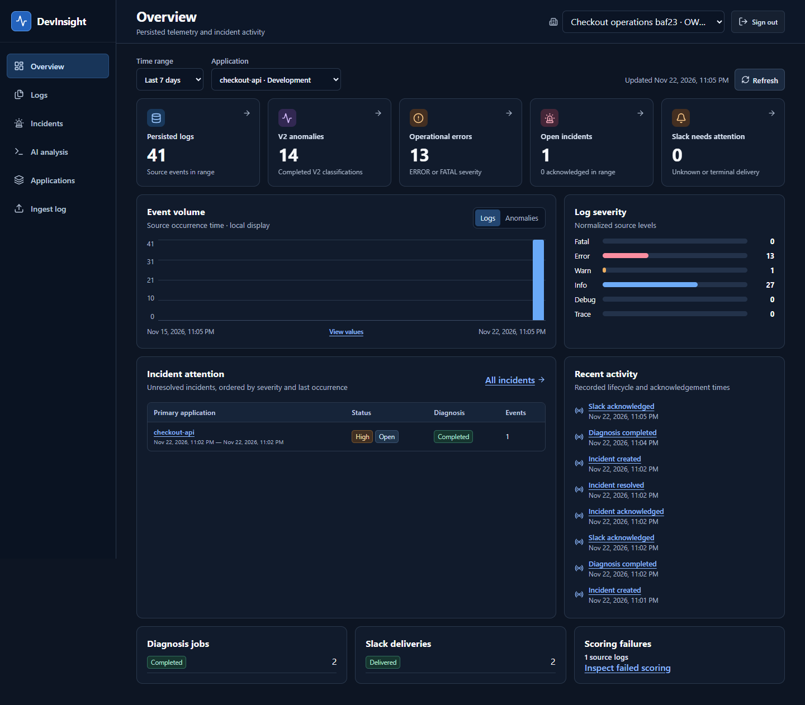
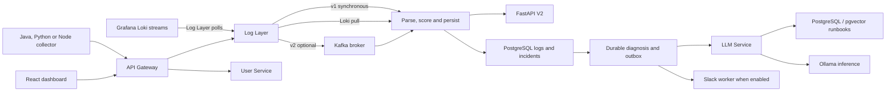

# DevInsight

DevInsight turns application logs into **tenant-scoped incident investigations**. It combines V2 anomaly scoring with operational error rules, groups related events, and produces runbook-grounded diagnoses with local Ollama. The React dashboard links each incident to its source logs, diagnosis attempts, and Slack delivery history. It accepts pushed logs from application collectors and can pull from Grafana Loki.



## Architecture



The synchronous batch route returns committed log IDs. The optional Kafka route returns broker acceptance and processes events separately. Stable event IDs make retries safe at the persistence boundary. Diagnosis results are advisory. Operator access is scoped by organization membership and PostgreSQL row policies. Loki uses a PostgreSQL time checkpoint and the same deduplicating writer. The Loki worker reads the source directly.

## Run locally with Docker Compose

The clean-copy run built all six services with Docker Desktop and used PostgreSQL in a fresh Compose volume. It reused the host's local Ollama server through a temporary [Ollama override](system-architecture/CONTAINER_DEPLOYMENT.md#use-ollama-already-running-on-the-docker-desktop-host). The repository includes the V1 and V2 artifacts under `ml-pipeline/artifacts/`.

Follow the [container runbook](system-architecture/CONTAINER_DEPLOYMENT.md#docker-compose) to prepare a private env file outside the checkout and the temporary override. Set `$privateEnv` and `$override` to those file paths. Use a fresh project and stop on the first failure. The existing development PostgreSQL instance is outside this project.

```powershell
$compose = @('--env-file', $privateEnv, '-p', 'devinsight-lab', '-f', 'docker-compose.yml', '-f', $override)
docker compose @compose config --quiet
docker compose @compose up -d --wait postgres
docker compose @compose run --rm migrate-users migrate
docker compose @compose run --rm migrate-logs migrate
docker compose @compose run --rm log-db-role
$env:RAG_SYNCHRONIZE_ON_START = 'true'
docker compose @compose up -d --build --wait --wait-timeout 600 ml-pipeline user-service llm-service log-layer api-gateway frontend
Remove-Item Env:RAG_SYNCHRONIZE_ON_START
```

Open the dashboard at `http://localhost:5173`. The Gateway is at `http://localhost:8080`. Set `DEVINSIGHT_FRONTEND_PORT` and `DEVINSIGHT_GATEWAY_PORT` for alternate loopback ports. Slack and email delivery are disabled. The runbook also covers bundled Ollama, model synchronization, readiness, and shutdown. A separate [bundled Compose rehearsal](docs/VERIFICATION.md#local-container-rehearsals) used pinned Ollama 0.17.1 with preseeded models and completed diagnosis and replay.

## API reference

| Request | Meaning |
|---|---|
| `POST /api/v1/logs` | HTTP 201 after creating a log |
| `POST /api/v1/logs/batch` | HTTP 200 with committed log acknowledgements |
| `POST /api/v2/logs/batch` | HTTP 202 after optional Kafka broker acknowledgement |

Create an organization and a development application in the dashboard. Give the collector its issued application key through the process environment. See the [Java Logback](client-integrations/spring-boot/README.md), [Python logging](client-integrations/python/README.md), and [Node Winston](client-integrations/nodejs/README.md) guides. The [service contracts](system-architecture/EXTERNAL_INTERACTIONS.md) describe operator and service requests.

## Pull logs from Grafana Loki

An operator approves the Loki base URL for an organization. Its owner saves the endpoint under **Applications → Organization Loki connection**. Each application then has its own selector, such as `{app="pull-demo"}`, and shows sync status and replay counts. The current checkout requires Log Layer migration **V11** for owner-managed endpoints. [Loki setup and replay guide](docs/LOKI_LOG_SOURCES.md)

## Verification

The clean-copy Compose smoke passed with all six services healthy and local Ollama completing a synthetic diagnosis. Replaying the same **HTTP v1 batch** left counts at **3 logs, 1 incident, and 1 diagnosis job**. See the [clean-copy receipt summary](docs/VERIFICATION.md#clean-copy-compose-smoke-and-http-replay) for the schema checks and before-and-after counts.

[Watch the demo](docs/clean-clone/compose-demo.webm) · [View the dashboard capture](docs/clean-clone/compose-demo.png) · [Read the replay receipt](docs/clean-clone/compose-replay-receipt.json)

**Loki V11 replay.** In the existing local Compose stack, `pull-demo` replay skipped one duplicate, kept the Loki import count at **3**, and preserved the only matching row with log ID **`9`**. [Local V11 verification](docs/VERIFICATION.md#local-v11-loki-verification)

The earlier Windows fixture passed **511 automated tests** and reconciled **336 distinct Kafka events** with persisted V2 scores. Its shortest burst peaked at 17.18 persisted events/s. These measurements describe one controlled workstation setup. [Verification and benchmarks](docs/VERIFICATION.md)

**Kubernetes cold-start rehearsal.** On a single Docker Desktop node, all six apps became ready. The job pulled both models into a fresh volume using pinned Ollama 0.17.1 in **4 minutes 30 seconds**. PostgreSQL stored **253 pgvector runbook chunks**. Three synthetic events produced one incident and one diagnosis, which succeeded on the first attempt in **129.3 seconds**. HTTP v1 replay returned the original log IDs and preserved all counts. [Kubernetes evidence](docs/VERIFICATION.md#kubernetes-cold-pull-and-http-replay) · [Kubernetes runbook](system-architecture/CONTAINER_DEPLOYMENT.md#kubernetes)

The registry Compose override passed with locally tagged app images. A separate Kafka Compose rehearsal returned HTTP 202 twice for the original batch and replay, preserved the original SQL log IDs, and finished with zero consumer lag. Remote application image pulls and production or multi-node rollout remain unverified. [Local container rehearsals](docs/VERIFICATION.md#local-container-rehearsals)

## Further reading

- [Setup and troubleshooting](docs/SETUP_GUIDE.md)
- [Architecture and service internals](system-architecture/README.md)
- [Model serving and rollback](ml-pipeline/README.md)
- [Runbook retrieval evaluation](docs/verification/rag_retrieval_experiments_and_final_decision.md)
