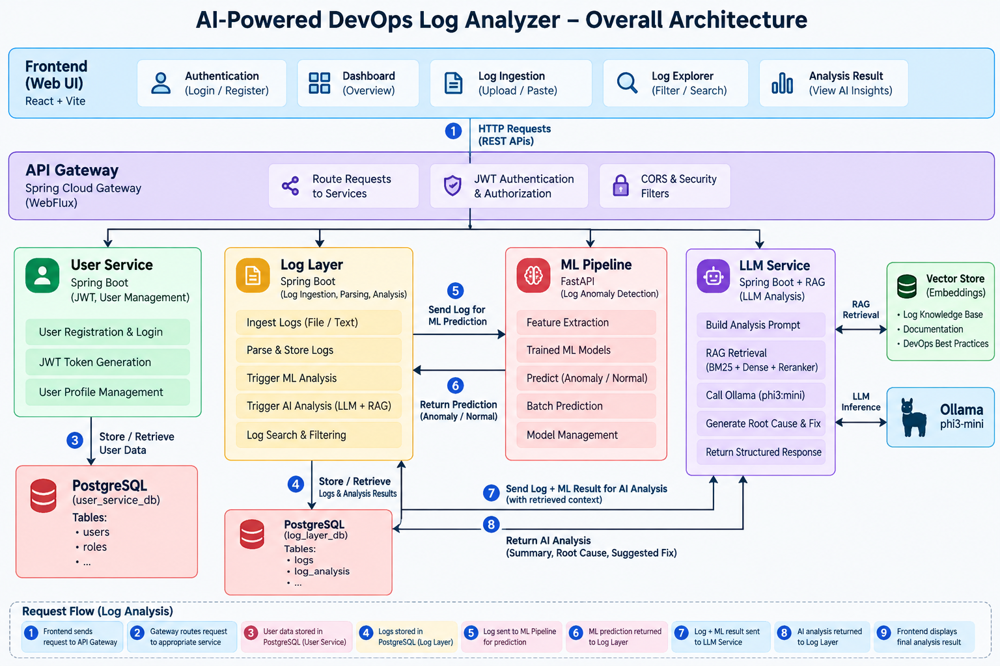

# DevInsight — AI-Powered DevOps Log Analyzer & Incident Assistant

**An AI-powered DevOps platform that detects log anomalies, investigates incidents, retrieves relevant technical knowledge, and generates actionable troubleshooting recommendations.**

DevInsight combines a microservice-based backend, machine-learning anomaly detection, Retrieval-Augmented Generation (RAG), and a React dashboard to help developers understand application failures and investigate infrastructure issues.

Instead of relying only on traditional log searching, DevInsight combines ML-based anomaly detection with LLM-powered incident analysis grounded in a DevOps knowledge base.

---

## Table of Contents

- [1. Project Overview](#1-project-overview)
- [2. Architecture](#2-architecture)
- [3. How DevInsight Works](#3-how-devinsight-works)
- [4. Key Features](#4-key-features)
- [5. Technology Stack](#5-technology-stack)
- [6. Monorepo Structure](#6-monorepo-structure)
- [7. Microservices and Responsibilities](#7-microservices-and-responsibilities)
- [8. Database Design](#8-database-design)
- [9. Machine Learning Pipeline](#9-machine-learning-pipeline)
- [10. LLM and RAG Architecture](#10-llm-and-rag-architecture)
- [11. RAG Evaluation and Experiments](#11-rag-evaluation-and-experiments)
- [12. API Reference](#12-api-reference)
- [13. Prerequisites](#13-prerequisites)
- [14. Environment Configuration](#14-environment-configuration)
- [15. Database Setup](#15-database-setup)
- [16. Ollama Setup](#16-ollama-setup)
- [17. Running the Project Locally](#17-running-the-project-locally)
- [18. Frontend](#18-frontend)
- [19. Testing and Verification](#19-testing-and-verification)
- [20. Security Considerations](#20-security-considerations)
- [21. Known Limitations](#21-known-limitations)
- [22. Development and Deployment Roadmap](#22-development-and-deployment-roadmap)
- [23. Future Improvements](#23-future-improvements)
- [24. Project Status](#24-project-status)

---

# 1. Project Overview

DevInsight is designed to simplify the process of analyzing application logs and investigating technical incidents.

In a typical development environment, engineers frequently encounter:

- Application errors and exceptions.
- Unexpected service failures.
- Database connection problems.
- Infrastructure and deployment issues.
- Container and orchestration failures.
- Performance-related warnings.
- Repeated or unusual application behavior.

Manually investigating these problems requires searching through logs, understanding error messages, identifying the affected service, and consulting technical documentation.

DevInsight brings these activities into one platform.

It uses:

1. **Microservices architecture** to separate application responsibilities.
2. **Machine Learning** to identify anomalous log behavior.
3. **Retrieval-Augmented Generation** to retrieve relevant DevOps knowledge.
4. **Large Language Models** to explain incidents and recommend possible solutions.
5. **React dashboard** to provide a centralized interface for log ingestion and investigation.

### Main objective

Transform raw application logs into useful diagnostic information:

```text
Raw Application Logs
        |
        v
Log Parsing and Validation
        |
        v
Log Storage
        |
        v
ML-Based Anomaly Detection
        |
        v
RAG-Based Knowledge Retrieval
        |
        v
LLM Incident Analysis
        |
        v
Summary + Root Cause + Suggested Fix
```

---

# 2. Architecture

DevInsight follows a layered microservice architecture.

The frontend communicates with backend services through a centralized API Gateway. The Log Layer coordinates log processing and communicates with the ML Pipeline and LLM Service.



### Architecture components

| Component | Technology | Responsibility |
|---|---|---|
| Frontend | React + Vite | User interface and log investigation |
| API Gateway | Spring Cloud Gateway + WebFlux | Request routing and security |
| User Service | Spring Boot | Authentication and user management |
| Log Layer | Spring Boot | Log ingestion, parsing, storage, and orchestration |
| ML Pipeline | FastAPI | Feature extraction and anomaly detection |
| LLM Service | Spring Boot + RAG | Incident analysis and troubleshooting guidance |
| PostgreSQL | PostgreSQL | Persistent application and log data |
| Vector Store | Spring AI vector storage | Embedding-based knowledge retrieval |
| Ollama | Local LLM runtime | Local language-model inference |

### Why microservices?

The application separates authentication, log processing, machine learning, and LLM-based analysis into independent services.

This provides:

- Separation of responsibilities.
- Independent development and testing.
- Independent service configuration.
- The ability to scale resource-intensive components separately.
- Easier maintenance as the system grows.

For example, ML inference and LLM inference have different computational requirements. Keeping them separate avoids making the Log Layer responsible for every processing task.

---

# 3. How DevInsight Works

The following sequence describes the complete log-analysis workflow.

### Step 1 — User authentication

The user registers or logs in through the React frontend.

The request passes through the API Gateway to the User Service.

The User Service authenticates the user and generates a JWT token.

### Step 2 — API Gateway routing

The frontend sends HTTP requests to the API Gateway.

The Gateway:

- Routes requests to the appropriate backend service.
- Applies JWT authentication and authorization.
- Handles CORS and security filters.

### Step 3 — User data persistence

The User Service stores user information in its PostgreSQL database.

### Step 4 — Log ingestion and storage

The user submits application logs through the frontend.

The Log Layer:

- Receives the log request.
- Parses and validates the incoming log.
- Extracts structured information.
- Stores the log in PostgreSQL.
- Initiates the analysis workflow.

### Step 5 — ML anomaly detection

The Log Layer sends the required log information to the ML Pipeline.

The ML Pipeline extracts features and performs anomaly prediction.

### Step 6 — ML prediction returned

The ML Pipeline returns prediction information, including the anomaly classification and associated prediction metadata.

The Log Layer stores the ML result with the log.

### Step 7 — LLM incident investigation

The Log Layer sends the log information and ML prediction to the LLM Service.

The LLM Service:

1. Constructs an analysis prompt.
2. Retrieves relevant DevOps knowledge using the RAG pipeline.
3. Combines the log, ML prediction, and retrieved context.
4. Sends the resulting prompt to Ollama.
5. Generates an incident-analysis response.

### Step 8 — Analysis returned

The LLM Service returns structured analysis containing information such as:

- Summary.
- Probable root cause.
- Severity.
- Recommended troubleshooting actions.

The Log Layer stores the analysis result.

### Step 9 — Frontend presentation

The frontend displays the log and its associated analysis.

The user can inspect the log, review the anomaly prediction, and understand the generated troubleshooting recommendations.

### Complete request flow

```text
React Frontend
      |
      | HTTP Request
      v
API Gateway (:8080)
      |
      |-----------------------------|
      |                             |
      v                             v
User Service (:8081)          Log Layer (:8082)
      |                             |
      v                             |
User PostgreSQL                    |
                                    |
                                    v
                             Log PostgreSQL
                                    |
                                    v
                             ML Pipeline (:8000)
                                    |
                                    v
                             Anomaly Prediction
                                    |
                                    v
                              Log Layer
                                    |
                                    v
                              LLM Service (:8084)
                                    |
                         -----------------------
                         |                     |
                         v                     v
                    Vector Store           Ollama
                    (RAG Retrieval)       (:11434)
                         |                     |
                         -----------|----------
                                    |
                                    v
                            AI Incident Analysis
                                    |
                                    v
                                Log Layer
                                    |
                                    v
                              React Frontend
```

---

# 4. Key Features

## 4.1 Authentication and User Management

- User registration and login.
- JWT token generation.
- JWT-based authentication.
- Protected backend API requests.
- User profile management.

## 4.2 Log Ingestion

- Submit logs through the frontend.
- Support file/text-based log submission.
- Associate logs with source and environment information.
- Parse and structure incoming log information.
- Persist logs for future investigation.

## 4.3 Log Explorer

- Search and filter stored logs.
- Inspect individual log details.
- Filter by available log metadata.
- View associated analysis results.

## 4.4 ML-Based Anomaly Detection

- Extract features from incoming logs.
- Detect anomalous log behavior.
- Return anomaly/normal predictions.
- Associate predictions with model metadata.
- Support individual and batch prediction endpoints.

## 4.5 AI-Powered Incident Analysis

- Analyze logs using an LLM.
- Include ML prediction information in the analysis context.
- Retrieve relevant DevOps documentation.
- Generate incident summaries.
- Identify probable root causes.
- Recommend troubleshooting actions.

## 4.6 Hybrid RAG Retrieval

- Dense vector retrieval.
- BM25 lexical retrieval.
- Reciprocal Rank Fusion.
- Experimental reranking.
- Retrieval benchmarking.

## 4.7 Centralized Dashboard

- View ingested logs.
- Explore log records.
- Inspect analysis results.
- Access log investigation functionality.

---

# 5. Technology Stack

## Backend

| Technology | Usage |
|---|---|
| Java 21 | Backend development |
| Spring Boot | Microservice development |
| Spring Cloud Gateway | API Gateway |
| Spring WebFlux | Reactive Gateway architecture |
| Spring Security | Authentication and authorization |
| Spring Data JPA | Database persistence |
| PostgreSQL Driver | Database connectivity |
| WebClient | Inter-service HTTP communication |
| Maven | Dependency and build management |
| JJWT | JWT-related functionality |

## Machine Learning

| Technology | Usage |
|---|---|
| Python | ML pipeline development |
| FastAPI | ML REST API |
| Uvicorn | ASGI server |
| Scikit-learn | Machine-learning functionality |
| Pandas | Data processing |
| NumPy | Numerical processing |
| Joblib | Model artifact handling |

## LLM and RAG

| Technology | Usage |
|---|---|
| Spring AI | LLM and embedding integration |
| Ollama | Local LLM runtime |
| `phi3:mini` | Chat model |
| `nomic-embed-text:latest` | Embedding model |
| BM25 | Lexical retrieval |
| Dense Retrieval | Semantic retrieval |
| Reciprocal Rank Fusion | Hybrid result fusion |
| PostgreSQL/vector storage | Persistent application and vector data |

## Frontend

| Technology | Usage |
|---|---|
| React | Frontend development |
| Vite | Development and build tooling |
| Axios | HTTP requests |
| React Router | Client-side routing |
| Lucide React | Icons |

---

# 6. Monorepo Structure

The project is organized as a monorepo containing independent application services.

```text
AI-Powered-DevOps-Log-Analyzer-Incident-Assistant/
│
├── api-gateway/
│   ├── src/
│   └── pom.xml
│
├── user-service/
│   ├── src/
│   └── pom.xml
│
├── log-layer/
│   ├── src/
│   └── pom.xml
│
├── ml-pipeline/
│   ├── app/
│   ├── api/
│   ├── core/
│   ├── schemas/
│   ├── services/
│   ├── models/
│   ├── features/
│   ├── tests/
│   ├── artifacts/
│   └── requirements.txt
│
├── llm-service/
│   ├── src/
│   │   └── main/
│   │       └── resources/
│   │           └── knowledge/
│   └── pom.xml
│
├── frontend/
│   ├── src/
│   ├── public/
│   └── package.json
│
├── docs/
│   ├── assets/
│   │   └── architecture.png
│   └── rag_retrieval_experiments_and_final_decision.md
│
├── README.md
└── .gitignore
```

Each service has its own dependencies, configuration, and responsibilities.

---

# 7. Microservices and Responsibilities

| Service | Port | Main Responsibility |
|---|---:|---|
| API Gateway | `8080` | Routing and security |
| User Service | `8081` | Authentication and user management |
| Log Layer | `8082` | Log processing and orchestration |
| ML Pipeline | `8000` | Feature extraction and anomaly prediction |
| LLM Service | `8084` | RAG-based incident analysis |
| Frontend | `5173` | Web application |
| PostgreSQL | `5432` | Persistent storage |
| Ollama | `11434` | Local model inference |

## 7.1 API Gateway

**Technology:** Spring Cloud Gateway, Spring WebFlux, Spring Security.

The API Gateway acts as the single entry point for frontend requests.

Responsibilities:

- Route requests to backend services.
- Validate JWT authentication.
- Apply authorization rules.
- Handle CORS configuration.
- Centralize gateway security.

### Configured routes

```text
/api/v1/auth/**   → User Service (:8081)
/api/v1/users/**  → User Service (:8081)
/api/v1/logs/**   → Log Layer (:8082)
```

The Gateway uses reactive security configuration through `SecurityWebFilterChain`.

## 7.2 User Service

**Technology:** Spring Boot, Spring Security, Spring Data JPA, PostgreSQL.

Responsibilities:

- User registration.
- User login.
- Password authentication.
- JWT generation.
- User profile management.
- User persistence.

The service uses a JWT authentication filter based on Spring Security's `OncePerRequestFilter`.

## 7.3 Log Layer

**Technology:** Spring Boot, Spring Data JPA, PostgreSQL, WebClient.

The Log Layer is responsible for managing the log-analysis workflow.

Responsibilities:

- Receive log-ingestion requests.
- Parse and validate incoming logs.
- Store logs.
- Search and retrieve logs.
- Trigger ML analysis.
- Store ML predictions.
- Trigger LLM analysis.
- Store analysis results.
- Return structured responses to the frontend.

The Log Layer acts as the orchestration layer between the application logs, ML Pipeline, and LLM Service.

### ML integration

The Log Layer maps log information into an ML prediction request using its integration layer and communicates with the ML Pipeline.

### Analysis lifecycle

The log entity maintains analysis-related metadata, including:

```text
prediction
predictionLabel
decisionScore
modelVersion
analysisStatus
analyzedAt
```

The analysis lifecycle includes:

```text
PENDING
PROCESSING
COMPLETED
FAILED
```

## 7.4 ML Pipeline

**Technology:** Python, FastAPI, Scikit-learn.

Responsibilities:

- Receive structured log information.
- Extract model features.
- Perform anomaly detection.
- Support single predictions.
- Support batch predictions.
- Return prediction metadata.
- Expose model and health information.

## 7.5 LLM Service

**Technology:** Spring Boot, Spring AI, Ollama.

Responsibilities:

- Receive log-analysis requests.
- Construct analysis prompts.
- Retrieve relevant DevOps knowledge.
- Perform hybrid retrieval.
- Communicate with Ollama.
- Generate structured incident-analysis responses.

## 7.6 Frontend

**Technology:** React, Vite, Axios.

The frontend provides the user-facing application for:

- Authentication.
- Dashboard overview.
- Log ingestion.
- Log exploration.
- Search and filtering.
- AI analysis inspection.

The frontend communicates with the API Gateway rather than directly accessing individual backend services.

---

# 8. Database Design

DevInsight uses PostgreSQL for persistent application data.

The application maintains separate databases for user management and log processing.

## User Service Database

```text
Database: devinsight
Port:     5432
Username: postgres
```

The user database maintains information such as:

```text
users
roles
```

## Log Layer Database

```text
Database: log_layer_db
Port:     5432
Username: postgres
```

The log database maintains information such as:

```text
logs
log_analysis
```

The exact table structure is managed by the service's persistence entities and database configuration.

## Why separate databases?

Separating the databases keeps user-management data independent from log-processing data.

It also supports service-level ownership of persistence and allows the services to evolve independently.

---

# 9. Machine Learning Pipeline

The ML Pipeline is implemented as a separate FastAPI service.

Its responsibility is to identify anomalous behavior in application logs and return structured predictions to the Log Layer.

## ML workflow

```text
Structured Log Request
         |
         v
Feature Extraction
         |
         v
Feature Processing
         |
         v
Trained ML Model
         |
         v
Anomaly Prediction
         |
         v
Prediction Metadata
         |
         v
Log Layer
```

## Prediction information

The prediction response contains fields such as:

```text
prediction
prediction_label
is_anomaly
decision_score
model_version
```

The anomaly convention used by the model includes:

| Prediction | Meaning |
|---:|---|
| `-1` | Anomaly |
| `1` | Normal |

The Log Layer stores the prediction information alongside the corresponding log.

## ML API endpoints

| Method | Endpoint | Purpose |
|---|---|---|
| POST | `/api/v1/predict` | Single-log prediction |
| POST | `/api/v1/predict/batch` | Batch prediction |
| GET | `/api/v1/system/health` | Pipeline health |
| GET | `/api/v1/system/model` | Model information |

### Health check

```http
GET http://localhost:8000/api/v1/system/health
```

The health endpoint reports information such as service status, service name, version, environment, and model-loading status.

---

# 10. LLM and RAG Architecture

The LLM Service provides context-aware incident analysis using Retrieval-Augmented Generation.

Instead of relying only on the language model's internal knowledge, DevInsight retrieves relevant information from a DevOps knowledge base and includes it in the analysis prompt.

## 10.1 Why RAG?

A language model may not have sufficient information about a specific infrastructure error or the technical configuration of a system.

RAG helps by retrieving relevant documentation before generating an answer.

For example, when a log contains a PostgreSQL connection error, the retrieval pipeline can search for relevant PostgreSQL documentation and provide that context to the LLM.

## 10.2 Knowledge Base

The current documented knowledge base contains 21 Markdown documents.

| Category | Documents |
|---|---:|
| Docker | 5 |
| Kubernetes | 5 |
| Nginx | 3 |
| PostgreSQL | 3 |
| Spring Boot | 5 |
| **Total** | **21** |

Knowledge documents are stored under:

```text
llm-service/src/main/resources/knowledge/
```

## 10.3 Document Processing

The knowledge documents are split into smaller chunks before retrieval.

The documented stable configuration uses:

```text
Chunk size:    1000 characters
Chunk overlap: 0
```

These chunks are embedded and indexed for retrieval.

## 10.4 Dense Retrieval

Dense retrieval uses vector embeddings to identify semantically similar documents.

For example:

```text
Query:
"Why is my Spring Boot application unable to connect to PostgreSQL?"

        |
        v

Query Embedding
        |
        v

Vector Similarity Search
        |
        v

Relevant Knowledge Chunks
```

Dense retrieval is useful when the query and documentation use different wording but describe similar concepts.

## 10.5 BM25 Lexical Retrieval

BM25 is a lexical information-retrieval method that ranks documents using query-term relevance.

It is useful when exact technical terms matter.

For example:

```text
Query:
"CrashLoopBackOff"
```

BM25 can prioritize documentation containing that specific technical term.

## 10.6 Hybrid Retrieval

DevInsight combines dense retrieval and BM25 retrieval.

```text
                  User Query
                      |
              -----------------
              |               |
              v               v
        Dense Retrieval   BM25 Retrieval
              |               |
              v               v
        Semantic Results  Lexical Results
              |               |
              -------|--------
                      |
                      v
               RRF Fusion
                      |
                      v
              Ranked Results
                      |
                      v
              Prompt Construction
                      |
                      v
                   Ollama
                      |
                      v
              Generated Analysis
```

## 10.7 Reciprocal Rank Fusion

Reciprocal Rank Fusion combines the rankings produced by different retrieval systems.

The RRF score is:

\[
RRF(d)=\sum_{r \in R}\frac{1}{k+rank_r(d)}
\]

Where:

- \(d\) is a retrieved document.
- \(R\) represents the retrieval rankings.
- \(rank_r(d)\) is the rank of document \(d\) in ranking \(r\).
- \(k\) is a smoothing constant.

RRF combines rankings without requiring the retrieval systems to produce directly comparable raw scores.

## 10.8 LLM Inference

After retrieval, the LLM Service constructs a prompt containing:

- Log information.
- ML prediction information.
- Retrieved DevOps knowledge.
- Analysis instructions.

The prompt is sent to Ollama.

Current documented models:

```text
Chat Model:
phi3:mini

Embedding Model:
nomic-embed-text:latest
```

Ollama runs locally and exposes its service at:

```text
http://localhost:11434
```

## 10.9 Structured Analysis Response

The LLM Service generates an analysis response containing fields such as:

```text
summary
rootCause
severity
recommendation
```

This response is returned to the Log Layer for persistence and presentation through the frontend.

---

# 11. RAG Evaluation and Experiments

The retrieval pipeline was evaluated using an internal DevOps benchmark containing 20 queries.

The benchmark covers:

- Spring Boot
- Docker
- Kubernetes
- Nginx
- PostgreSQL

The objective was to compare retrieval strategies and select a configuration based on measured retrieval performance.

## 11.1 Evaluation Metrics

### Hit@1

Measures whether the relevant document appears at rank 1.

### Hit@3

Measures whether the relevant document appears within the top 3 results.

### Hit@5

Measures whether the relevant document appears within the top 5 results.

### Mean Reciprocal Rank (MRR)

MRR evaluates how highly the first relevant result is ranked.

\[
MRR=\frac{1}{N}\sum_{i=1}^{N}\frac{1}{rank_i}
\]

Where:

- \(N\) is the number of queries.
- \(rank_i\) is the position of the first relevant result for query \(i\).

A higher MRR indicates that relevant results tend to appear closer to the top.

## 11.2 Baseline Retrieval Results

The documented internal benchmark results are:

| Retrieval Strategy | Hit@1 | Hit@3 | Hit@5 | MRR |
|---|---:|---:|---:|---:|
| Dense, no overlap | 80% | 100% | 100% | 0.9000 |
| BM25, no overlap | 75% | 95% | 100% | 0.8542 |
| Hybrid RRF, no overlap | 75% | 95% | 100% | 0.8542 |

These results are specific to the project's internal benchmark. They should not be interpreted as general performance guarantees for RAG systems.

## 11.3 Chunk Overlap Experiment

A 200-character overlap was tested against the no-overlap configuration.

Results:

| Retrieval Strategy | MRR Without Overlap | MRR With 200-Character Overlap |
|---|---:|---:|
| Dense | 0.9000 | 0.8500 |
| BM25 | 0.8542 | 0.8042 |
| Hybrid | 0.8542 | 0.8042 |

The overlap configuration reduced the measured MRR in the benchmark.

**Decision:** Retain 1000-character chunks with zero overlap for the documented stable configuration.

## 11.4 Lexical Reranker Experiment

A lexical reranking approach was tested after Hybrid RRF.

```text
Dense Retrieval + BM25
          |
          v
       RRF Fusion
          |
          v
     Lexical Reranker
          |
          v
     Ranked Results
```

Results:

| Metric | Result |
|---|---:|
| Hit@1 | 70% |
| Hit@3 | 95% |
| Hit@5 | 100% |
| MRR | 0.8292 |

This approach performed worse than the Hybrid RRF baseline.

## 11.5 TF-IDF-Inspired Reranker Experiment

A second reranking experiment used TF-IDF-inspired weighting.

Results:

| Metric | Result |
|---|---:|
| Hit@1 | 70% |
| Hit@3 | 90% |
| Hit@5 | 95% |
| MRR | 0.8017 |

This approach also performed worse than the Hybrid RRF baseline.

## 11.6 Final Retrieval Decision

Based on the documented experiments, the stable retrieval configuration is:

```text
Chunk Size:       1000 characters
Chunk Overlap:    0

Retrieval:
    Dense Retrieval
    BM25 Retrieval

Fusion:
    Reciprocal Rank Fusion
```

The lexical and TF-IDF-inspired rerankers remain experimental approaches that did not improve the measured benchmark results.

Detailed experiment documentation:

[View RAG Retrieval Experiments and Final Decision](docs/rag_retrieval_experiments_and_final_decision.md)

---

# 12. API Reference

The following endpoints describe the documented service APIs.

All frontend requests are routed through the API Gateway where applicable.

## 12.1 Authentication APIs

### Register

```http
POST /api/v1/auth/register
```

Example request:

```json
{
  "email": "user@example.com",
  "password": "your-password",
  "role": "DEVELOPER"
}
```

### Login

```http
POST /api/v1/auth/login
```

Example request:

```json
{
  "email": "user@example.com",
  "password": "your-password"
}
```

The login response contains a JWT token.

### Get Current User

```http
GET /api/v1/users/me
```

Requires:

```http
Authorization: Bearer <token>
```

## 12.2 Log APIs

### Ingest a Log

```http
POST /api/v1/logs
```

The request supports fields such as:

```text
rawLog
source
environment
applicationName
hostName
correlationId
```

### Get a Log

```http
GET /api/v1/logs/{id}
```

### Search Logs

```http
POST /api/v1/logs/search
```

The frontend uses this endpoint for log searching and dashboard exploration.

### Analyze a Log

```http
POST /api/v1/logs/{id}/analyze
```

Documented analysis types include:

```text
SUMMARY
ROOT_CAUSE
SUGGESTED_FIX
```

### Delete a Log

```http
DELETE /api/v1/logs/{id}
```

## 12.3 ML Pipeline APIs

| Method | Endpoint |
|---|---|
| POST | `/api/v1/predict` |
| POST | `/api/v1/predict/batch` |
| GET | `/api/v1/system/health` |
| GET | `/api/v1/system/model` |

## 12.4 LLM Service APIs

| Method | Endpoint |
|---|---|
| POST | `/api/v1/llm/analyze` |
| GET | `/api/v1/system/health` |
| GET | `/test` |

The LLM analysis request can contain:

```text
timestamp
level
service_name
message
prediction
prediction_label
decision_score
model_version
```

The analysis response can contain:

```text
summary
rootCause
severity
recommendation
```

---

# 13. Prerequisites

Before running DevInsight locally, install the following tools.

| Requirement | Version / Tool |
|---|---|
| Java | Java 21 |
| Build Tool | Maven |
| Python | Python 3.x |
| Node.js | Node.js and npm |
| Database | PostgreSQL |
| LLM Runtime | Ollama |
| Version Control | Git |

### Verify installations

Using PowerShell:

```powershell
java -version
mvn -version
python --version
node --version
npm --version
psql --version
ollama --version
git --version
```

The project was developed and tested locally with Java 21.

---

# 14. Environment Configuration

Do not commit actual passwords, JWT secrets, or internal API keys.

The services use environment-variable placeholders for sensitive configuration.

Documented variables include:

```text
DB_PASSWORD
JWT_SECRET
INTERNAL_API_KEY
```

## PowerShell Configuration

Open PowerShell from the repository root.

Configure the PostgreSQL password:

```powershell
$env:DB_PASSWORD="<your-postgres-password>"
```

Configure the JWT secret:

```powershell
$env:JWT_SECRET="<your-jwt-secret>"
```

Configure the internal API key for the ML Pipeline:

```powershell
$env:INTERNAL_API_KEY="<your-local-internal-api-key>"
```

Replace the placeholders with your actual local values.

These PowerShell variables are session-level. If you open a new terminal, configure them again in that terminal where required.

### Security note

Never publish actual credentials in:

- GitHub repositories.
- README examples.
- Screenshots.
- Application logs.
- Public configuration files.

Use placeholders in documentation and keep real secrets outside version control.

---

# 15. Database Setup

DevInsight currently uses PostgreSQL.

Create the required databases before starting the backend services.

Open PostgreSQL using your preferred PostgreSQL client or `psql`.

Execute:

```sql
CREATE DATABASE devinsight;

CREATE DATABASE log_layer_db;
```

Verify the databases:

```sql
\l
```

The expected database configuration is:

| Database | Service | Port |
|---|---|---:|
| `devinsight` | User Service | 5432 |
| `log_layer_db` | Log Layer | 5432 |

The PostgreSQL username used in the documented local configuration is:

```text
postgres
```

Supply the database password through the `DB_PASSWORD` environment variable.

---

# 16. Ollama Setup

The LLM Service uses Ollama for local inference.

Install Ollama and make sure it is running.

The default local endpoint is:

```text
http://localhost:11434
```

## Pull the required models

### Chat model

```powershell
ollama pull phi3:mini
```

### Embedding model

```powershell
ollama pull nomic-embed-text:latest
```

## Verify installed models

```powershell
ollama list
```

The expected models are:

```text
phi3:mini
nomic-embed-text:latest
```

The chat model generates incident-analysis responses, while the embedding model is used to generate embeddings for semantic retrieval.

Ollama must be available when actual LLM analysis is performed.

---

# 17. Running the Project Locally

The recommended approach is to start and verify each service independently.

The following instructions use PowerShell.

Make sure PostgreSQL and Ollama are running before starting the application services.

## Terminal 1 — ML Pipeline

Navigate to the ML Pipeline directory:

```powershell
cd ml-pipeline
```

Configure the internal API key:

```powershell
$env:INTERNAL_API_KEY="<your-local-internal-api-key>"
```

Start the FastAPI application:

```powershell
python -m uvicorn app.main:app --host 0.0.0.0 --port 8000
```

Service URL:

```text
http://localhost:8000
```

Health endpoint:

```text
http://localhost:8000/api/v1/system/health
```

## Terminal 2 — User Service

Open another terminal from the repository root.

Configure the database password and JWT secret:

```powershell
$env:DB_PASSWORD="<your-postgres-password>"
$env:JWT_SECRET="<your-jwt-secret>"
```

Start the User Service:

```powershell
mvn -f .\user-service\pom.xml spring-boot:run
```

Service URL:

```text
http://localhost:8081
```

## Terminal 3 — Log Layer

Open another terminal from the repository root.

Configure the database password:

```powershell
$env:DB_PASSWORD="<your-postgres-password>"
```

Start the Log Layer:

```powershell
mvn -f .\log-layer\pom.xml spring-boot:run
```

Service URL:

```text
http://localhost:8082
```

The Log Layer communicates with:

```text
ML Pipeline:
http://localhost:8000

LLM Service:
http://localhost:8084
```

Ensure the configured service URLs match your local environment.

## Terminal 4 — LLM Service

Open another terminal.

Navigate to the LLM Service:

```powershell
cd llm-service
```

Start the application:

```powershell
mvn spring-boot:run
```

Service URL:

```text
http://localhost:8084
```

Ensure Ollama is running and the required models are available.

## Terminal 5 — API Gateway

Open another terminal from the repository root.

Start the Gateway:

```powershell
mvn -f .\api-gateway\pom.xml spring-boot:run
```

Gateway URL:

```text
http://localhost:8080
```

The Gateway routes frontend requests to the User Service and Log Layer.

## Terminal 6 — Frontend

Open another terminal.

Navigate to the frontend directory:

```powershell
cd frontend
```

Install dependencies:

```powershell
npm install
```

Start the development server:

```powershell
npm run dev
```

Open the application:

```text
http://localhost:5173
```

### Expected local service URLs

| Component | URL |
|---|---|
| Frontend | http://localhost:5173 |
| API Gateway | http://localhost:8080 |
| User Service | http://localhost:8081 |
| Log Layer | http://localhost:8082 |
| ML Pipeline | http://localhost:8000 |
| LLM Service | http://localhost:8084 |
| Ollama | http://localhost:11434 |

---

## One-Click Orchestration Scripts

Instead of opening 6 terminal windows manually, you can use the automated orchestration scripts:

### Windows (PowerShell)
```powershell
# Start all 6 microservices in parallel with auto pre-flight checks:
.\start-all.ps1

# Stop and gracefully terminate all running DevInsight services:
.\stop-all.ps1
```

### Linux / macOS / WSL (Bash)
```bash
chmod +x start-all.sh
./start-all.sh
```

---

## Running with Docker Compose

DevInsight is fully containerized with multi-stage Dockerfiles and a production-grade `docker-compose.yml`.

### Architecture of Containers:
1. `devinsight-postgres` (PostgreSQL 16 Alpine with multi-database initialization)
2. `devinsight-ollama` (Ollama local inference runtime + volume persistence)
3. `devinsight-ollama-puller` (Automated puller for `phi3:mini` and `nomic-embed-text`)
4. `devinsight-ml-pipeline` (Python 3.11 FastAPI with preloaded Isolation Forest model)
5. `devinsight-user-service` (Java 21 Temurin Alpine microservice)
6. `devinsight-llm-service` (Java 21 Spring AI + pgvector RAG microservice)
7. `devinsight-log-layer` (Java 21 Log parsing, anomaly orchestration & live analyzer)
8. `devinsight-api-gateway` (Reactive Spring Cloud Gateway reverse proxy)
9. `devinsight-frontend` (Multi-stage Node.js 20 build served via Alpine Nginx)

### Launching the Complete Stack:
```bash
# 1. Start Docker Desktop (if not already running)

# 2. Build and launch all services in detached mode (Local Dev)
docker compose up --build -d

# 3. View live logs across all containers
docker compose logs -f

# 4. View logs for a specific service
docker compose logs -f log-layer

# 5. Stop the entire stack
docker compose down
```

---

## Production Deployment with Docker Hub (`docker-compose.prod.yml`)

For production environments, you can pull and run pre-built images directly from Docker Hub without needing local source code, Maven, Node.js, or Python installations:

```bash
# 1. Configure production environment (optional)
cp .env.prod.example .env.prod

# 2. Pull and start all production services in the background
docker compose -f docker-compose.prod.yml up -d

# 3. Monitor production logs
docker compose -f docker-compose.prod.yml logs -f

# 4. Stop the production stack
docker compose -f docker-compose.prod.yml down
```

### Production Features:
- **Zero-Build Deployment**: Direct pull from Docker Hub repository `adityagoku12/devinsight-*`.
- **Automatic Process Recovery**: `restart: unless-stopped` on all microservices.
- **Log Rotation**: Docker JSON log-driver with size limits (e.g., `max-size: 20m`, `max-file: 3`) to prevent host disk exhaustion.
- **Network Isolation**: All internal communication runs on an isolated bridge network (`devinsight-prod-net`).

Once running, navigate to `http://localhost:5173` to access the DevInsight web interface.

---

# 18. Frontend

The frontend is implemented using React and Vite.

It communicates with the API Gateway rather than directly accessing individual backend services.

## Main application areas

### Authentication

- User registration.
- User login.
- JWT-based authenticated requests.

### Dashboard

The dashboard provides an overview of the application's log-analysis information.

### Log Ingestion

Users can submit logs through the web interface with available metadata such as:

- Source.
- Environment.
- Application name.
- Host information.
- Correlation ID.

### Log Explorer

The Log Explorer provides log-searching and filtering functionality.

Documented dashboard functionality includes:

- Total log count.
- Error count.
- Warning count.
- AI analysis count.
- Severity filtering.
- Source filtering.
- Environment filtering.
- Application filtering.
- Anomaly filtering.
- Message search.
- Pagination.
- Log details.
- Analyze action.
- Delete action.

### AI Analysis

Users can inspect the analysis associated with a log, including:

- Summary.
- Probable root cause.
- Severity.
- Remediation.
- Extracted commands.
- Retrieved context.

### Live Log Inspector & Incident Sandbox (`/analyzer`)

The dedicated Live Inspector interface empowers DevOps engineers to test raw logs or stack traces interactively without manual pre-formatting:
- **Application Type Selection**: `SPRING_BOOT`, `DOCKER`, `KUBERNETES`, `NGINX`, `CUSTOM`.
- **Analysis Execution Mode**:
  - `FAST`: Sub-50ms heuristic & ML Isolation Forest triage without LLM call.
  - `AUTO`: Automatically triggers deep RAG + Ollama analysis only when an anomaly/error is detected.
  - `FORCE_DEEP`: Forces comprehensive RAG root-cause diagnosis on any log payload.
- **One-Click Quick Samples**: Preloaded realistic production crash scenarios (Spring Boot port conflict, Docker Redis timeout, Kubernetes `CrashLoopBackOff`, and clean healthy ping).
- **Interactive UI Cards**: Anomaly banner, decision score metrics, root cause summary, heuristic badge indicators, shell remediation commands, and formatted JSON output.
- Recommended fix.

---

# 19. Testing and Verification

DevInsight has been developed with service-level and integration verification.

The project has undergone local verification of the main services and frontend integration.

## ML Pipeline Testing

The ML Pipeline includes automated tests for its API, feature extraction, and prediction-related functionality.

The documented test suite reached:

```text
18 tests passed
```

## LLM Service Testing

The LLM Service includes tests covering service functionality, retrieval, vector storage, and analysis-related behavior.

A documented Maven test run completed with:

```text
Tests run: 192
Failures: 0
Errors: 0
Skipped: 0
```

## User Service Testing

The User Service test suite was also executed successfully after the security error-dispatch configuration change.

## Frontend Build

The frontend production build was verified using:

```powershell
npm run build
```

## Local Integration Verification

The documented local verification covered:

```text
ML Pipeline
User Service
Log Layer
LLM Service
API Gateway
Frontend
Gateway authentication
CORS preflight
Dashboard log loading
Frontend → API Gateway
API Gateway → Log Layer
```

These results describe the recorded development and testing state; they are not a guarantee that every environment or deployment configuration will behave identically.

---

# 20. Security Considerations

Security is handled through centralized Gateway authentication and service-level security configuration.

### JWT Authentication

The API Gateway uses JWT-based authentication for protected API requests.

### Public Authentication Endpoints

The registration and login endpoints are public authentication endpoints.

```text
/api/v1/auth/register
/api/v1/auth/login
```

The frontend avoids attaching a previously stored JWT to these public requests.

### Protected API Requests

Authenticated requests use:

```http
Authorization: Bearer <token>
```

### CORS

The Gateway handles CORS configuration for frontend communication.

Browser preflight requests are permitted so that cross-origin requests can proceed through the Gateway's security configuration.

### Secret Management

The project uses environment variables for sensitive values, including:

```text
DB_PASSWORD
JWT_SECRET
INTERNAL_API_KEY
```

Never commit real credentials.

For a public production deployment, additional security hardening is required, including reviewing role assignment, secret management, internal service authentication, and deployment-level access controls.

---

# 21. Known Limitations

The following limitations were documented during development.

## 21.1 Multiline and Stack-Trace Logs

Some multiline or stack-trace-style logs are currently rejected with:

```text
400 INVALID_LOG_FORMAT
```

Improving multiline parsing and stack-trace handling is a potential future enhancement.

## 21.2 Log Collection Endpoint

A general collection endpoint is not currently documented as implemented:

```http
GET /api/v1/logs
```

The frontend uses:

```http
POST /api/v1/logs/search
```

for log searching and retrieval.

## 21.3 Registration Role Selection

The current registration flow allows the client to provide a role.

For a public production deployment, role assignment should be restricted and controlled on the server side to prevent privilege escalation.

## 21.4 Deployment

The documented workflow is based on local service execution.

Docker Compose integration and Kubernetes deployment are future deployment stages rather than features that this README claims are already complete.

---

# 22. Development and Deployment Roadmap

The development sequence follows an incremental approach.

```text
Complete and Test Services Locally
                |
                v
       Verify Service Integration
                |
                v
       Docker Compose Integration
                |
                v
     Containerized System Testing
                |
                v
       Kubernetes Deployment
```

### Phase 1 — Local Development

- Develop individual services.
- Verify service-level functionality.
- Test inter-service communication.
- Integrate the frontend.
- Verify the end-to-end log-analysis workflow.

### Phase 2 — Docker Compose

Planned work:

- Containerize backend services.
- Containerize the ML Pipeline.
- Configure PostgreSQL.
- Configure Ollama.
- Configure service-to-service networking.
- Replace local `localhost` dependencies with container service names where appropriate.
- Add health checks and persistent volumes.
- Verify the complete application using Docker Compose.

### Phase 3 — Kubernetes

Planned work:

- Deploy services using Kubernetes workloads.
- Configure Services and internal networking.
- Manage application configuration and secrets.
- Add resource requests and limits.
- Configure health probes.
- Evaluate horizontal scaling.
- Deploy and verify the complete system.

---

# 23. Future Improvements

Potential improvements include:

- Better multiline and stack-trace log parsing.
- Additional log formats and structured log support.
- Improved anomaly-detection evaluation.
- More diverse log datasets.
- Additional DevOps knowledge-base documents.
- Further retrieval experiments.
- Evaluation of alternative embedding models.
- Evaluation of additional LLM models.
- Improved analysis reliability and response validation.
- Docker Compose deployment.
- Kubernetes deployment.
- Monitoring and observability for the microservices.
- More comprehensive end-to-end integration tests.

These are potential improvements and should not be interpreted as already implemented functionality.

---

# 24. Project Status

| Area | Status |
|---|---|
| Monorepo architecture | Completed |
| Git history preservation | Completed |
| Secret sanitization | Completed |
| API Gateway | Implemented |
| JWT authentication | Implemented |
| User Service | Implemented |
| Log Layer | Implemented |
| PostgreSQL integration | Implemented |
| ML Pipeline | Implemented |
| ML integration with Log Layer | Implemented |
| LLM Service | Implemented |
| Ollama integration | Implemented |
| DevOps knowledge base | Implemented |
| Dense retrieval | Implemented |
| BM25 retrieval | Implemented |
| RRF fusion | Implemented |
| RAG benchmark | Completed |
| Frontend integration | Implemented |
| Local service verification | Completed |
| Resilient Multi-line Log Parsing | Implemented |
| Selective Fast-path / Deep RAG | Implemented |
| Live Log Inspector Sandbox UI | Implemented |
| Multi-stage Dockerfiles | Implemented |
| Docker Compose Full Stack Orchestration | Implemented |
| Kubernetes deployment | Planned |

---

# Summary

DevInsight combines multiple technologies into a unified DevOps incident-investigation platform.

```text
Microservices Architecture
          +
Spring Cloud Gateway
          +
JWT Authentication
          +
PostgreSQL
          +
Machine Learning Anomaly Detection
          +
Retrieval-Augmented Generation
          +
Dense Vector Retrieval
          +
BM25 Lexical Retrieval
          +
Reciprocal Rank Fusion
          +
Ollama Local Inference
          +
React Dashboard
```

The key idea behind DevInsight is to combine machine-learning-based anomaly detection with knowledge-grounded LLM analysis.

The ML Pipeline identifies anomalous log behavior, while the RAG-based LLM Service retrieves relevant DevOps knowledge and uses it to generate explanations and troubleshooting recommendations.

The retrieval pipeline was evaluated experimentally using an internal benchmark. Multiple approaches, including chunk overlap and reranking, were compared, and the documented stable configuration was selected based on the measured results.

**DevInsight aims to turn raw application logs into actionable incident insights through the integration of microservices, machine learning, and retrieval-augmented language models.**
