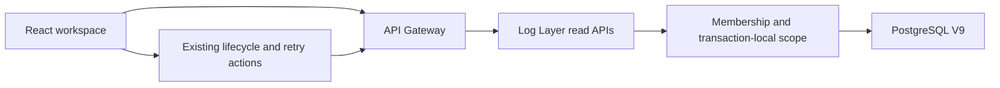

# Observability workspace architecture

React Router retains authentication, manual ingestion, the inspector, and log investigation. The shell adds a shared verified organization selector. Overview, Logs, Incidents, AI analysis, and Applications use the Gateway. The Log Layer performs PostgreSQL reads through the restricted tenant role.

Open Logs at `/logs`, overview at `/dashboard`, incident detail at `/incidents?incident=<id>`, and integrations at `/integrations`. Filter, range, and page controls use shareable URL state where meaningful. Message searches stay in component state and are sent in a bounded request body. A change of organization remounts the workspace and clears old filter and detail parameters.
