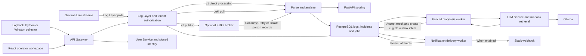
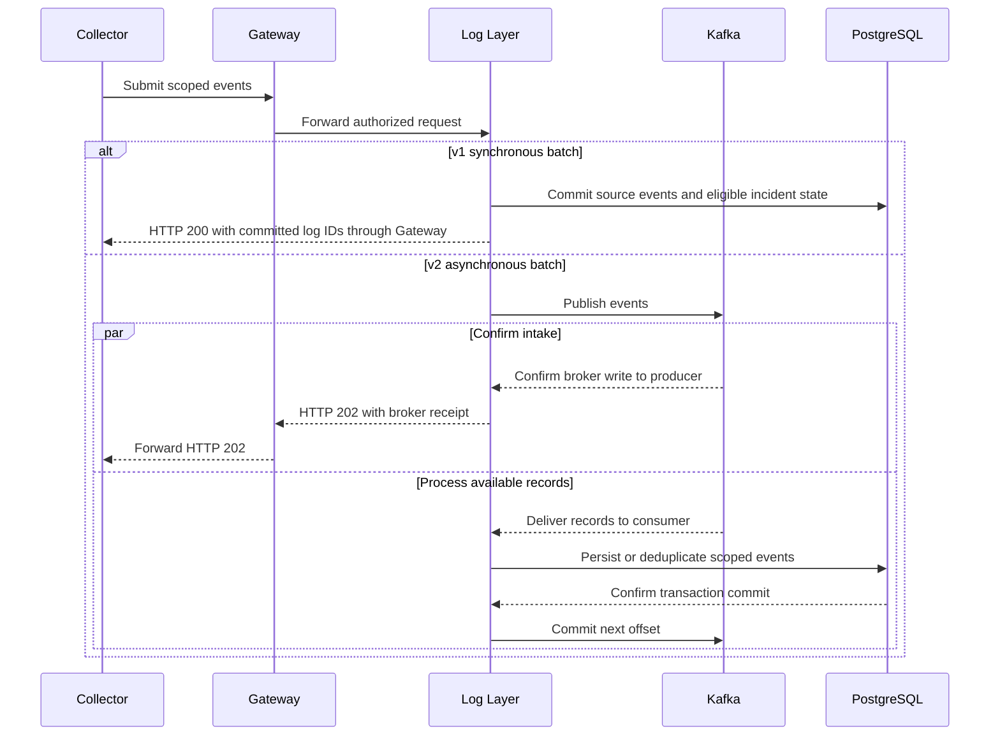
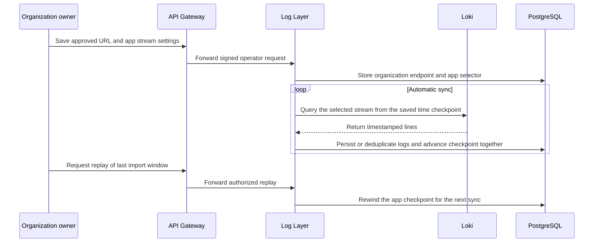

# DevInsight data flow

## Ingestion and investigation

## Acknowledgement and replay

The single-log API returns HTTP 201 after creation. Kafka consumers can begin processing independently of the HTTP response. A stable external event ID scopes replay to the original application and tenant.

## Loki polling and replay

After a failed import, the worker retains the checkpoint and retries. On replay, deterministic event IDs resolve repeated records to the original persisted log IDs. [Loki setup and verification](../docs/LOKI_LOG_SOURCES.md)

## Separate states

| State | Owner | Meaning |
|---|---|---|
| Broker accepted | Kafka | V2 publish reached the broker |
| Scored or failed | Log Layer | Source log persists with its independent ML result |
| Open, acknowledged, or resolved | Incident record | Operator lifecycle and correlation state |
| Pending, running, retrying, succeeded, or terminal | Diagnosis queue | Persisted job and attempts |
| Delivered or delivery unknown | Notification outbox | Provider acknowledgement or unresolved dispatch uncertainty |

Diagnosis produces guidance for an operator. A notification retry after unknown delivery requires explicit confirmation because the provider may already have accepted the original request.
