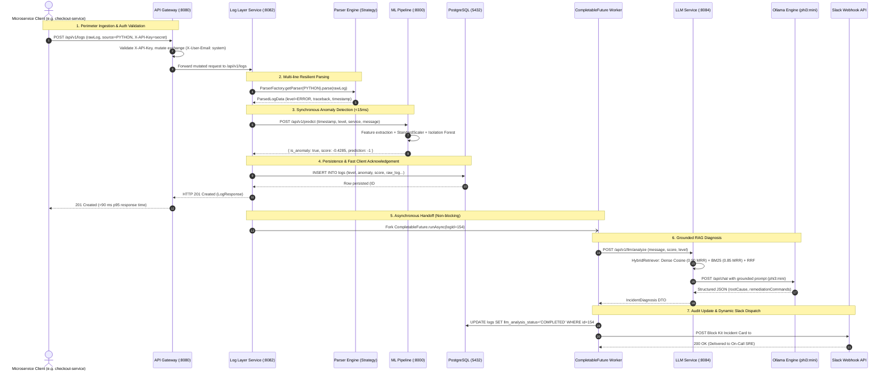
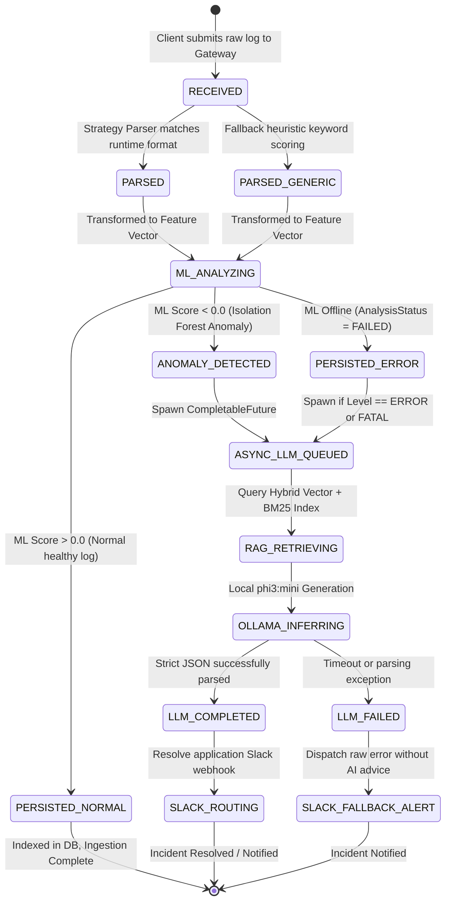

# Complete Project Architecture & Flowcharts

> **Document:** `system-architecture/COMPLETE_PROJECT_FLOWCHART.md`  
> **Visual Specifications:** Complete end-to-end Mermaid flowcharts, sequence diagrams, and state machines illustrating the full lifecycle of DevInsight.

---

## 1. Master End-to-End Architecture Flowchart

```mermaid
flowchart TD
    %% CLIENT & INGESTION TIER
    subgraph ClientTier["1. Polyglot Client Ingestion Tier"]
        C1["Python Microservices\n(FastAPI / Django Handler)"]
        C2["Node.js Microservices\n(Winston / Pino Transport)"]
        C3["Go Microservices\n(Zap / Slog Hook)"]
        C4["Java / Spring Boot\n(Async Logback Appender)"]
        C5["Kubernetes & Docker\n(Fluent Bit DaemonSet)"]
        C6["Database & Infra\n(PostgreSQL / MySQL Syslog)"]
        ReactUI["Observability UI\n(React 18 + Vite :5173)"]
    end

    %% PERIMETER ROUTING & SECURITY TIER
    subgraph PerimeterTier["2. Perimeter Security & API Gateway (:8080)"]
        direction TB
        Netty["Netty Reactive EventLoop"]
        CORS["CorsConfig Filter"]
        JWTFilter["JwtAuthenticationWebFilter\n(Dual Auth: Bearer JWT & X-API-Key)"]
        RouteLocator["Spring Cloud Gateway RouteLocator\n(/api/v1/auth/**, /api/v1/logs/**)"]
    end

    %% AUTHENTICATION SERVICE TIER
    subgraph AuthTier["3. User & Authentication Service (:8081)"]
        AuthCtrl["AuthController\n(/api/v1/auth/login, /register)"]
        UserSvc["UserService (BCrypt Salting)"]
        JwtSvc["JwtService (HMAC-SHA512)"]
        UserDB[("PostgreSQL\nusers table")]
    end

    %% CORE LOG INGESTION & PARSING TIER
    subgraph LogTier["4. Log Layer Ingestion & Orchestration Engine (:8082)"]
        LogCtrl["LogController\n(/api/v1/logs)"]
        ParserFactory["ParserFactory (Factory Pattern)"]
        
        subgraph Parsers["Polyglot Strategy Parsers"]
            P_Py["PythonParser (Traceback Indent)"]
            P_Node["NodeJsParser (V8 CallSites)"]
            P_Go["GoParser (Structured JSON)"]
            P_Java["SpringBootParser (Logback)"]
            P_K8s["KubernetesParser (Fluent Bit)"]
            P_Gen["GenericLogParser (Heuristic)"]
        end

        LogSvc["LogServiceImpl (Master Orchestrator)"]
        LogRepo["LogRepository (Spring Data JPA)"]
        LogDB[("PostgreSQL\nlogs & integrations tables")]
        AsyncFork{"Anomaly Detected OR\nLevel == ERROR/FATAL?"}
    end

    %% MACHINE LEARNING INFERENCE TIER
    subgraph MLTier["5. Machine Learning Pipeline (:8000)"]
        MLRouter["prediction.py\n(POST /api/v1/predict)"]
        FeatureOrch["FeatureOrchestrator\n(Metadata + Text + Regex + Entropy)"]
        Scaler["StandardScaler\n(scaler.pkl)"]
        IsoForest["Isolation Forest Model\n(model.pkl - 100 Trees)"]
    end

    %% GENERATIVE AI & RAG TIER
    subgraph LLMTier["6. Local Privacy-Preserving LLM Service (:8084)"]
        LLMCtrl["LlmAnalysisController\n(POST /api/v1/llm/analyze)"]
        
        subgraph HybridRAG["Hybrid RAG Retrieval Engine"]
            Dense["VectorRetriever\n(nomic-embed-text : 768-dim)"]
            Sparse["BM25Retriever\n(Lucene Lexical Tokenizer)"]
            RRF["Reciprocal Rank Fusion\nRRF(d) = Σ 1/(60 + r_m(d))"]
        end

        KnowledgeCorpus[("21 Markdown\nRunbook Docs")]
        PromptEngine["PromptBuilder (StringTemplate)\nAnti-Hallucination Guardrails"]
        OllamaLocal["Local Ollama Engine (:11434)\nMicrosoft phi3:mini (3.8B Q4)"]
        JSONParser["JsonResponseParser\n(Structured POJO Deserializer)"]
    end

    %% NOTIFICATION & ALERTING TIER
    subgraph NotificationTier["7. Dynamic Per-Service Alert Routing"]
        WebhookResolver["ApplicationIntegrationService\n(Lookup Webhook by App Name)"]
        SlackClient["SlackNotificationService\n(Block Kit Message Generator)"]
        SlackChannels["Targeted Slack Channels\n(#python-test, #payment-sre, etc.)"]
    end

    %% INGESTION FLOW CONNECTIONS
    C1 & C2 & C3 & C4 & C5 & C6 -->|POST Log Event| Netty
    ReactUI -->|REST API / Token Auth| Netty
    Netty --> CORS --> JWTFilter --> RouteLocator
    
    %% ROUTING DECISIONS
    RouteLocator -->|/api/v1/auth/**| AuthCtrl
    AuthCtrl --> UserSvc --> UserDB
    UserSvc --> JwtSvc -->|Return Signed JWT| ReactUI

    RouteLocator -->|/api/v1/logs/** + Trusted X-User-Email| LogCtrl
    LogCtrl --> LogSvc
    LogSvc --> ParserFactory
    ParserFactory --> P_Py & P_Node & P_Go & P_Java & P_K8s & P_Gen
    P_Py & P_Node & P_Go & P_Java & P_K8s & P_Gen -->|ParsedLogData| LogSvc

    %% SYNCHRONOUS ML SCORING PATH
    LogSvc -->|Synchronous WebClient| MLRouter
    MLRouter --> FeatureOrch --> Scaler --> IsoForest
    IsoForest -->|Score & Label| MLRouter -->|Anomaly Response| LogSvc

    %% DATABASE PERSISTENCE
    LogSvc --> LogRepo --> LogDB
    LogSvc -->|HTTP 201 Response <90ms p95| ReactUI

    %% ASYNCHRONOUS DEEP ANALYSIS FORK
    LogSvc --> AsyncFork
    AsyncFork -->|Yes: CompletableFuture.runAsync| LLMCtrl
    AsyncFork -->|No: Healthy INFO Log| EndLog[Log Ingested & Indexed]

    %% RAG & LLM INFERENCE FLOW
    LLMCtrl --> HybridRAG
    HybridRAG --> Dense & Sparse
    KnowledgeCorpus -.->|Startup Ingestion| Dense & Sparse
    Dense & Sparse --> RRF -->|Top 3 Chunks| PromptEngine
    PromptEngine --> OllamaLocal --> JSONParser --> LLMCtrl
    LLMCtrl -->|IncidentDiagnosis POJO| LogSvc

    %% ALERT ROUTING FLOW
    LogSvc --> WebhookResolver --> SlackClient --> SlackChannels
```

---

## 2. Complete Request-Response Lifecycle (Sequence Diagram)

---

## 3. Log Entity State Transition Machine

---

## 4. Architectural Summary: The 3 Core Pillars of DevInsight

```mermaid
flowchart LR
    subgraph Pillar1["Pillar 1: Resilient Ingestion"]
        direction TB
        A1["Reactive Gateway :8080"]
        A2["Stateless JWT / API-Key"]
        A3["6 Polyglot Parsers"]
        A4["Sub-90ms p95 Ingestion"]
    end

    subgraph Pillar2["Pillar 2: Intelligent Detection"]
        direction TB
        B1["15+ Engineered Features"]
        B2["Shannon Entropy Analysis"]
        B3["Isolation Forest Model"]
        B4["100% Unsupervised Scoring"]
    end

    subgraph Pillar3["Pillar 3: Root-Cause Automation"]
        direction TB
        C1["Hybrid RAG (0.90 MRR)"]
        C2["Reciprocal Rank Fusion"]
        C3["Local Ollama (phi3:mini)"]
        C4["Dynamic Slack Block Kit"]
    end

    Pillar1 ==> Pillar2 ==> Pillar3
```

