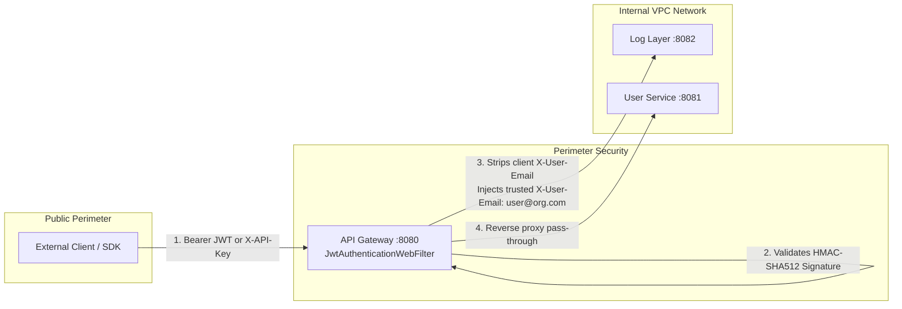

# External Service Interactions & Communication Architecture

> **Document:** `system-architecture/EXTERNAL_INTERACTIONS.md`  
> **Scope:** Inter-service protocols, network boundaries, authentication propagation, data persistence, and fault-tolerance contracts across DevInsight.

---

## 1. Network Topology & Service Matrix

DevInsight consists of 5 dedicated microservices, 1 relational/vector database, 1 local AI runtime, 1 frontend single-page application, and external third-party webhook receivers.

| Service / Component | Port | Transport Protocol | Primary Responsibility | Calling Clients | Downstream Targets |
|---|---|---|---|---|---|
| **Frontend UI** | `5173` | HTTP / WebSocket | React/Vite observability dashboard | End User Browser | `api-gateway` (:8080) |
| **API Gateway** | `8080` | HTTP / REST (Netty) | Perimeter routing, CORS, JWT auth | Frontend, SDKs, Logback | `user-service`, `log-layer` |
| **User Service** | `8081` | HTTP / REST (Tomcat) | RBAC, credentials, JWT generation | `api-gateway` | PostgreSQL (`devinsight`) |
| **Log Layer** | `8082` | HTTP / REST (Tomcat) | Ingestion, parsing, persistence | `api-gateway` | PostgreSQL, `ml-pipeline`, `llm-service`, Slack |
| **ML Pipeline** | `8000` | HTTP / REST (Uvicorn) | Isolation Forest anomaly inference | `log-layer` | *None (Self-contained in-memory)* |
| **LLM Service** | `8084` | HTTP / REST (Tomcat) | Hybrid RAG retrieval & diagnosis | `log-layer` | Local Ollama (`:11434`), PostgreSQL |
| **Local Ollama** | `11434`| HTTP / JSON | CPU/GPU quantized model inference | `llm-service` | *Local filesystem models* |
| **PostgreSQL** | `5432` | TCP / PostgreSQL Wire | Relational tables & vector indices | `user-service`, `log-layer`, `llm-service` | Local Storage |
| **Slack Webhooks** | `443` | HTTPS / Block Kit | Targeted team incident dispatch | `log-layer` | Slack Cloud Servers |

---

## 2. Authentication & Identity Propagation Across Service Boundaries

A critical security principle of DevInsight is **Perimeter Authentication with Trusted Header Enrichment**:



### Security Rule & Boundary Contracts
1. **Public Boundary (`Client -> API Gateway`):**
   * Human users authenticate using `Authorization: Bearer <JWT>` issued by `user-service`.
   * Headless background microservices and logging SDKs authenticate using an `X-API-Key` header matching `internal.api-key`.
2. **Internal Perimeter Boundary (`API Gateway -> Downstream Microservices`):**
   * The Gateway acts as a cryptographic boundary. Downstream services (`log-layer`, `user-service`) do not re-verify the raw cryptographic JWT signature on every internal call.
   * Instead, the Gateway strips any incoming client-provided `X-User-Email` header and injects the **cryptographically verified** email:
     ```http
     X-User-Email: operator@example.com
     ```
   * The `LogLayer` simply reads `CurrentUser.getEmail(httpServletRequest)`, ensuring data isolation without database lookup overhead.

---

## 3. Inter-Service Communication Contracts & Payloads

### Interaction 1: Client Ingestion $\longrightarrow$ API Gateway $\longrightarrow$ Log Layer
* **Protocol:** HTTP POST (Synchronous)
* **Path:** `POST http://localhost:8080/api/v1/logs`
* **Headers:** `X-API-Key: <secret>` or `Authorization: Bearer <token>`
* **Payload:**
  ```json
  {
    "rawLog": "2026-11-15 10:00:00.123 ERROR 123 --- [main] c.p.checkout.PaymentService : Connection timeout",
    "source": "SPRING_BOOT",
    "environment": "PRODUCTION",
    "applicationName": "checkout-service",
    "hostName": "prod-node-1"
  }
  ```
* **Response (HTTP 201 Created, $<90\text{ ms}$):**
  ```json
  {
    "id": 154,
    "correlationId": "8f3b6c2a-9e12-4d8e-b521-123456789abc",
    "level": "ERROR",
    "source": "SPRING_BOOT",
    "applicationName": "checkout-service",
    "anomaly": true,
    "decisionScore": -0.4285,
    "status": "RECEIVED"
  }
  ```

---

### Interaction 2: Log Layer $\longrightarrow$ ML Pipeline (Anomaly Scoring)
* **Protocol:** HTTP POST via non-blocking Spring `WebClient` (Synchronous within Ingestion)
* **Target:** `POST http://localhost:8000/api/v1/predict`
* **Timeout:** $3,000\text{ ms}$ (Configured in `MlServiceProperties`)
* **Payload:**
  ```json
  {
    "timestamp": "2026-11-15T10:00:00.123",
    "level": "ERROR",
    "service_name": "checkout-service",
    "message": "Connection pool exhausted after 5000ms"
  }
  ```
* **Response (HTTP 200 OK):**
  ```json
  {
    "prediction": -1,
    "prediction_label": "ANOMALY",
    "is_anomaly": true,
    "decision_score": -0.4285,
    "model_version": "1.0.0"
  }
  ```
* **Failure Handling:** If the ML Pipeline is unreachable or times out, `WebClientMlInferenceClient` catches `MlServiceException`, marks the log's `analysisStatus = FAILED`, and allows the ingestion to complete successfully without dropping the log.

---

### Interaction 3: Log Layer $\longrightarrow$ LLM Service (Deep Incident Diagnosis)
* **Protocol:** HTTP POST via Project Reactor `WebClient` (Asynchronous via `CompletableFuture`)
* **Target:** `POST http://localhost:8084/api/v1/llm/analyze`
* **Trigger Condition:** Executed in the background if `anomaly == true` OR `level == ERROR` OR `level == FATAL`.
* **Payload:**
  ```json
  {
    "timestamp": "2026-11-15T10:00:00.123",
    "level": "ERROR",
    "service_name": "checkout-service",
    "message": "Connection pool exhausted after 5000ms",
    "prediction": -1,
    "prediction_label": "ANOMALY",
    "decision_score": -0.4285,
    "model_version": "1.0.0"
  }
  ```
* **Response (HTTP 200 OK):**
  ```json
  {
    "summary": "Database connection pool exhausted under transaction surge",
    "rootCause": "HikariPool-1 reached maximumPoolSize (50) with 150 requests queued",
    "severity": "CRITICAL",
    "recommendation": "Increase maximum-pool-size to 100 in application.yml and review long-running queries."
  }
  ```

---

### Interaction 4: LLM Service $\longrightarrow$ Local Ollama Engine
* **Protocol:** HTTP POST over local socket
* **Target:** `http://localhost:11434/api/chat`
* **Payload:**
  ```json
  {
    "model": "phi3:mini",
    "format": "json",
    "temperature": 0.2,
    "messages": [
      {
        "role": "system",
        "content": "You are a DevOps Incident Assistant. Ground your answer strictly in the provided runbook chunks. Emit valid JSON."
      },
      {
        "role": "user",
        "content": "Context: [Runbook Chunk: PostgreSQL Pool Exhaustion] ... Log: Connection pool exhausted"
      }
    ]
  }
  ```

---

### Interaction 5: Log Layer $\longrightarrow$ Slack Incoming Webhook (Alert Routing)
* **Protocol:** HTTPS POST (Asynchronous non-blocking)
* **Target:** Dynamically resolved from `ApplicationIntegration` database record.
* **Payload (Slack Block Kit Format):**
  ```json
  {
    "channel": "#python-test",
    "text": "🚨 [CRITICAL ANOMALY] checkout-service incident detected by DevInsight",
    "blocks": [
      {
        "type": "header",
        "text": { "type": "plain_text", "text": "🚨 CRITICAL INCIDENT DETECTED" }
      },
      {
        "type": "section",
        "fields": [
          { "type": "mrkdwn", "text": "*Service:*\ncheckout-service" },
          { "type": "mrkdwn", "text": "*Environment:*\nPRODUCTION" },
          { "type": "mrkdwn", "text": "*Anomaly Score:*\n-0.4285" },
          { "type": "mrkdwn", "text": "*Level:*\nERROR" }
        ]
      },
      {
        "type": "section",
        "text": { "type": "mrkdwn", "text": "*AI Diagnosis:*\nDatabase connection pool exhausted." }
      },
      {
        "type": "section",
        "text": { "type": "mrkdwn", "text": "*Remediation:*\n`$ kubectl scale deployment checkout-service --replicas=5`" }
      }
    ]
  }
  ```

---

## 4. Synchronous vs Asynchronous Communication Boundaries

To guarantee high-throughput ingestion ($>500\text{ concurrent requests}$), DevInsight enforces a strict partition between the **Fast Ingestion Path** and the **Slow Analytical Path**:

```text
┌─────────────────────────────────────────────────────────────────────────────┐
│ 1. SYNCHRONOUS FAST PATH (<90 ms p95 Latency)                               │
│ Client Ingest → API Gateway Auth → Regex Parsing → ML Scoring → DB Insert   │
└─────────────────────────────────────────────────────────────────────────────┘
                                      │
                         (Async Fork: CompletableFuture)
                                      ▼
┌─────────────────────────────────────────────────────────────────────────────┐
│ 2. ASYNCHRONOUS DEEP ANALYTICAL PATH (Background Thread Pool)               │
│ DB Read → RAG Hybrid Retrieval → Ollama Local Inference → Slack Dispatch    │
└─────────────────────────────────────────────────────────────────────────────┘
```

---

## 5. Fault-Tolerance & Degradation Contracts

| Failure Scenario | Impact | System Fallback & Self-Healing |
|---|---|---|
| **ML Pipeline Offline (`:8000`)** | Anomaly score unavailable | Log Layer catches `MlServiceException`, sets `analysis_status = FAILED`, persists log, returns HTTP 201 to client. **Zero logs dropped.** |
| **Ollama / LLM Offline (`:8084`)** | AI explanation unavailable | Log Layer catches exception in `CompletableFuture`, sets `llm_analysis_status = FAILED`, dispatches basic error alert to Slack without AI diagnosis. |
| **Slack Webhook Fails (404/500)** | Chat notification dropped | Log Layer logs warning, updates integration audit trail. Core log ingestion and persistence remain unaffected. |
| **PostgreSQL Out of Disk / Connections** | Ingestion blocked | HikariCP pool queues incoming connections up to `connection-timeout` ($30\text{ s}$); API Gateway returns HTTP 503 if threshold exceeded. |
| **Malformed Non-Standard Log** | Regex fails to match | `ParserFactory` delegates to `GenericLogParser`, extracting basic timestamp and classifying severity via keyword heuristics (`ERROR`, `FATAL`). |
