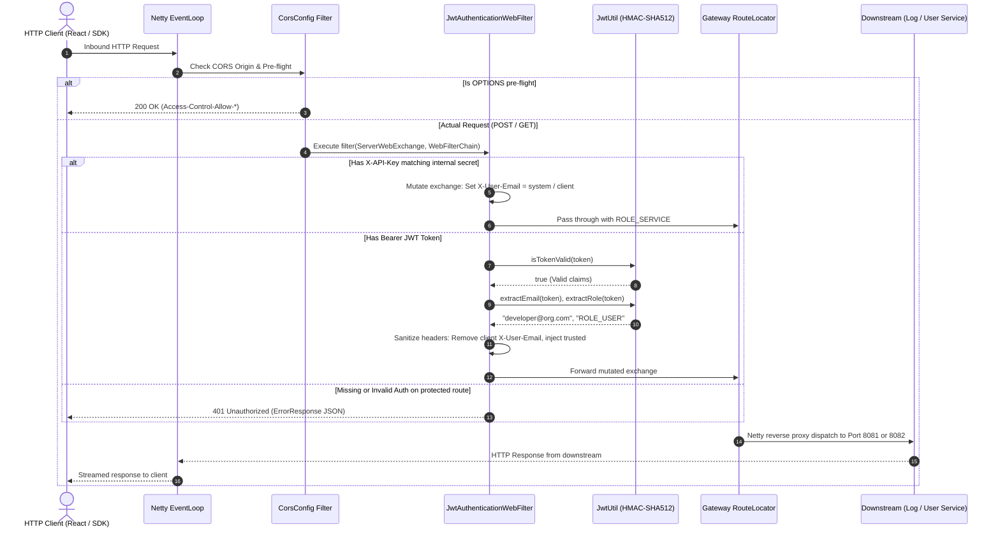

# API Gateway — Internal Architecture & Engineering Deep Dive

> **Service:** `api-gateway`  
> **Runtime / Framework:** Java 21, Spring Boot 3.x, Spring Cloud Gateway, Spring WebFlux, Spring Security Reactive  
> **Server Port:** `8080`  
> **Execution Model:** Reactive, Asynchronous, Non-Blocking Event-Loop (Netty)

---

## 1. Module Overview & Package Structure

The API Gateway is the single public entry point for all client requests entering the DevInsight platform. It operates entirely on a non-blocking reactive model using Project Reactor (`Mono` / `Flux`) running atop Netty.

```text
com.project.apigateway
├── ApiGatewayApplication.java           # Spring Boot bootstrap application entrypoint
├── advice
│   └── GlobalExceptionHandler.java      # Reactive global error translator (maps GatewayException -> JSON)
├── config
│   ├── CorsConfig.java                  # Global CORS filter for frontend React origins
│   ├── GatewayConfig.java               # Declarative RouteLocator definition and target URIs
│   └── SecurityConfig.java              # Reactive SecurityWebFilterChain configuration
├── dto
│   └── response
│       └── ErrorResponse.java           # Unified RFC-7807 style error payload record
├── exception
│   ├── GatewayException.java            # Base abstract gateway runtime exception
│   ├── InvalidJwtException.java         # Thrown when JWT signature/claims are malformed or expired
│   └── UnauthorizedException.java       # Thrown when unauthenticated requests hit protected routes
├── properties
│   └── JwtProperties.java               # Type-safe configuration properties for JWT secret & TTL
├── ratelimit
│   └── UserKeyResolver.java             # Resolves rate-limit key from user email or remote IP
├── security
│   └── JwtAuthenticationWebFilter.java  # Dual-mode authentication filter (Bearer JWT + Headless API Key)
└── util
    └── JwtUtil.java                     # Low-level JJWT cryptographic token parsing and verification
```

---

## 2. Core Classes, Interfaces & Their Responsibilities

### `GatewayConfig.java` (Dynamic RouteLocator)
* **Role:** Declaratively maps incoming URI patterns to downstream microservices using Spring Cloud Gateway's `RouteLocatorBuilder`.
* **Key Routes:**
  * `/api/v1/auth/**`, `/api/v1/users/**` $\longrightarrow$ Forwarded to `user-service` (`http://localhost:8081`).
  * `/api/v1/logs/**`, `/api/v1/analyzer/**`, `/api/v1/integrations/**` $\longrightarrow$ Forwarded to `log-layer` (`http://localhost:8082`).
* **Design Pattern:** **Router / Gateway Pattern**. Downstream service physical topology is completely abstracted from the client.

### `SecurityConfig.java` (Reactive Security Pipeline)
* **Role:** Configures `SecurityWebFilterChain` using Spring Security Reactive (`ServerHttpSecurity`).
* **Key Policies:**
  * CSRF, Form Login, and HTTP Basic disabled (stateless REST API).
  * `/api/v1/auth/**` and HTTP `OPTIONS` (pre-flight checks) marked `.permitAll()`.
  * All other routes require authentication via `SecurityWebFiltersOrder.AUTHENTICATION`.

### `JwtAuthenticationWebFilter.java` (Dual-Mode Authentication Filter)
* **Role:** A custom reactive `WebFilter` executing inside Netty's event loop.
* **Dual-Authentication Pipeline:**
  1. **Headless Machine-to-Machine Mode (`X-API-Key`):**
     * Checks if the incoming request contains an `X-API-Key` header matching `internal.api-key`.
     * If matched, assigns `ROLE_SERVICE` and sets the identity to `system@devinsight.io` (or client-provided `X-User-Email`).
     * Injects the trusted `X-User-Email` header into the mutated downstream exchange.
  2. **Human User Session Mode (`Authorization: Bearer <token>`):**
     * Extracts token, verifies HMAC-SHA512 cryptographic signature via `JwtUtil`.
     * Extracts user `email` and granted `role` (`ROLE_USER` / `ROLE_ADMIN`).
     * Instantiates `UsernamePasswordAuthenticationToken` and commits it to `ReactiveSecurityContextHolder`.
  3. **Header Sanitization & Downstream Propagation:**
     * **Crucial Security Step:** Strips any untrusted client-supplied `X-User-Email` headers:
       ```java
       headers.remove(USER_EMAIL_HEADER);
       headers.add(USER_EMAIL_HEADER, email);
       ```
     * Guarantees downstream microservices can trust `X-User-Email` implicitly without needing their own database session lookups.

### `JwtUtil.java` (Cryptographic Engine)
* **Role:** Cryptographic token parser using `io.jsonwebtoken` (JJWT).
* **Methods:**
  * `isTokenValid(String token)`: Validates expiration and cryptographic signature against HMAC-SHA512 key.
  * `extractEmail(String token)`: Resolves subject claim (`claims.getSubject()`).
  * `extractRole(String token)`: Resolves custom `role` claim.

---

## 3. Step-by-Step Internal Request Lifecycle



---

## 4. Key Design Patterns Applied

1. **Gateway Routing Pattern:** Centralizes cross-cutting concerns (CORS, SSL termination, authentication, rate limiting) in front of distributed services.
2. **Chain of Responsibility Pattern:** Implemented via Spring Security's `WebFilterChain` and Spring Cloud Gateway filters.
3. **Immutability & Exchange Mutation:** Uses Netty's reactive `exchange.mutate().request(...).build()` ensuring thread safety across concurrent non-blocking requests.
4. **Header Enrichment Pattern:** Securely bridges authentication from public perimeter into trusted internal VPC headers (`X-User-Email`).

---

## 5. Concurrency & Performance Characteristics

* **Zero Thread Blocking:** Does not spawn a thread per connection (unlike Tomcat). A thread pool equal to CPU core count ($2 \times \text{cores}$) handles thousands of concurrent socket descriptors using Linux `epoll` / Windows `IOCP`.
* **Stateless Token Verification:** No database or cache queries during token validation; HMAC-SHA512 signature is verified mathematically in CPU memory ($<0.5\text{ ms}$).
* **Measured Overhead:** Verified in Benchmark 04 at **$\approx 24\text{ ms}$** total gateway routing and filter overhead.
