# LLM Service — Internal Architecture & Engineering Deep Dive

> **Service:** `llm-service`  
> **Runtime / Framework:** Java 21, Spring Boot 3.x, Spring AI, Ollama, Apache Lucene (BM25)  
> **LLM Provider:** Local Ollama (`http://localhost:11434`, model: `phi3:mini`)  
> **Embedding Model:** `nomic-embed-text:latest` (768 dimensions)  
> **Server Port:** `8084`  
> **Execution Model:** Multi-threaded Spring MVC with synchronized RAG vector/lexical retrieval

---

## 1. Module Overview & Package Structure

The LLM Service is DevInsight's automated SRE reasoning engine. When an incident or anomaly occurs, it retrieves relevant technical runbooks from a 21-document knowledge base using a **Hybrid RAG (Dense Vector + BM25 Lexical + Reciprocal Rank Fusion)** pipeline, constructs a grounded diagnostic prompt, and queries a local, privacy-preserving Ollama instance (`phi3:mini`) to produce structured JSON root-cause analyses and remediation commands.

```text
com.project.llmservice
├── LlmServiceApplication.java            # Spring Boot bootstrap & async configuration
├── advice
│   └── GlobalExceptionHandler.java       # Handles LlmException, RetrievalException, ParsingException
├── config
│   ├── ApplicationConfig.java            # Jackson ObjectMapper & general bean wiring
│   ├── OllamaConfig.java                 # Configures Spring AI OllamaChatClient & OllamaEmbeddingClient
│   ├── RagIngestionRunner.java           # Startup runner loading & indexing 21 runbooks into RAG store
│   └── RestClientConfig.java             # Low-level HTTP client connection tuning
├── controller
│   ├── LlmAnalysisController.java        # POST /api/v1/llm/analyze (primary diagnosis endpoint)
│   ├── SystemController.java             # GET /api/v1/system/health (Ollama & model health check)
│   └── TestController.java               # GET /test (connectivity verification)
├── dto
│   ├── request
│   │   └── LlmAnalysisRequest.java       # Input: { timestamp, level, service_name, message, decision_score }
│   └── response
│       ├── HealthResponse.java           # Ollama readiness and loaded model metadata
│       └── LlmAnalysisResponse.java      # Output: { summary, rootCause, severity, recommendation }
├── embeddings
│   ├── EmbeddingModelProvider.java       # Strategy interface for generating vector embeddings
│   ├── EmbeddingService.java             # Caches and batches embedding requests
│   └── impl
│       └── OllamaEmbeddingModelProvider.java # Calls Ollama nomic-embed-text API
├── parser
│   ├── ResponseParser.java               # Interface defining parse(rawJson)
│   └── JsonResponseParser.java           # Sanitizes markdown code blocks and deserializes into DTO
├── prompt
│   ├── PromptBuilder.java                # Injects retrieved runbooks, log message, and schema into template
│   ├── PromptContext.java                # Immutable container holding log context and RAG chunks
│   ├── PromptTemplateLoader.java         # Loads StringTemplate (.st) files from resources/prompts
│   └── PromptValidator.java              # Validates token limits and required variable bindings
├── provider
│   ├── LlmProvider.java                  # Strategy interface for LLM text generation
│   ├── ProviderFactory.java              # Factory selecting provider (Ollama / Local / Mock)
│   └── impl
│       └── OllamaProviderImpl.java       # Generates text via Spring AI OllamaChatModel
├── rag                                   # High-Performance Hybrid Retrieval Engine
│   ├── Retriever.java                    # Base contract: retrieve(query, topK)
│   ├── HybridRetriever.java              # Merges Dense + BM25 using Reciprocal Rank Fusion (RRF)
│   ├── VectorRetriever.java              # Dense cosine similarity search over vector store
│   ├── bm25
│   │   ├── BM25Index.java                # In-memory inverted index with TF-IDF/BM25 scoring
│   │   └── BM25Retriever.java            # Lexical tokenizer & keyword ranker
│   ├── reranker
│   │   ├── Reranker.java                 # Re-ranking contract
│   │   └── LexicalReranker.java          # Keyword frequency re-scoring
│   ├── splitter
│   │   ├── DocumentSplitter.java         # Markdown chunking contract
│   │   └── SimpleDocumentSplitter.java   # Splits on markdown headers (## Symptoms, ## Resolution)
│   ├── DocumentLoader.java               # Knowledge document loader
│   ├── RagIngestionService.java          # Orchestrates parsing, embedding, and indexing on startup
│   └── ResourceDocumentLoader.java       # Scans resources/knowledge/**/*.md files
├── service
│   ├── LlmAnalysisService.java           # Master diagnosis orchestrator
│   └── impl
│       └── LlmAnalysisServiceImpl.java   # Runs RAG query -> Builds Prompt -> Calls Ollama -> Parses JSON
└── vectorstore
    ├── VectorStore.java                  # Vector storage contract (similaritySearch, add)
    ├── InMemoryVectorStore.java          # High-speed in-memory vector store with cosine math
    └── PostgresVectorStore.java          # Production pgvector integration
```

---

## 2. Core Classes, Interfaces & Their Responsibilities

### `LlmAnalysisServiceImpl.java` (Diagnosis Orchestrator)
* **Role:** Implements `LlmAnalysisService.analyze()`.
* **Step-by-Step Execution:**
  1. **Query Construction:** Builds targeted retrieval query:
     ```java
     String query = request.getLevel() + " " + request.getServiceName() + " " + request.getMessage();
     ```
  2. **Hybrid RAG Retrieval:** Calls `retriever.retrieve(query, topK=3)`.
  3. **Prompt Assembly:** Delegates to `PromptBuilder` to merge retrieved runbook context, incident metadata, and strict JSON output instructions into StringTemplate templates.
  4. **Inference Execution:** Delegates to `ProviderFactory.getProvider().generate(prompt)`.
  5. **Structured Parsing:** Passes raw LLM generation through `JsonResponseParser` to strip markdown fences (` ```json `) and deserialize into `LlmAnalysisResponse`.

### `HybridRetriever.java` (Reciprocal Rank Fusion Engine)
* **Role:** Solves the primary limitation of pure vector search in DevOps.
* **Why Pure Vector Search Fails:** Embeddings group conceptually similar words together, but DevOps troubleshooting requires exact token matching (e.g. `org.postgresql.util.PSQLException`, `ExitCode 137`, `HikariPool-1`).
* **The Hybrid Solution:**
  1. **Dense Vector Retrieval (`VectorRetriever`):** Computes cosine similarity of 768-dimensional `nomic-embed-text` vectors to capture high-level semantic intent.
  2. **Sparse Lexical Retrieval (`BM25Retriever`):** Analyzes exact keyword frequencies using the Okapi BM25 algorithm.
  3. **Reciprocal Rank Fusion (RRF):** Merges both ranked lists into a single score:
     $$RRF(d) = \sum_{m \in \{\text{Vector}, \text{BM25}\}} \frac{1}{k + r_m(d)}$$
     *(where constant $k = 60$, and $r_m(d)$ is the 1-based rank of document $d$ in retrieval system $m$)*.
  * **Verified Performance:** Yields **0.90 MRR** on dense retrieval and **0.85 MRR** across hybrid test suites with a 95% Hit@3 accuracy.

### `PromptBuilder.java` & `JsonResponseParser.java` (Anti-Hallucination Guardrails)
* **Role:** Enforces factual, schema-compliant responses from the LLM.
* **Prompt Engineering Strategy:**
  * Injects grounding instructions: *"You are an expert DevOps Site Reliability Engineer. Answer ONLY based on the provided runbook context. If uncertain, state unknown rather than inventing commands."*
  * Requires strict JSON keys:
    ```json
    {
      "summary": "Concise 1-line incident overview",
      "rootCause": "Architectural and code-level root cause",
      "severity": "CRITICAL | WARNING | INFO",
      "recommendation": "Step-by-step terminal commands to resolve"
    }
    ```
* **Robust JSON Extraction:** `JsonResponseParser` extracts JSON payloads even if the model prefixes conversational chatter or markdown fences (` ```json ... ``` `).

### `RagIngestionRunner.java` & The Knowledge Corpus
* **Role:** On application startup, reads **21 Markdown runbooks** located in `resources/knowledge/`:
  * `docker/`: Network errors, resource exhaustion, startup failures, volume errors.
  * `kubernetes/`: CrashLoopBackOff, ImagePullBackOff, Pod Pending, Service Unreachable.
  * `nginx/`: 502 Bad Gateway, Connection Refused, Upstream Timeout.
  * `postgresql/`: Authentication failure, Connection pool exhaustion (53300), Connection refused.
  * `spring-boot/`: BeanCreationException, Port binding conflicts, DataSource errors.
* Each document is chunked by markdown section, vectorized with `nomic-embed-text`, and loaded into memory for sub-millisecond retrieval.

---

## 3. Step-by-Step Internal Diagnosis Lifecycle

```mermaid
sequenceDiagram
    autonumber
    actor LogLayer as Log Layer (:8082 WebClient)
    participant Ctrl as LlmAnalysisController (:8084)
    participant Svc as LlmAnalysisServiceImpl
    participant Hybrid as HybridRetriever
    participant Vector as VectorRetriever (nomic-embed)
    participant BM25 as BM25Retriever (Lucene)
    participant Prompt as PromptBuilder
    participant Provider as OllamaProviderImpl
    participant Ollama as Ollama Engine (:11434 phi3:mini)
    participant Parser as JsonResponseParser

    LogLayer->>Ctrl: POST /api/v1/llm/analyze { service_name, level, message, score }
    Ctrl->>Svc: analyze(LlmAnalysisRequest)
    
    rect rgb(20, 30, 50)
        Note over Svc,BM25: Step 1: Hybrid Parallel Retrieval
        Svc->>Hybrid: retrieve("ERROR checkout-service HikariPool-1 timeout", topK=3)
        par Dense Vector Search
            Hybrid->>Vector: similaritySearch(query, topK=5)
            Vector-->>Hybrid: [Doc #3 (Postgres Pool), Doc #7 (DB Refused)]
        and Sparse BM25 Search
            Hybrid->>BM25: search(query, topK=5)
            BM25-->>Hybrid: [Doc #3 (Postgres Pool - exact match 'HikariPool-1')]
        end
        Hybrid->>Hybrid: Calculate RRF score: 1/(60 + r_dense) + 1/(60 + r_bm25)
        Hybrid-->>Svc: Top 3 Grounded Knowledge Chunks
    end

    rect rgb(35, 25, 45)
        Note over Svc,Prompt: Step 2: Grounded Prompt Construction
        Svc->>Prompt: buildAnalysisPrompt(context, retrievedChunks)
        Prompt-->>Svc: Grounded System & User Prompt String
    end

    rect rgb(20, 45, 30)
        Note over Svc,Ollama: Step 3: Local Privacy-Preserving Inference
        Svc->>Provider: generate(prompt)
        Provider->>Ollama: POST /api/chat { model: "phi3:mini", format: "json", temperature: 0.2 }
        Ollama-->>Provider: Raw JSON text output
        Provider-->>Svc: Raw generated string
    end

    rect rgb(45, 35, 20)
        Note over Svc,Parser: Step 4: Structured Validation & POJO Deserialization
        Svc->>Parser: parse(rawOutput)
        Parser->>Parser: Strip markdown backticks & deserialize into POJO
        Parser-->>Svc: LlmAnalysisResponse
    end

    Svc-->>Ctrl: LlmAnalysisResponse
    Ctrl-->>LogLayer: HTTP 200 OK JSON { summary, rootCause, severity, recommendation }
```



---

## 4. Key Design Patterns Applied

1. **Hybrid Retrieval / Fusion Pattern:** Combines vector and lexical search with Reciprocal Rank Fusion, overcoming the vocabulary mismatch and out-of-vocabulary (OOV) challenges of pure embeddings.
2. **Provider Strategy Pattern (`LlmProvider`):** Allows swapping the underlying engine (e.g. from Ollama to vLLM or local mock) without modifying business analysis logic.
3. **Template Method & Builder Patterns (`PromptBuilder`):** Parameterizes incident variables into strict prompt templates while guaranteeing required schema tokens.
4. **Defensive Parsing Pattern (`JsonResponseParser`):** Sanitizes and repairs non-standard JSON formats emitted by small language models ($3.8\text{B}$ parameters).

---

## 5. Security, Concurrency & Performance Details

* **Zero Cloud Egress:** All embeddings and LLM generations run strictly on `localhost:11434`. Production logs, server IPs, and credentials never touch external networks.
* **Low Hallucination Rate:** High retrieval threshold ($0.65$) and low temperature ($0.2$) keep the model focused strictly on the retrieved runbook resolution steps.
* **Memory Management:** Runs Microsoft's quantized `phi3:mini` ($3.8\text{B}$ parameters, $\approx 2.2\text{ GB}$ RAM footprint), allowing execution on commodity infrastructure alongside the microservices.
