# Log Layer Service — Internal Architecture & Engineering Deep Dive

> **Service:** `log-layer`  
> **Runtime / Framework:** Java 21, Spring Boot 3.x, Spring Data JPA, Hibernate, WebClient (Spring WebFlux)  
> **Database:** PostgreSQL (`log_layer_db` & `devinsight`, port `5432`)  
> **Server Port:** `8082`  
> **Execution Model:** Hybrid (Spring MVC worker threads for ingestion + Reactive WebClient & `CompletableFuture` for asynchronous downstream orchestration)

---

## 1. Module Overview & Package Structure

The Log Layer is the core ingestion, parsing, persistence, and event-orchestration hub of DevInsight. It normalizes unstructured multi-line text into typed domain entities, triggers ML anomaly inference, manages dynamic per-service Slack alert routing, and coordinates LLM root-cause diagnosis.

```text
com.project.log_layer
├── LogLayerApplication.java                # Spring Boot bootstrap & async configuration
├── advice
│   └── GlobalExceptionHandler.java         # Global exception translator for 400/404/500 responses
├── appintegration                          # Application Integration & Telemetry Hub module
│   ├── controller
│   │   └── ApplicationIntegrationController.java # CRUD for services and /test simulation runner
│   ├── dto
│   │   ├── request                         # CreateIntegrationRequest, TestIntegrationRequest
│   │   └── response                        # ApplicationIntegrationResponse, TestIntegrationResponse
│   ├── entity
│   │   └── ApplicationIntegration.java     # Per-service registered credentials & Slack webhook URLs
│   ├── repository
│   │   └── ApplicationIntegrationRepository.java
│   └── service                             # Dynamic routing service interface & implementation
├── controller
│   ├── LogController.java                  # Core /api/v1/logs endpoints (ingest, get, search, delete)
│   └── LogAnalyzerController.java          # Sandbox /api/v1/analyzer/inspect interactive inspector
├── entity
│   └── Log.java                            # Master relational entity mapped to `logs` table
├── enums
│   ├── LogLevel.java                       # TRACE, DEBUG, INFO, WARN, ERROR, FATAL, UNKNOWN
│   ├── LogSource.java                      # SPRING_BOOT, PYTHON, NODEJS, GO, KUBERNETES, MYSQL...
│   ├── AnalysisStatus.java                 # PENDING, PROCESSING, COMPLETED, FAILED
│   └── TechStack.java                      # PYTHON, NODEJS, GO, SPRING_BOOT, KUBERNETES_DOCKER...
├── integration                             # Downstream microservice WebClient adapters
│   ├── client
│   │   ├── MlInferenceClient.java          # Interface defining predict() contract
│   │   ├── LlmInferenceClient.java         # Interface defining analyze() contract
│   │   ├── WebClientMlInferenceClient.java # Non-blocking WebClient calling ML Pipeline (:8000)
│   │   └── WebClientLlmInferenceClient.java# Non-blocking WebClient calling LLM Service (:8084)
│   └── dto                                 # Typed exchange DTOs for ML and LLM payloads
├── notification                            # Real-time alert dispatch engine
│   ├── dto
│   │   └── SlackPayload.java               # Slack Block Kit formatted alert structure
│   └── service
│       ├── NotificationService.java        # Alert dispatch interface
│       └── impl
│           ├── SlackNotificationService.java # WebClient HTTP POST to team webhook
│           └── CompositeNotificationService.java # Broadcasts to Slack + email/webhooks
├── parser                                  # Resilient polyglot parsing engine
│   ├── LogParser.java                      # Base Strategy interface: parse(LogIngestRequest)
│   ├── AbstractLogParser.java              # Template Method base class with regex helpers
│   ├── ParserFactory.java                  # Factory pattern returning parser by LogSource
│   └── impl
│       ├── PythonParser.java               # Matches Python traceback frames & asyncio pools
│       ├── NodeJsParser.java               # Matches V8 call sites, Winston & Pino formats
│       ├── GoParser.java                   # Decodes Zap/Logrus structured JSON & panics
│       ├── SpringBootParser.java           # Matches standard Logback / Log4j2 timestamps & threads
│       ├── KubernetesParser.java           # Matches Fluent Bit pod metadata & cgroup OOM kills
│       └── GenericLogParser.java           # Fallback regex & keyword-scoring tokenizer
├── repository
│   └── LogRepository.java                  # JPA repo with JpaSpecificationExecutor for dynamic search
├── service
│   ├── LogService.java                     # Master business contract
│   └── impl
│       └── LogServiceImpl.java             # Core orchestrator: Ingest -> Parse -> ML -> Async LLM -> Slack
└── specification
    ├── LogSpecification.java              # JPA Criteria Predicate generator
    └── LogSpecificationBuilder.java       # Combines dynamic filter predicates (level, date, source, text)
```

---

## 2. Core Classes, Interfaces & Their Responsibilities

### `LogServiceImpl.java` (Master Pipeline Orchestrator)
* **Role:** Orchestrates the lifecycle of an incoming log:
  1. Calls `parseLog(request)` using `ParserFactory`.
  2. Converts `ParsedLogData` to `Log` entity via `ParsedLogMapper`.
  3. Enriches metadata: injects trusted user email from `httpServletRequest.getHeader("X-User-Email")`, correlation UUID, and environment defaults.
  4. Executes synchronous ML anomaly inference via `performMlAnalysis(log)`.
  5. Commits to PostgreSQL via `logRepository.save(log)`.
  6. **Asynchronous Fork:** If the log is classified as an anomaly (`anomaly == true`) or an error (`level == ERROR || FATAL`), spawns `CompletableFuture.runAsync()` to perform deep RAG analysis and post alerts to Slack without blocking HTTP acknowledgement.

### `ParserFactory.java` & `LogParser.java` (Strategy & Factory Patterns)
* **Role:** Decouples heterogeneous log formats from business logic.
* **Architecture:**
  ```text
  Client Request (source = PYTHON)
         ↓
  ParserFactory.getParser(LogSource.PYTHON)
         ↓
  PythonParser (extends AbstractLogParser implements LogParser)
         ↓
  Extracts: Timestamp, Level (ERROR), Logger, Thread, Traceback
         ↓
  ParsedLogData (Standardized Domain Model)
  ```
* **Supported Parsers:**
  * `SpringBootParser`: Parses ISO-8601 timestamps, log levels, process IDs, thread brackets (`[main]`), class names, and Java stack traces.
  * `PythonParser`: Parses standard Python logging formats and multi-line tracebacks (`Traceback (most recent call last):`).
  * `NodeJsParser`: Parses Winston/Pino formats and V8 call stacks (`at TCPConnectWrap.afterConnect`).
  * `GoParser`: Detects JSON structured logging (Zap, Slog, Logrus) and Go goroutine panics.
  * `KubernetesParser`: Parses container runtime logs (`[container/payment-pod-...]`) and cgroup OOMKilled events.
  * `GenericLogParser`: Fallback parser using regex boundary detection and heuristic severity keyword scoring.

### `WebClientMlInferenceClient.java` & `WebClientLlmInferenceClient.java` (Reactive Adapters)
* **Role:** High-performance HTTP clients built on Project Reactor `WebClient`.
* **Resilience Features:**
  * Explicit connection and read timeouts (`timeout(Duration.ofMillis(...))`).
  * Non-blocking error handling (`onStatus(HttpStatusCode::isError, ...)`).
  * Graceful fallback: If the ML service is unreachable, sets `analysisStatus = FAILED` and logs a warning rather than crashing the ingestion pipeline.

### `ApplicationIntegrationServiceImpl.java` & Dynamic Slack Routing
* **Role:** Manages registered microservices (`ApplicationIntegration` entity).
* **Dynamic Routing:** When an anomaly or error occurs, `SlackNotificationService` inspects the `applicationName`. If a dedicated `slackWebhookUrl` and `slackChannelName` (e.g. `#python-test`) are registered, alerts route directly to that team's channel rather than a single generic channel.

---

## 3. Step-by-Step Internal Ingestion Lifecycle

```mermaid
sequenceDiagram
    autonumber
    actor Client as Ingest Client (SDK / Appender)
    participant Gateway as API Gateway (:8080)
    participant Ctrl as LogController (:8082)
    participant Svc as LogServiceImpl
    participant Factory as ParserFactory
    participant Parser as PythonParser / SpringBootParser
    participant MLClient as WebClientMlInferenceClient
    participant MLService as ML Pipeline (:8000)
    participant Repo as LogRepository
    participant DB as PostgreSQL
    participant AsyncWorker as CompletableFuture Worker Thread
    participant LLMClient as WebClientLlmInferenceClient
    participant LLMService as LLM Service (:8084)
    participant Slack as SlackNotificationService

    Client->>Gateway: POST /api/v1/logs { rawLog, source: "PYTHON", app: "checkout-service" }
    Gateway->>Ctrl: Forward with trusted X-User-Email
    Ctrl->>Svc: ingest(LogIngestRequest)
    
    rect rgb(20, 30, 50)
        Note over Svc,Parser: Step 1: Resilient Multi-line Parsing
        Svc->>Factory: getParser(PYTHON)
        Factory-->>Svc: PythonParser instance
        Svc->>Parser: parse(request)
        Parser-->>Svc: ParsedLogData (level=ERROR, traceback extracted)
    end

    rect rgb(30, 20, 45)
        Note over Svc,MLService: Step 2: Synchronous ML Anomaly Scoring
        Svc->>MLClient: predict(MlPredictionRequest)
        MLClient->>MLService: POST /api/v1/predict { timestamp, level, app, message }
        MLService-->>MLClient: { prediction: -1, is_anomaly: true, score: -0.42 }
        MLClient-->>Svc: MlPredictionResponse
        Svc->>Svc: log.setAnomaly(true), log.setDecisionScore(-0.42)
    end

    Svc->>Repo: save(logEntity)
    Repo->>DB: INSERT INTO logs (...) VALUES (...)
    DB-->>Repo: Persisted Log (ID = #154)
    
    rect rgb(20, 40, 30)
        Note over Svc,AsyncWorker: Step 3: Asynchronous Handoff (Non-Blocking)
        Svc->>AsyncWorker: CompletableFuture.runAsync(triggerDiagnosis(154))
    end
    
    Svc-->>Ctrl: LogResponse (ID = 154, Status = RECEIVED)
    Ctrl-->>Gateway: HTTP 201 Created (<90 ms p95 acknowledgement)
    Gateway-->>Client: 201 Created JSON

    rect rgb(40, 35, 20)
        Note over AsyncWorker,Slack: Step 4: Background Deep Diagnosis & Alert Dispatch
        AsyncWorker->>LLMClient: analyze(LlmAnalysisRequest)
        LLMClient->>LLMService: POST /api/v1/llm/analyze
        LLMService-->>LLMClient: IncidentDiagnosis { summary, rootCause, commands }
        AsyncWorker->>Repo: Update log with llmAnalysisStatus = COMPLETED
        AsyncWorker->>Slack: sendIncidentAlert(log, diagnosis)
        Slack->>Slack: Resolve webhook URL for "checkout-service"
        Slack-->>Client: Dispatched Block Kit card to #python-test
    end
```



---

## 4. Key Design Patterns Applied

1. **Strategy Pattern (`LogParser`):** Each runtime format (Java, Python, Node, Go, Docker) implements `LogParser.parse()`, allowing new runtimes to be added without modifying existing ingestion code.
2. **Factory Method Pattern (`ParserFactory`):** Encapsulates the selection logic that maps `LogSource` enums to concrete parser implementations.
3. **Template Method Pattern (`AbstractLogParser`):** Enforces common parsing invariants (timestamp extraction, multi-line buffer assembly) while letting subclasses define specific regex matchers.
4. **Adapter Pattern (`WebClientMlInferenceClient`):** Adapts external HTTP JSON responses from Python/FastAPI into strongly typed Java domain records.
5. **Specification Pattern (`LogSpecification`):** Uses Spring Data JPA Criteria API to build dynamic SQL queries with composable boolean predicates for advanced filtering.

---

## 5. Concurrency, Thread Safety & Failure Resilience

* **Client Non-Blocking Architecture:** Synchronous execution is restricted strictly to parsing, ML scoring, and local DB write ($\approx 75\text{ ms}$). Heavy LLM operations ($\approx 5\text{--}15\text{ s}$) execute on separate thread pools.
* **Fault-Tolerant Isolation:**
  * If the ML service is down, the log is persisted with `analysis_status = FAILED`, but the log itself is never lost.
  * If the LLM service or Slack webhook times out, errors are caught inside the `CompletableFuture` block and logged, keeping the main HTTP thread healthy.
