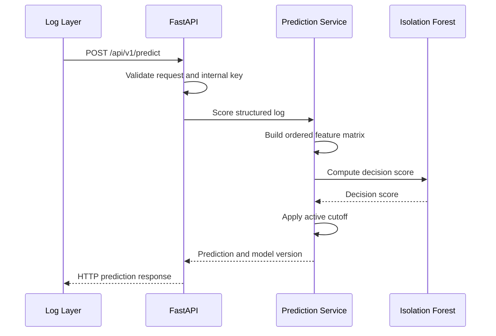

# ML Pipeline Service — Internal Architecture & Engineering Deep Dive

> **Service:** `ml-pipeline`  
> **Runtime / Framework:** Python 3.11, FastAPI, Uvicorn, scikit-learn, NumPy, Pydantic v2  
> **Server Port:** `8000`  
> **Model:** V2 Curated Isolation Forest by default, with a scaled V1 rollback profile
>
> **Execution Model:** Asynchronous ASGI event loop (Uvicorn) with CPU-bound scikit-learn inference

---

## 1. Module Overview & Package Structure

The ML Pipeline converts structured log fields into ordered numeric features and scores them with an unsupervised Isolation Forest. V2 uses 40 raw curated features, including explicit service categories. The V1 rollback path uses 41 legacy features and a saved StandardScaler. See the [ML Pipeline guide](../../ml-pipeline/README.md) for artifact paths and startup commands.

```text
ml-pipeline
├── app
│   ├── main.py                          # FastAPI application initialization & lifespan management
│   ├── api
│   │   └── v1
│   │       ├── dependencies.py          # Dependency injection container (singleton PredictionService)
│   │       ├── router.py                # Aggregates system and prediction routers
│   │       ├── routes
│   │       │   ├── prediction.py        # POST /api/v1/predict & POST /api/v1/predict/batch
│   │       │   └── system.py            # GET /health, GET /info, GET /artifacts/health
│   │       └── schemas                  # Pydantic v2 request/response validation schemas
│   ├── artifacts
│   │   ├── artifact_manager.py          # Loads and deserializes model.pkl, scaler.pkl, metadata.json
│   │   └── artifact_validator.py        # Verifies artifact integrity and feature schema alignment
│   ├── bootstrap
│   │   └── prediction.py                # Initializes singleton PredictionService with warm models
│   ├── core
│   │   ├── config.py                    # Environment settings (Pydantic BaseSettings)
│   │   └── constants.py                 # PREDICTION_LABELS {-1: "ANOMALY", 1: "NORMAL"}
│   ├── domain                           # Rich domain models (LogEntry, FeatureVector, PredictionResult)
│   ├── exceptions
│   │   ├── custom_exceptions.py         # ModelNotLoadedException, FeatureExtractionException
│   │   └── handlers.py                  # Global FastAPI exception handlers formatting RFC-7807 JSON
│   ├── features                         # High-performance Feature Extraction Engine
│   │   ├── orchestrator.py              # Coordinates feature extraction pipeline
│   │   ├── feature_names.py             # Master list of ordered feature names
│   │   ├── extractors
│   │   │   ├── metadata_extractor.py    # Log level encoding, hour of day, day of week
│   │   │   ├── text_extractor.py        # Length, token count, uppercase ratio, digit ratio
│   │   │   ├── regex_extractor.py       # Stack trace patterns, IP addresses, UUIDs, exceptions
│   │   │   └── statistical_extractor.py # Shannon entropy of message text
│   │   └── utils
│   │       └── entropy.py               # Optimized Shannon entropy calculation
│   ├── models
│   │   └── model_factory.py             # Factory instantiating scikit-learn estimators
│   └── services
│       ├── feature_matrix_builder.py    # Assembles 2D NumPy arrays from feature vectors
│       ├── preprocessing_service.py     # Applies StandardScaler transform
│       └── prediction_service.py        # Executes model.predict() and decision_function()
└── artifacts                            # Persisted model binary artifacts
    ├── metadata.json                    # Model version, training metrics, hyperparameters
    ├── model.pkl                        # Serialized IsolationForest instance (joblib)
    └── scaler.pkl                       # Serialized StandardScaler instance (joblib)
```

---

## 2. Core Classes, Modules & Their Responsibilities

### `prediction.py` (FastAPI Prediction Router)
* **Role:** Exposes `/api/v1/predict` and `/api/v1/predict/batch`.
* **Execution Contract:**
  * Accepts `PredictionRequest` containing `{ timestamp, level, service_name, message }`.
  * Injects `PredictionService` using FastAPI's `@lru_cache` dependency injection (`get_prediction_service`).
  * Returns `PredictionResponse`:
    ```json
    {
      "prediction": -1,
      "prediction_label": "Anomaly",
      "is_anomaly": true,
      "decision_score": -0.07592874256934068,
      "model_version": "2.0.0-candidate"
    }
    ```

### `PredictionService.py` (Business Inference Engine)
* **Role:** Coordinates the end-to-end transformation of a `LogEntry` into an anomaly classification:
  ```text
  LogEntry
     ↓
  FeatureOrchestrator.extract()
     ↓
  FeatureVector (Numerical list)
     ↓
  FeatureMatrixBuilder.build()
     ↓
  PreprocessingService.transform() (V1 scaling or V2 passthrough)
     ↓
  model.decision_function() and active cutoff comparison
     ↓
  PredictionResult
  ```

### Feature orchestrators and extractors
* **Role:** Generates an ordered, validated numeric vector from semi-structured log fields.
* **Specialized Extractors:** V2 combines severity, message statistics, operational indicators, hour of day and service categories. The legacy metadata details below apply to V1.
  1. **`MetadataExtractor`:**
     * Encodes log level into ordinal scale: `DEBUG=0`, `INFO=1`, `WARN=2`, `ERROR=3`, `FATAL=4`.
     * Extracts cyclical temporal features: `hour_of_day` ($0\text{--}23$) and `day_of_week` ($0\text{--}6$).
     * Hashes `service_name` into a consistent bucket.
  2. **`TextExtractor`:**
     * Computes raw message length, word count, character count.
     * Computes uppercase letter ratio (high in exceptions and stack traces).
     * Computes digit ratio (indicates memory addresses, ports, or error codes).
  3. **`RegexExtractor`:**
     * Detects stack trace keywords (`Exception`, `Error`, `Traceback`, `at com.`, `File "/...`).
     * Detects IP addresses (IPv4 regex) and UUID / transaction IDs.
  4. **`StatisticalExtractor` (`entropy.py`):**
     * Computes **Shannon Entropy**:
       $$H(X) = -\sum_{i=1}^{n} P(x_i) \log_2 P(x_i)$$
  5. **`FeatureValidator`:**
     * The startup loader checks ordered feature names and dimensions against the selected extractor.

### `ArtifactManager.py` & `ArtifactValidator.py`
* **Role:** Loads persisted metadata and the V1 scaler when selected.
* **Startup checks:** `PredictionBootstrap.load_bundle` validates metadata, extractor schema, estimator and scaler dimensions, and the model checksum when available. Startup fails if the selected bundle is missing or invalid.

---

## 3. Step-by-Step Internal Inference Flow



---

## 4. Key Design Patterns Applied

1. **Process-scoped service (`get_prediction_service`):** Loads the model and any required scaler during application startup. Inference calls reuse the loaded bundle.
2. **Strategy Pattern (`Extractors`):** Distinct feature extraction strategies (`MetadataExtractor`, `TextExtractor`, etc.) implement a common `extract()` contract.
3. **Pipeline Pattern:** Clear separation of stages: Ingestion $\rightarrow$ Feature Extraction $\rightarrow$ Matrix Construction $\rightarrow$ Scaling $\rightarrow$ Model Inference $\rightarrow$ Response Mapping.
4. **Dependency Injection (FastAPI `Depends`):** Decouples HTTP request routing from inference service instantiation.

---

## 5. Concurrency & Performance Details

* **Inference Complexity:** Isolation Forest traverses its fitted trees for each log. The current V2 artifact has 300 trees with a sample cap of 512 per tree.
* **Warm Artifact Cache:** `joblib.load()` occurs at process initialization; inference requires zero disk operations.
* **Batch Endpoint Support:** `POST /api/v1/predict/batch` leverages vectorized NumPy matrix operations, achieving higher throughput when processing bulk log streams.
