# ML Pipeline Service — Internal Architecture & Engineering Deep Dive

> **Service:** `ml-pipeline`  
> **Runtime / Framework:** Python 3.11, FastAPI, Uvicorn, scikit-learn, NumPy, Pydantic v2  
> **Server Port:** `8000`  
> **Model:** Isolation Forest (`model.pkl` + `scaler.pkl`)  
> **Execution Model:** Asynchronous ASGI event loop (Uvicorn) with CPU-bound scikit-learn inference

---

## 1. Module Overview & Package Structure

The ML Pipeline is a specialized machine learning microservice designed for low-latency anomaly detection across unstructured log entries. It converts raw log fields into multi-dimensional numerical feature vectors, scales them, and scores them using an unsupervised Isolation Forest model.

```text
ml-pipeline
├── app
│   ├── main.py                          # FastAPI application initialization & lifespan management
│   ├── api
│   │   └── v1
│   │       ├── dependencies.py          # Dependency injection container (singleton PredictionService)
│   │       ├── router.py                # Aggregates system and prediction routers
│   │       ├── routes
│   │       │   ├── prediction.py        # POST /api/v1/predict & POST /api/v1/predict/batch
│   │       │   └── system.py            # GET /health, GET /info, GET /artifacts/health
│   │       └── schemas                  # Pydantic v2 request/response validation schemas
│   ├── artifacts
│   │   ├── artifact_manager.py          # Loads and deserializes model.pkl, scaler.pkl, metadata.json
│   │   └── artifact_validator.py        # Verifies artifact integrity and feature schema alignment
│   ├── bootstrap
│   │   └── prediction.py                # Initializes singleton PredictionService with warm models
│   ├── core
│   │   ├── config.py                    # Environment settings (Pydantic BaseSettings)
│   │   └── constants.py                 # PREDICTION_LABELS {-1: "ANOMALY", 1: "NORMAL"}
│   ├── domain                           # Rich domain models (LogEntry, FeatureVector, PredictionResult)
│   ├── exceptions
│   │   ├── custom_exceptions.py         # ModelNotLoadedException, FeatureExtractionException
│   │   └── handlers.py                  # Global FastAPI exception handlers formatting RFC-7807 JSON
│   ├── features                         # High-performance Feature Extraction Engine
│   │   ├── orchestrator.py              # Coordinates feature extraction pipeline
│   │   ├── feature_names.py             # Master list of ordered feature names
│   │   ├── extractors
│   │   │   ├── metadata_extractor.py    # Log level encoding, hour of day, day of week
│   │   │   ├── text_extractor.py        # Length, token count, uppercase ratio, digit ratio
│   │   │   ├── regex_extractor.py       # Stack trace patterns, IP addresses, UUIDs, exceptions
│   │   │   └── statistical_extractor.py # Shannon entropy of message text
│   │   └── utils
│   │       └── entropy.py               # Optimized Shannon entropy calculation
│   ├── models
│   │   └── model_factory.py             # Factory instantiating scikit-learn estimators
│   └── services
│       ├── feature_matrix_builder.py    # Assembles 2D NumPy arrays from feature vectors
│       ├── preprocessing_service.py     # Applies StandardScaler transform
│       └── prediction_service.py        # Executes model.predict() and decision_function()
└── artifacts                            # Persisted model binary artifacts
    ├── metadata.json                    # Model version, training metrics, hyperparameters
    ├── model.pkl                        # Serialized IsolationForest instance (joblib)
    └── scaler.pkl                       # Serialized StandardScaler instance (joblib)
```

---

## 2. Core Classes, Modules & Their Responsibilities

### `prediction.py` (FastAPI Prediction Router)
* **Role:** Exposes `/api/v1/predict` and `/api/v1/predict/batch`.
* **Execution Contract:**
  * Accepts `PredictionRequest` containing `{ timestamp, level, service_name, message }`.
  * Injects `PredictionService` using FastAPI's `@lru_cache` dependency injection (`get_prediction_service`).
  * Returns `PredictionResponse`:
    ```json
    {
      "prediction": -1,
      "prediction_label": "ANOMALY",
      "is_anomaly": true,
      "decision_score": -0.4285,
      "model_version": "1.0.0"
    }
    ```

### `PredictionService.py` (Business Inference Engine)
* **Role:** Coordinates the end-to-end transformation of a `LogEntry` into an anomaly classification:
  ```text
  LogEntry
     ↓
  FeatureOrchestrator.extract()
     ↓
  FeatureVector (Numerical list)
     ↓
  FeatureMatrixBuilder.build()
     ↓
  PreprocessingService.transform() (StandardScaler)
     ↓
  model.predict() & model.decision_function()
     ↓
  PredictionResult
  ```

### `FeatureOrchestrator.py` & The Feature Extractors
* **Role:** Generates an ordered, validated numeric vector from semi-structured log fields.
* **Specialized Extractors:**
  1. **`MetadataExtractor`:**
     * Encodes log level into ordinal scale: `DEBUG=0`, `INFO=1`, `WARN=2`, `ERROR=3`, `FATAL=4`.
     * Extracts cyclical temporal features: `hour_of_day` ($0\text{--}23$) and `day_of_week` ($0\text{--}6$).
     * Hashes `service_name` into a consistent bucket.
  2. **`TextExtractor`:**
     * Computes raw message length, word count, character count.
     * Computes uppercase letter ratio (high in exceptions and stack traces).
     * Computes digit ratio (indicates memory addresses, ports, or error codes).
  3. **`RegexExtractor`:**
     * Detects stack trace keywords (`Exception`, `Error`, `Traceback`, `at com.`, `File "/...`).
     * Detects IP addresses (IPv4 regex) and UUID / transaction IDs.
  4. **`StatisticalExtractor` (`entropy.py`):**
     * Computes **Shannon Entropy**:
       $$H(X) = -\sum_{i=1}^{n} P(x_i) \log_2 P(x_i)$$
     * Standard human-readable log messages have low entropy ($3.0\text{--}4.5$). Binary dumps, serialized tokens, encrypted payloads, and dense hex stack traces have high entropy ($>5.5$), acting as a strong signal for anomalies.
  5. **`FeatureValidator`:**
     * Verifies that every feature matches the exact order and type defined in `FEATURE_NAMES` before matrix assembly.

### `ArtifactManager.py` & `ArtifactValidator.py`
* **Role:** Thread-safe artifact loader.
* **Integrity Guarantee:**
  * Checks for the physical existence of `model.pkl`, `scaler.pkl`, and `metadata.json` on disk.
  * Validates that the loaded scaler feature count matches the extractor output dimensions.
  * Throws `ModelNotLoadedException` (HTTP 503) if artifacts are missing or corrupted.

---

## 3. Step-by-Step Internal Inference Flow

```mermaid
sequenceDiagram
    autonumber
    actor Client as Log Layer (:8082 WebClient)
    participant Uvicorn as Uvicorn ASGI Server
    participant Router as prediction.py (:8000)
    participant Dep as dependencies.py (Singleton)
    participant Svc as PredictionService
    participant Orch as FeatureOrchestrator
    participant Extractors as Metadata/Text/Regex/Entropy Extractors
    participant Preproc as PreprocessingService (StandardScaler)
    participant Model as IsolationForest (model.pkl)

    Client->>Uvicorn: POST /api/v1/predict { timestamp, level, service_name, message }
    Uvicorn->>Router: Parse JSON into PredictionRequest
    Router->>Dep: get_prediction_service()
    Dep-->>Router: PredictionService singleton (pre-warmed)
    Router->>Svc: predict(LogEntry)
    
    rect rgb(20, 30, 50)
        Note over Svc,Extractors: Stage 1: Feature Extraction
        Svc->>Orch: extract(LogEntry)
        Orch->>Extractors: Run Metadata, Text, Regex, Shannon Entropy
        Extractors-->>Orch: 15+ numeric features
        Orch->>Orch: FeatureValidator.validate(features)
        Orch-->>Svc: FeatureVector (ordered float array)
    end

    rect rgb(35, 25, 45)
        Note over Svc,Preproc: Stage 2: Feature Matrix & Scaling
        Svc->>Preproc: transform(matrix)
        Preproc->>Preproc: Apply z-score normalization: (X - mean) / std
        Preproc-->>Svc: Scaled 2D NumPy array
    end

    rect rgb(20, 45, 30)
        Note over Svc,Model: Stage 3: Isolation Forest Inference
        Svc->>Model: predict(scaled_matrix)
        Model-->>Svc: -1 (Anomaly) or 1 (Normal)
        Svc->>Model: decision_function(scaled_matrix)
        Model-->>Svc: float score (e.g. -0.4285)
    end

    Svc-->>Router: PredictionResult { prediction: -1, score: -0.4285, is_anomaly: true }
    Router-->>Uvicorn: PredictionResponse Pydantic model
    Uvicorn-->>Client: HTTP 200 OK JSON
```



---

## 4. Key Design Patterns Applied

1. **Singleton Pattern (`PredictionBootstrap`):** Loads the scikit-learn model and scaler into memory once during application startup. Inference calls reuse the warm model without repeated disk I/O.
2. **Strategy Pattern (`Extractors`):** Distinct feature extraction strategies (`MetadataExtractor`, `TextExtractor`, etc.) implement a common `extract()` contract.
3. **Pipeline Pattern:** Clear separation of stages: Ingestion $\rightarrow$ Feature Extraction $\rightarrow$ Matrix Construction $\rightarrow$ Scaling $\rightarrow$ Model Inference $\rightarrow$ Response Mapping.
4. **Dependency Injection (FastAPI `Depends`):** Decouples HTTP request routing from inference service instantiation.

---

## 5. Concurrency & Performance Details

* **Inference Complexity:** Isolation Forest inference traverses $k$ decision trees ($O(k \cdot \text{tree\_depth})$). With 100 trees of maximum depth 8, single prediction time is computationally lightweight.
* **Warm Artifact Cache:** `joblib.load()` occurs at process initialization; inference requires zero disk operations.
* **Batch Endpoint Support:** `POST /api/v1/predict/batch` leverages vectorized NumPy matrix operations, achieving higher throughput when processing bulk log streams.
