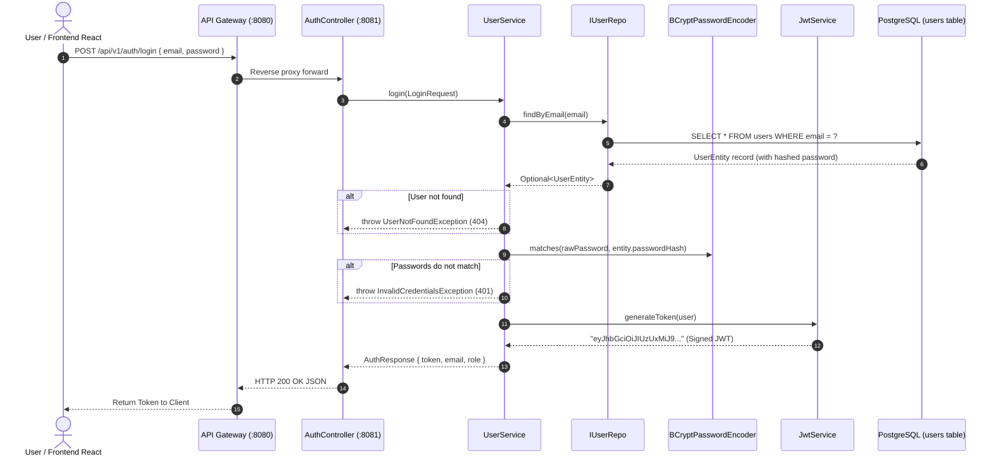

# User Service — Internal Architecture & Engineering Deep Dive

> **Service:** `user-service`  
> **Runtime / Framework:** Java 21, Spring Boot 3.x, Spring Data JPA, Spring Security, Hibernate  
> **Database:** PostgreSQL (`devinsight` database, port `5432`)  
> **Server Port:** `8081`  
> **Execution Model:** Multi-threaded synchronous MVC (embedded Tomcat)

---

## 1. Module Overview & Package Structure

The User Service manages user identity, role-based access control (RBAC), credential hashing, and JWT token issuance for the DevInsight ecosystem.

```text
com.project.demouserservice
├── DemoUserServiceApplication.java       # Spring Boot bootstrap class
├── advice
│   └── GlobalExceptionHandler.java      # ControllerAdvice translating domain exceptions to HTTP codes
├── controller
│   ├── AuthController.java              # Exposes /api/v1/auth/register and /api/v1/auth/login
│   └── UserController.java              # Internal user profile and administrative endpoints
├── dao
│   └── IUserRepo.java                   # Spring Data JPA Repository for UserEntity
├── dto
│   ├── AuthResponse.java                # Response payload: { token, email, role }
│   ├── LoginRequest.java                # Inbound payload: { email, password }
│   ├── RegisterRequest.java             # Inbound payload: { email, password, role }
│   └── UserResponse.java                # Sanitized user record (excludes password hash)
├── entity
│   ├── Role.java                        # Enum: USER, ADMIN
│   └── UserEntity.java                  # JPA Entity mapped to relational `users` table
├── exception
│   ├── AdminRegistrationNotAllowedException.java # Thrown when non-admin attempts ADMIN registration
│   ├── InvalidCredentialsException.java # Thrown on password mismatch (HTTP 401)
│   ├── UserAlreadyExistsException.java  # Thrown on email conflict (HTTP 409)
│   └── UserNotFoundException.java       # Thrown when user record does not exist (HTTP 404)
├── security
│   ├── JwtAuthFilter.java               # Internal filter verifying Bearer tokens on protected MVC routes
│   └── SecurityConfig.java              # Configures BCryptPasswordEncoder, CORS, and endpoint rules
└── service
    ├── IUserService.java                # Business service interface defining auth contract
    ├── JwtService.java                  # Generates signed JWT tokens with claims and expiration
    └── UserService.java                 # Implements user lifecycle, password validation, and persistence
```

---

## 2. Core Classes, Interfaces & Their Responsibilities

### `AuthController.java` (Authentication API Controller)
* **Role:** Exposes public endpoints consumed by the React Frontend and SDKs:
  * `POST /api/v1/auth/register`: Validates `RegisterRequest` via Jakarta `@Valid` annotations and delegates to `UserService`.
  * `POST /api/v1/auth/login`: Accepts credentials, authenticates, and returns `AuthResponse` with JWT token.

### `UserService.java` & `IUserService.java` (Business Logic Engine)
* **Role:** Encapsulates business validation rules and persistence orchestration:
  * **Registration Flow:**
    1. Checks uniqueness via `userRepo.existsByEmail(request.getEmail())`. Throws `UserAlreadyExistsException` if duplicate.
    2. Prevents self-escalation: explicitly blocks registering as `ADMIN` via `AdminRegistrationNotAllowedException`.
    3. Hashes plaintext password using `passwordEncoder.encode()` (BCrypt with default cost factor 10).
    4. Persists `UserEntity` and returns sanitized `UserResponse`.
  * **Login Flow:**
    1. Queries user by email via `userRepo.findByEmail(request.getEmail())`. Throws `UserNotFoundException` if missing.
    2. Compares supplied plaintext password against BCrypt hash via `passwordEncoder.matches(raw, hash)`.
    3. Throws `InvalidCredentialsException` on mismatch.
    4. Delegates to `jwtService.generateToken(user)` on match and returns `AuthResponse`.

### `JwtService.java` (Token Factory)
* **Role:** Constructs and cryptographically signs JWTs using HMAC-SHA512.
* **Claims Injected:**
  * `subject`: User email address (`user.getEmail()`).
  * `role`: User role formatted as authority string (`ROLE_USER` or `ROLE_ADMIN`).
  * `issuedAt`: Current timestamp.
  * `expiration`: Current timestamp + 24 hours ($86,400,000\text{ ms}$).

### `IUserRepo.java` (Data Access Layer)
* **Role:** Spring Data JPA interface extending `JpaRepository<UserEntity, Long>`.
* **Methods:**
  * `boolean existsByEmail(String email)`: Generates optimized `SELECT count(*) > 0` query.
  * `Optional<UserEntity> findByEmail(String email)`: Indexed single-row lookup on unique email column.

---

## 3. Step-by-Step Internal Request Lifecycle (Login & Register)



---

## 4. Key Design Patterns Applied

1. **Repository Pattern:** Decouples domain logic in `UserService` from SQL generation and JDBC operations via `IUserRepo`.
2. **DTO (Data Transfer Object) Pattern:** Prevents entity leakage; `RegisterRequest` and `LoginRequest` sanitize inputs, while `UserResponse` hides password hashes.
3. **Strategy / Hashing Pattern:** `PasswordEncoder` interface backed by `BCryptPasswordEncoder` ensures salting and slow key derivation to protect against rainbow table attacks.
4. **Exception Translation Pattern:** `GlobalExceptionHandler` intercepting unchecked domain exceptions and transforming them into structured JSON error payloads.

---

## 5. Security & Concurrency Considerations

* **BCrypt Hashing:** Uses 10 rounds of key expansion ($\approx 80\text{--}120\text{ ms}$ compute cost). This deliberate CPU cost protects against brute-force password cracking.
* **Connection Pooling:** Uses HikariCP managing connections to `devinsight` PostgreSQL database.
* **Stateless Persistence:** Once the JWT is issued, the User Service does not maintain HTTP sessions in memory, allowing horizontal scaling behind the gateway.
